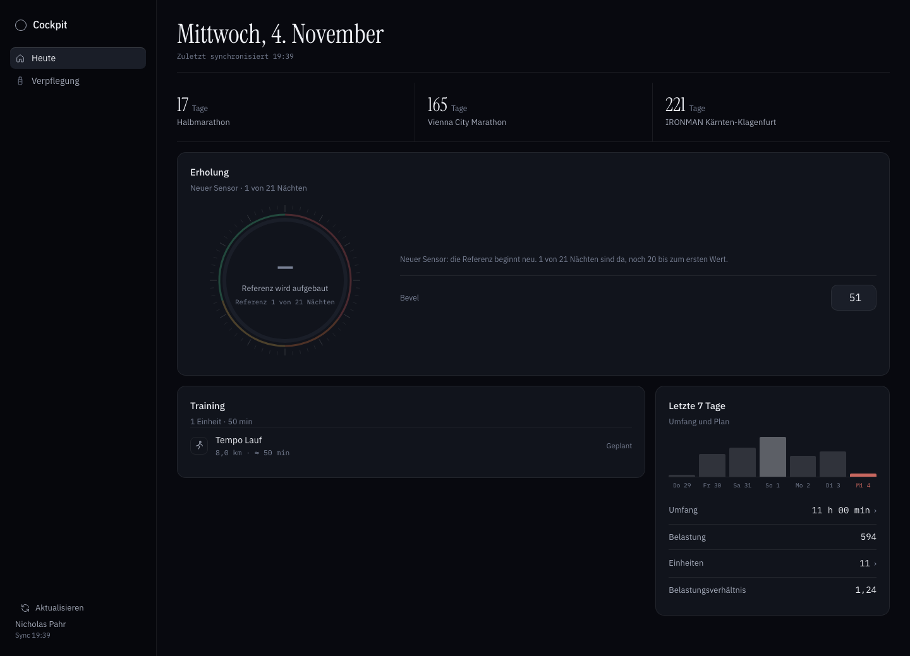
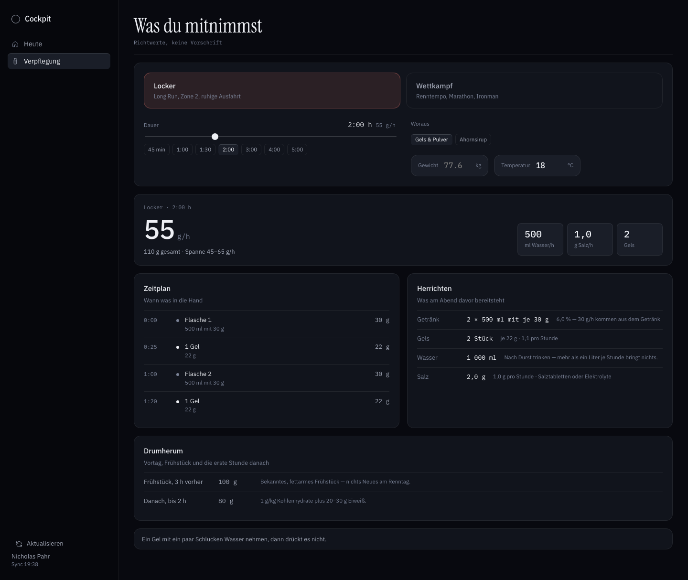
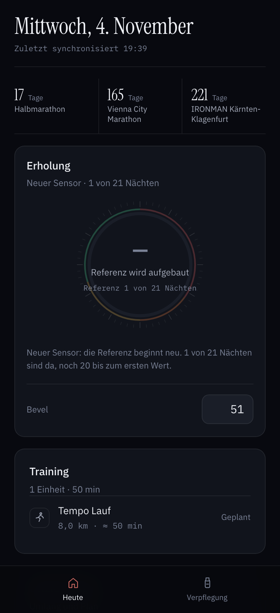

# Trainings- & Recovery-Cockpit

Lokales Dashboard für Training und Erholung. Garmin und Amazfit/Zepp laufen in
intervals.icu zusammen; das Cockpit bewertet die Erholung, zeigt Belastung und
Form in verständlicher Sprache und begleitet die Saisonziele.

**Stand:** v0.2.0 — Premium-Oberfläche nach [DESIGN.md](DESIGN.md) (D-59),
Erholungskarte mit lokalem Lichtschein (D-64), drei Bereiche: Heute, Planer
und Verpflegung. Stabil auf Port 8100, Vorschau auf 8101.



## Was drin ist

| Seite | Inhalt |
|---|---|
| **Heute** | Erholungskarte mit Ring — Score erst ab 21 Nächten, vorher „Referenz wird aufgebaut". HRV, Ruhepuls und Schlaf mit Delta zur eigenen Referenz, Countdowns, Training für heute und morgen, Letzte 7 Tage mit Umfang, Belastung, Einheiten und Belastungsverhältnis. „Umfang“ ist eine reine Kennzahl ohne Navigation. |
| **Planer** | Kalenderwoche Montag–Sonntag mit getrennten Plan-/Ist-Summen, Tages-Plus, Inline-Editor, wiederholbaren Aufbauten, Planungsdetail und bestehenden Aktivitätsdetails. Alte Listen-URLs leiten kompatibel in den Planer. |
| **Verpflegung** | Kohlenhydratrechner für Locker und Wettkampf: Gramm je Stunde, Getränk, Gels oder Ahornsirup, Wasser, Salz, Zeitplan, Herrichten und Drumherum |

Dazu: dunkle Oberfläche, mobiles Layout, installierbar auf dem iPhone (PWA),
Sync über „Aktualisieren“ in der Seitenleiste oder per Ziehen nach unten,
Saison-Countdowns.

<p>
  
  
</p>

## Begriffe

Keine intervals-Fachbegriffe in der Oberfläche:

| Intern | Anzeige | Bedeutung |
|---|---|---|
| CTL | **Fitness** | langfristige Trainingsbelastung (42 Tage) |
| ATL | **Müdigkeit** | kurzfristige Belastung (7 Tage) |
| TSB | **Frische** | Fitness minus Müdigkeit |
| ACWR | **Belastungsverhältnis** | 7 Tage im Verhältnis zu 28 Tagen |
| Load | **Belastung** | Trainingspunkte einer Einheit |

## Erholung

Nachtsignale, gewichtetes Mittel. Die letzte Nacht zählt vollständig; verglichen
wird mit den eigenen letzten drei Wochen.
**Training fließt nicht direkt ein** – Belastung wirkt über die nächste Nacht.

**Alles oder nichts (D-26):** Ein Wert entsteht nur, wenn HRV, Ruhepuls, Schlaf
**und** Atmung von heute vorliegen. Fehlt eines, zeigt das Cockpit „Keine Daten"
und nennt das fehlende Signal — kein Teilwert, keine Hochrechnung aus dem Rest,
kein Wert von gestern.

| Signal | Gewicht | Basis |
|---|---|---|
| HRV | 35 % | Tageswert gegen die eigene 21-Tage-Referenz (z-Score) |
| Ruhepuls | 20 % | dito, invertiert |
| Schlaf | 30 % | 50 % Dauer gegen 7:30 h, 50 % Schlafscore |
| Atmung | 5 % | Nachtschnitt gegen 21-Tage-Referenz, niedriger = besser |
| SpO₂ | 5 % | **nur Abzug** unter 95 % oder ≥ 2 Punkte unter Referenz |

Skala: `68 + 25·z` – ein normaler Tag ergibt 68, +1 SD 93, −1 SD 43.
Ampel: ≥ 85 sehr gut erholt, 70–84 gut erholt, 50–69 solide, 35–49
Erholungsbedarf, < 35 Ruhetag.
Jeder Wert zeigt **heute**, **Schnitt** und **üblich**; darunter erklärt ein Satz
den Score. Ausreißer (z. B. HRV 255) werden gefiltert. Temperatur fehlt aktuell
in den Daten und wird ergänzt, sobald sie verfügbar ist.

## Verpflegung

Zwei Modi, ein Rechenweg. Die Zahlen hängen an der Dauer, nicht am Gewicht –
die Grenze sitzt in der Darmwand, nicht in der Muskelmasse.

| Dauer | Locker | Wettkampf |
|---|---|---|
| < 45 min | 0 g/h | 0 g/h |
| 45–75 min | 20 g/h | 25 g/h |
| 75–120 min | 40 g/h | 50 g/h |
| 2–3 h | 55 g/h | 65 g/h |
| 3–4 h | 70 g/h | 85 g/h |
| > 4 h | 75 g/h | 90 g/h |

„Locker“ ist an den ersten eigenen Lauf kalibriert (73 g für 17 km in 1:51,
D-18), nicht an den Literaturfaktor.

- **Deckel 90 g/h.** Ab 60 g/h nur mit Glukose *und* Fruktose – sonst bleibt
  der Rest im Darm liegen.
- **Zwei Quellen zur Wahl.** *Gels & Pulver*: Getränk und Gels teilen sich die
  Stunde, Konzentration im Getränk bleibt unter 8 %. *Ahornsirup*: alles kommt
  aus den Shots, die Flasche trägt nur Wasser.
- **Wasser und Salz** skalieren mit Dauer und Temperatur. Getrunken wird nach
  Durst, nie über die Schweissrate.
- **Drumherum:** Vortag (nur Wettkampf ab 2,5 h), Frühstück 3 h vorher, danach
  Kohlenhydrate plus Eiweiß. Gewicht zählt nur hier.

### Ahornsirup

65,3 g Kohlenhydrate je 100 g, Dichte 1,33 g/ml – 100 ml sind rund 87 g
Kohlenhydrate. Ein Shot von 50 ml wiegt 66 g und bringt 43 g, also etwa zwei Gels.

| Einheit | ml Sirup / h | Shots à 50 ml | Takt | Salz je Shot |
|---|---|---|---|---|
| 1:51 locker | 46 | 2 | alle 65 min | 1,10 g |
| 2 h locker | 63 | 3 | alle 47 min | 0,80 g |
| 2 h Wettkampf | 75 | 3 | alle 40 min | 1,02 g |
| 3 h Wettkampf | 98 | 6 | alle 31 min | 0,78 g |
| 4 h Wettkampf | 104 | 8 | alle 29 min | 0,74 g |

Salz rechnet der Rechner in Gramm, weil man es abwiegt: 1 g Natrium entspricht
2,54 g Kochsalz. Zu jedem Shot gehören ein paar Schluck Wasser — **Wasser steht
nicht im Zeitplan**, es läuft nebenher und ohne Kohlenhydrate. Passt die
Shotgröße schlecht zur Stunde, schlägt die Seite eine passendere vor.

Grundlage: Dauerbänder nach ACSM/IOC-Konsens, Mitte des Bandes statt oberes Ende.
Referenz und Rechenkern: [felsr.com/verpflegung](https://felsr.com/verpflegung).
Siehe E-19 in [docs/ENTSCHEIDUNGEN.md](docs/ENTSCHEIDUNGEN.md).

## Oberfläche

Die Gestaltung folgt [DESIGN.md](DESIGN.md) (D-59), hervorgegangen aus den Regeln
von *unslop* von Damir Sokolovsky (CC BY 4.0): eine dunkle, neutrale Fläche,
genau ein lokaler Lichtschein, ein Akzent, ruhige Navigation, keine Verläufe
über Karten, keine Sparklines in Kennzahlen, Sentence case, 4-px-Raster.

- **System-UI-Schrift, ein Serif-Moment.** Alles steht in der Systemschrift;
  die Serif bleibt dem Datum im Kopf vorbehalten. Zahlen laufen mit
  `tabular-nums`, nicht in einer zweiten Schrift.
- **Ein Akzent.** Türkis `#35DCC5` markiert den Ring, die aktive Navigation und
  die ausgewählte Interaktion. Grün, Gelb, Orange und Rot bleiben Statusfarben
  für Erholung, erledigte Einheiten und Fehler — nie Dekoration.
- **Anthrazit statt Petrol.** Standardkarten liegen auf `#0B1318`, die
  Erholungskarte noch dunkler; der Seitenhintergrund ist dunkler als alle
  Karten. Unterschieden wird über Helligkeit und 1-px-Rand, nicht über Farbe.
- **Genau ein Lichtschein.** Er liegt lokal und weich auf der Erholungskarte;
  alle anderen Karten bleiben flach.
- **Kein Diagramm-Paket.** Wochenstreifen und Verlaufsdiagramme sind ohne
  Chart-Bibliothek gebaut; recharts ist raus, das Bündel liegt bei 266,82 kB
  JavaScript und 35,55 kB CSS.

## Datenquellen

| Quelle | Rolle |
|---|---|
| **intervals.icu** | einzige Schnittstelle des Cockpits: Aktivitäten, Wellness (Schlaf, HRV, Ruhepuls), Kalender |
| **Health Sync** | schickt Garmin- und Apple-Health-Daten nach intervals.icu (seit 31.10.2026) |
| **Garmin Personal API** | Aktivitäten und FIT-Dateien, Gewicht (Phase 0 geprüft) |
| **Zepp/Amazfit** | liefert über intervals.icu; die Helio trägt die Nachtdaten |

Das Cockpit kennt **keine Gerätemarke**. Alles kommt über intervals.icu, damit
ein Wechsel auf Coros oder ein anderes Gerät ohne Codeänderung funktioniert
(E-18). Die Daten liegen in einer eigenen SQLite-DB (`data/cockpit.db`); der
Garmin-Direktzugriff ist vorbereitet und wird in Etappe 3 ergänzt.

## Schnellstart (lokal)

```bash
cd trainings-cockpit
cp .env.example .env
chmod 600 .env          # Keys eintragen
uv sync

uv run tc doctor --online
uv run tc sync --days 365
uv run tc serve
```

Frontend einmal bauen:

```bash
cd web && npm install && npm run build && cd ..
```

Dann **http://127.0.0.1:8000** öffnen.

## Entwicklung

```bash
uv run tc serve --reload      # API mit Auto-Reload
cd web && npm run dev         # Frontend mit HMR auf :5173

VITE_APP_VARIANT=preview npm run dev   # Vorschau-Logo und -Titel
```

## Docker / Homeserver

```bash
TC_UID=$(id -u) TC_GID=$(id -g) docker compose up -d --build
```

Details, HTTPS über Tailscale, Backup und iPhone-Installation:
[docs/DEPLOY.md](docs/DEPLOY.md).

## Befehle

| Befehl | Zweck |
|---|---|
| `tc doctor [--online]` | Keys, Rechte und Verbindungen prüfen |
| `tc sync [--days N]` | intervals.icu in die lokale DB laden; ohne `--days` nur den Rückstand seit dem letzten Lauf |
| `tc serve [--port 8000]` | Dashboard starten |
| `tc fetch intervals --days 90` | Rohdaten als JSON sichern |
| `tc fetch garmin --days 30 --fit` | Garmin-Aktivitäten, Schlaf, HRV, FIT-Test |
| `tc dedupe` | doppelt aufgezeichnete Einheiten entfernen |
| `tc push-test` | Test-Workout nach intervals.icu pushen und prüfen |
| `tc report` | Phase-0-Befund als Markdown |

## Lokal prüfen und starten

```bash
uv sync
uv run pytest -q
cd web && npm run build && cd ..
uv run tc serve --port 8000
```

Danach **http://127.0.0.1:8000** öffnen. Der Planer liegt unter dem eigenen
Tab „Planer“; die Dashboard-Kennzahl „Umfang“ bleibt ohne Link und ohne
Wochenwechsel. Für einen echten Sync müssen `.env` und die Keys gesetzt sein;
ohne ausdrücklich vorgesehenen Testdatensatz und Freigabe keine produktiven
Schreibzugriffe gegen intervals.icu ausführen.

**Prüfstand P26/P27 + Review:** 380 Backend-Tests, `tsc --noEmit` und Vite-Build
erfolgreich. Die Abnahme lief mit einer separaten SQLite-Kopie und einem
lokalen Kontrolladapter; ein Live-Rundlauf gegen intervals.icu und eine
Geräteübertragung wurden nicht behauptet. Details:
[docs/trainingsplaner/UEBERGABE.md](docs/trainingsplaner/UEBERGABE.md).

## Struktur

```
docs/ENTSCHEIDUNGEN.md   Erkenntnisse, Fragen und Entscheidungen (Grundlage für Änderungen)
docs/KONZEPT.md          Architektur, Metriken, Saisonplan
docs/PHASE0-BEFUND.md    Datenlage und Befund vom 30.10.2026
docs/DEPLOY.md           Homeserver, HTTPS, Backup, iPhone
src/trainings_cockpit/
  api.py                 FastAPI, Wochen-/Planer-Endpunkte und Frontend-Auslieferung
  metrics.py             Erholung, Fitness/Müdigkeit, Wochen, Serien
  fuel.py                Verpflegung: Kohlenhydrate, Getränk, Wasser, Salz, Zeitplan
  db.py                  SQLite-Schema und Upserts
  sync.py                intervals.icu → DB
  planner/               Fachmodell, Remote-Adapter, Serializer, Save/Sync, Konflikte
  sources/               intervals- und Garmin-Client
  spike/                 Phase-0-Werkzeuge
DESIGN.md                Designsystem, verbindlich für jede Oberfläche
docs/UI-REGELN.md        ersetzt, nur noch Herkunftsnachweis (unslop, CC BY 4.0)
docs/trainingsplaner/    Plan, Fähigkeitsmatrix, Sync-/Konfliktverträge, Übergabe
web/src/
  pages/                 Heute, Planer, Verpflegung
  components/            Karten, Blätter, Plan-Editor, Verlauf, Aktivitätsdetails
  styles.css             Tokens, Layout, Komponenten
web/public/fonts/        Instrument Serif fürs Datum; Plex-Dateien ungenutzt
tests/                   pytest inklusive Planer-Fixtures F01–F15
```

## Regeln

- Änderungen werden zuerst in [docs/ENTSCHEIDUNGEN.md](docs/ENTSCHEIDUNGEN.md)
  entschieden, dann umgesetzt.
- Keys nur in `.env` (`chmod 600`), niemals im Repo.
- Keine Cloud, kein Multi-User: der Garmin-Key ist persönlich.
- `data/` enthält Gesundheitsdaten und ist gitignored.
- Nach jeder größeren Änderung wird committet und gepusht. Nachricht: erste
  Zeile `Bereich: Was` im Imperativ, darunter zwei bis fünf Zeilen zu Was und
  Warum.

## Nächste Schritte

1. **Live-Abnahme:** einen ausdrücklich vorgesehenen intervals.icu-Testdatensatz
   freigeben und Create/Update inklusive Rücklesen einmal live prüfen.
2. **Beziehung:** bestätigte Plan-/Aktivitätsbeziehung dauerhaft im Bestand
   führen; Darstellung und Summen sind dafür vorbereitet.
3. **Skip-Gruppe:** den vorbereiteten `EditorShapeMetadata`-Weg beim Lesen
   anbinden, damit „Letzte Erholung auslassen“ als Gruppe erhalten bleibt.
4. **Etappe 4:** Wirkungsanalyse der Einheiten, Bevel-Ablösung.
