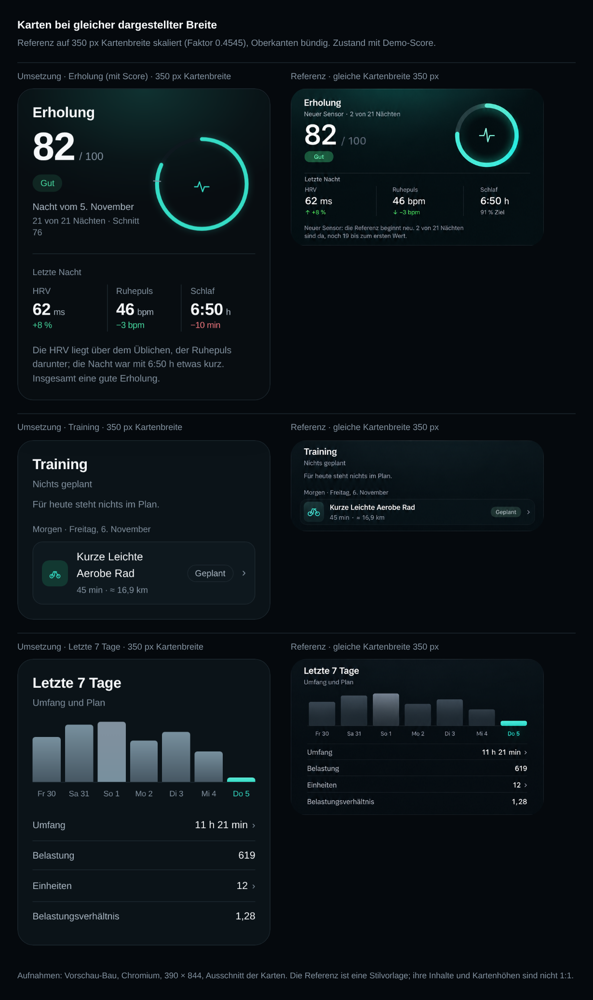

# Karten, Statuslabels und Navigation

**Ticket:** TB-10 (Schritt 2 von 2) · **Stand:** 05.11.2026 · **Basis:** `develop` (TB-9-Stand), Branch `feature/tb-10-design-stil-auf-karten-statuslabels-und-`
**Ziel:** Die Wirkung der Erholungskarte auf alle Karten übertragen, Statuslabels dämpfen, Navigation beruhigen. Layout, Maße, Abstände, Radien, Schriftgrößen, Markup-Struktur, Datenlogik und API bleiben unverändert.

---

## 0. Kurzfassung

- **Kartenrampe:** `--bg-surface` `#0d171d` → `#0b1318`, `--bg-surface-raised` `#102229` → `#0e181e`, `--bg-surface-interactive` `#132b31` → `#121f26`; Konturen `--border-subtle` `#203039` → `#1c272e`, `--border-strong` `#2d4650` → `#2a373f`. Die Erholungskarte bleibt mit `#080d11` der dunkelste Bezug, der Seitenhintergrund `#05090d` bleibt dunkler als die Karten. Kein Verlauf, kein Schein, keine farbige Grundfüllung auf den übrigen Karten.
- **Statuslabels:** Bewertete Statuslabels tragen 12 % ihrer Statusfarbe; das neutrale bleibt auf der erhöhten Fläche. Das Erholungsband mappt auf `--band-top`/`--band-good`/`--band-mid`/`--band-low`/`--band-bad` (neue Töne `--band-top-soft`, `--band-low-soft`); die vollflächig gefüllte Akzentpille entfällt. Das „Gut" misst 9,28:1.
- **Navigation:** aktiv türkises Icon + helle 500er-Beschriftung, inaktiv `--text-muted`; keine Fläche, kein Balken, kein Halo. Die Seitenleiste folgt jetzt denselben Werten wie die Tab-Leiste.
- **Verpflegung:** Die gewählte Art behält die Akzentkontur (`--accent-line`), bekommt aber eine neutrale Fläche statt `--accent-soft`.
- **Layout unverändert:** mit Score bei 390 px weiter **350 × 431,39 px** (Position 20 / 241,09); ohne Score 350 × 506,80 px; bei 1440 px 1128 × 327,50 px. Alle Kartenmaße, Seitenhöhen und die Tab-Leiste (63 px, `8px 8px 4px`) sind vor/nach identisch.

---

## 1. Umsetzung

### 1.1 Tokens in `web/src/styles.css`

| Token | Vorher | Nachher | Rolle |
|---|---|---|---|
| `--bg-surface` | `#0d171d` | `#0b1318` | Standardkarten |
| `--bg-surface-raised` | `#102229` | `#0e181e` | Zeilen, Sekundärflächen |
| `--bg-surface-interactive` | `#132b31` | `#121f26` | Hover, gewählte Art |
| `--border-subtle` | `#203039` | `#1c272e` | Kartenkontur, Trenner |
| `--border-strong` | `#2d4650` | `#2a373f` | betonte Konturen |
| `--recovery-surface` | `#080d11` | unverändert | Erholungskarte, dunkelster Bezug |
| `--bg-app` | `#05090d` | unverändert | Seite, dunkler als die Karten |
| `--band-top-soft` | — | `rgba(126, 240, 192, 0.12)` | Statusfläche „Sehr gut erholt" |
| `--band-low-soft` | — | `rgba(232, 146, 95, 0.12)` | Statusfläche „Erholungsbedarf" |

`--band-good`, `--band-mid` und `--band-bad` zeigen weiter auf `--positive`, `--warning` und `--negative`; deren 12-%-Töne waren bereits vorhanden. Die Statusfarben selbst bleiben unverändert (keine globale Entsättigung).

### 1.2 Statuslabels

`StatusBadge` erhält zusätzlich die Töne `band-top`, `band-good`, `band-mid`, `band-low`, `band-bad`; `accent` entfällt. In `Today.tsx` übersetzt `BAND_TONES` das Erholungsband in den passenden Ton:

| Band | Label | Klasse | Fläche | Schrift |
|---|---|---|---|---|
| `green-top` | Sehr gut erholt | `.badge--band-top` | `--band-top-soft` | `--band-top` |
| `green` | Gut erholt | `.badge--band-good` | `--positive-soft` | `--band-good` |
| `amber` | Solide | `.badge--band-mid` | `--warning-soft` | `--band-mid` |
| `orange` | Erholungsbedarf | `.badge--band-low` | `--band-low-soft` | `--band-low` |
| `red` | Ruhetag | `.badge--band-bad` | `--negative-soft` | `--band-bad` |
| `unknown` | — | `.badge--neutral` | `--bg-surface-raised` | `--text-secondary` |

„Geplant", „Erledigt" und „Zusätzlich" bleiben bei den bestehenden Tönen (neutral, positive); auch sie sind bereits 12-%-Flächen. Die Bauvarianten-Abzeichen „Vorschau" und „Demo" sind keine Statuslabels und bleiben gefüllt (D-56/D-60).

### 1.3 Navigation

- `.nav button` inaktiv: `--text-muted` statt `--text-secondary`; aktiv: `--text-primary` und `font-weight: 500` (wie die Tab-Leiste und DESIGN.md §6).
- Der aktive Eintrag bleibt ohne Fläche: türkises Icon, helles Label. Kein Balken, kein Halo, kein Schein.
- Tab-Leiste, Höhe (63 px) und Innenabstand (`8px 8px 4px`) unverändert; kein `filter`, keine neue Dekoration.

### 1.4 Verpflegung

`.mode-option.active` behält `border-color: var(--accent-line)` als interaktive Kontur, die Fläche wechselt von `--accent-soft` auf `--bg-surface-interactive`. Damit ist die Auswahl weiter eindeutig, aber die große türkise Fläche im Kartenraster entfällt. Kleinteile mit `--accent-soft` (Auswahlmarkierung, Trainings-Icon, Sync-Knopf im Fehlerzustand) bleiben unverändert.

---

## 2. Nachweis

Alle Aufnahmen: Vorschau-Bau (`VITE_APP_VARIANT=preview`, Demo nur unter `?demo=recovery`), Chromium, `force-color-profile=srgb`. Die API-Daten wurden für alle Bilder aus derselben Antwort von `http://127.0.0.1:8101` eingefroren (2 von 21 Nächten, „Referenz wird aufgebaut"), damit der Kopfzeitstempel vorher und nachher gleich ist. Der Vorher-Stand ist der Vorschau-Bau von `develop` (TB-9), der Nachher-Stand der Vorschau-Bau dieses Branch.

### 2.1 Vorher / Nachher

**390 × 844**

| | Vorher | Nachher |
|---|---|---|
| Heute, mit Score (`?demo=recovery`) | [vorher](screens/karten-status-navigation/vorher-heute-390-demo.png) | [nachher](screens/karten-status-navigation/nachher-heute-390-demo.png) |
| Heute, ohne Score | [vorher](screens/karten-status-navigation/vorher-heute-390-ohne.png) | [nachher](screens/karten-status-navigation/nachher-heute-390-ohne.png) |
| Verpflegung | [vorher](screens/karten-status-navigation/vorher-verpflegung-390.png) | [nachher](screens/karten-status-navigation/nachher-verpflegung-390.png) |

**1440 × 900**

| | Vorher | Nachher |
|---|---|---|
| Heute, mit Score (`?demo=recovery`) | [vorher](screens/karten-status-navigation/vorher-heute-1440-demo.png) | [nachher](screens/karten-status-navigation/nachher-heute-1440-demo.png) |
| Heute, ohne Score | [vorher](screens/karten-status-navigation/vorher-heute-1440-ohne.png) | [nachher](screens/karten-status-navigation/nachher-heute-1440-ohne.png) |
| Verpflegung | [vorher](screens/karten-status-navigation/vorher-verpflegung-1440.png) | [nachher](screens/karten-status-navigation/nachher-verpflegung-1440.png) |

Ganze Seite bei 390 px (ohne Score, Tab-Leiste für die Aufnahme ausgeblendet): [vorher](screens/karten-status-navigation/vorher-heute-390-ohne-voll.png) · [nachher](screens/karten-status-navigation/nachher-heute-390-ohne-voll.png).

### 2.2 Vergleich mit der Referenz

Die Referenz ist auf **350 px dargestellte Kartenbreite** skaliert (Faktor 350/770 = 0,4545; Karte bei x = 41), die Oberkanten von Umsetzung und Referenz sind bündig. Drei Zeilen: Erholung, Training, Letzte 7 Tage. Kartenhöhen und Inhalte der Referenz sind nicht 1:1 (Stilvorlage); die gefüllte „Gut"-Pille der Referenz ist der alte Stand und wird durch die gedämpfte Pille aus D-63/D-66 ersetzt.

---

## 3. Messwerte

### 3.1 Kartenmaße und Layout (vorher = nachher)

| Ansicht | Karte | Maß | Position |
|---|---|---|---|
| 390, mit Score | Erholung | **350 × 431,39 px** | 20 / 241,09 px |
| 390, mit Score | Training | 350 × 248 px | 20 / 688,48 px |
| 390, mit Score | Letzte 7 Tage | 350 × 396 px | 20 / 952,48 px |
| 390, ohne Score | Erholung | **350 × 506,80 px** | 20 / 241,09 px |
| 390, ohne Score | Training | 350 × 248 px | 20 / 763,89 px |
| 390, ohne Score | Letzte 7 Tage | 350 × 396 px | 20 / 1027,89 px |
| 1440 | Erholung | **1128 × 327,50 px** | 280 / 234,30 px |
| 1440 | Training | 741,33 × 233,50 px | 280 / 577,80 px |
| 1440 | Letzte 7 Tage | 370,66 × 404 px | 1037,33 / 577,80 px |

- Seitenhöhen unverändert: 390 mit Score 1436 px, 390 ohne Score 1512 px, 390 Verpflegung 2269 px; 1440 Heute 1046 px, 1440 Verpflegung 1269 px.
- Tab-Leiste 390: **63 px** hoch, `padding: 8px 8px 4px`; unverändert.
- Kein horizontaler Überlauf bei 320, 390, 430, 1000, 1001 und 1440 px (`scrollWidth == clientWidth`), vorher und nachher gleich.
- Keine Konsolen- oder Seitenfehler in den Aufnahmeläufen (Heute und Verpflegung, 390 und 1440, mit und ohne Demo).

### 3.2 Flächenfarben (gemessen)

| Fläche | Vorher | Nachher |
|---|---|---|
| Karte (Standard) | `rgb(13, 23, 29)` | `rgb(11, 19, 24)` = `#0b1318` |
| Erholungskarte | `rgb(8, 13, 17)` | unverändert = `#080d11` |
| Erhöhte Zeile (`.train-row`) | `rgb(16, 34, 41)` | `rgb(14, 24, 30)` = `#0e181e` |
| Kartenkontur | `rgb(32, 48, 57)` | `rgb(28, 39, 46)` = `#1c272e` |
| Seitenhintergrund | `rgb(5, 9, 13)` | unverändert = `#05090d` |
| Gewählte Verpflegungsart | `rgb(18, 56, 49)` + Akzentkontur | `rgb(18, 31, 38)` + Akzentkontur |

Nur die Erholungskarte trägt weiter den radialen Lichtschein (`.recovery::before`, `--recovery-glow-opacity: 0.5`) und den Schatten. Alle übrigen Karten haben `box-shadow: none` und kein Hintergrundbild.

### 3.3 Kontraste (WCAG, berechnet)

Statuslabels (Schrift = volle Statusfarbe, Fläche = 12 % davon):

| Label / Band | Fläche auf Karte | Kontrast auf Karte | Kontrast auf Erholung |
|---|---|---|---|
| Sehr gut erholt (`band-top`) | `#192e2c` | **10,29:1** | **11,07:1** |
| Gut erholt / „Gut" (`band-good`) | `#122b29` | **8,74:1** | **9,27:1** (gemessen 9,28:1) |
| Solide (`band-mid`) | `#272822` | **8,77:1** | **9,38:1** |
| Erholungsbedarf (`band-low`) | `#262221` | **6,53:1** | **6,90:1** |
| Ruhetag (`band-bad`) | `#271f24` | **5,91:1** | **6,23:1** |
| Geplant (neutral) | `#0e181e` | **8,89:1** | — |
| Gut, vorher (gefüllte Akzentpille) | `#35dcc5` | **11,23:1** | — |

Sekundärtexte und weitere Werte:

| Stelle | Farbe | Hintergrund | Kontrast |
|---|---|---|---|
| „Nacht vom …" (Erholung) | `--text-secondary` | `--recovery-surface` | **9,65:1** |
| „Letzte Nacht", „HRV", Erklärung (Erholung) | `--text-muted` | `--recovery-surface` | **6,04:1** |
| Karten-Untertitel („Nichts geplant", „Umfang und Plan") | `--text-muted` | `--bg-surface` | **5,80:1** |
| Metazeile „45 min · ≈ 16,9 km" | `--text-muted` | `--bg-surface-raised` | **5,56:1** |
| Zeilenlabel „Umfang" | `--text-secondary` | `--bg-surface` | **9,27:1** |
| Navigationslabel inaktiv | `--text-muted` | `--bg-app` | **6,18:1** |
| Navigationslabel aktiv | `--text-primary` | `--bg-app` | **18,76:1** |

Alle Werte liegen über WCAG AA (4,5:1 für normalen Text); die Statusfarben selbst wurden nicht abgedunkelt. Die Werte für die nicht sichtbaren Bänder sind aus den 12-%-Tönen über der jeweiligen Karte gerechnet, die sichtbaren Werte zusätzlich am gerenderten Pixel geprüft.

---

## 4. Umfang

**Geändert:**

- `web/src/styles.css` — Karten-/Rand-Tokens, `--band-top-soft`, `--band-low-soft`, Band-Badge-Klassen, `.badge--accent` entfernt, `.nav`-Farben/Gewicht, `.mode-option.active`-Fläche
- `web/src/pages/Today.tsx` — `BAND_TONES`, Statusbadge mit Bandton
- `web/src/components/ui.tsx` — `BadgeTone` um die Bandtöne erweitert, `accent` entfernt
- `DESIGN.md` — Abschnitte 5, 6, 10, Bezug D-66, Anti-Pattern
- `docs/ENTSCHEIDUNGEN.md` — D-66 und Log-Zeile
- `docs/design/karten-status-navigation.md` — dieser Bericht
- `docs/design/screens/karten-status-navigation/` — 15 Nachweisbilder

**Nicht geändert:**

- Layout, Maße, Abstände, Radien, Schriftgrößen, Markup-Struktur, Responsive-Breakpoints
- Erholungskarte (`--recovery-surface`, Schein, Ring, `STROKE` 8), Inhalte, Zustände
- API, Berechnungen, Datenbank, Sync, Demo-Logik, `types.ts`
- Keine neuen Bibliotheken, keine neuen Komponenten

---

## 5. Prüfung

- `uv run pytest`: **148 passed**, 1 bestehende Starlette-Deprecation-Warnung.
- `npm run build` (stabil): grün, 53 Module, CSS 35,55 kB, JS 266,82 kB; kein `demo=recovery`-Zweig im Bündel.
- `VITE_APP_VARIANT=preview npm run build`: grün, CSS 35,55 kB, JS 268,13 kB; die Nachweisbilder stammen aus diesem Bau.
- Chromium 390 × 844 und 1440 × 900: Heute mit/ohne Demo, Verpflegung; 15 Bilder; kein horizontaler Überlauf bei 320/390/430/1000/1001/1440; keine Konsolenfehler.
- Kartenmaße, Positionen, Seitenhöhen und Tab-Leiste vor/nach identisch; die Erholungskarte bleibt die dunkelste Karte, der Seitenhintergrund dunkler als alle Karten.
- Branch bewusst von `develop` statt `main` abgezweigt: `main` ist ein Vorfahr; DESIGN.md v2.0 und die D-59/D-63–D-65-Stände liegen nur auf `develop` (wie bei TB-6–TB-9).

---

## 6. Offene Punkte

- Die laufende Vorschau `http://127.0.0.1:8101` zeigt den Stand erst nach Merge und Deploy; die Nachweise stammen aus dem lokalen Vorschau-Bau desselben Branch.
- Der echte 21-Nächte-Score entsteht erst ab 24.11.2026; der Score-Zustand ist weiterhin nur über `?demo=recovery` im Vorschau-Bau beurteilbar.
- Die Referenz zeigt die „Gut"-Pille noch gefüllt; das ist der alte Stand und wird durch D-66 bewusst nicht übernommen.
