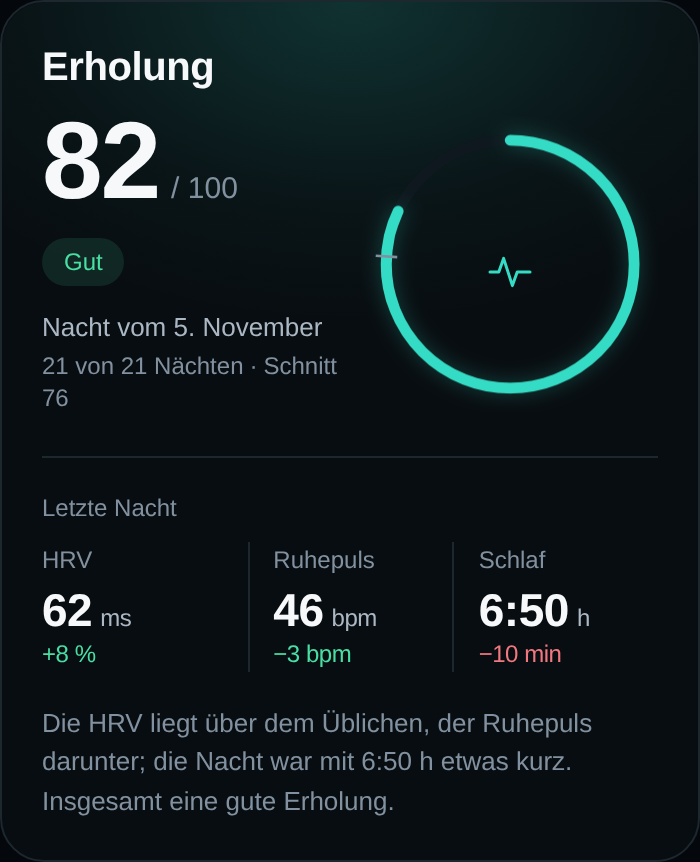
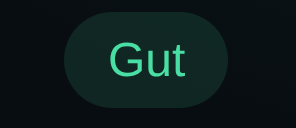
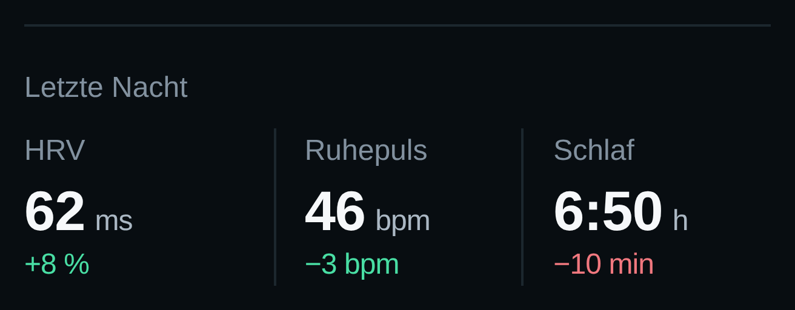
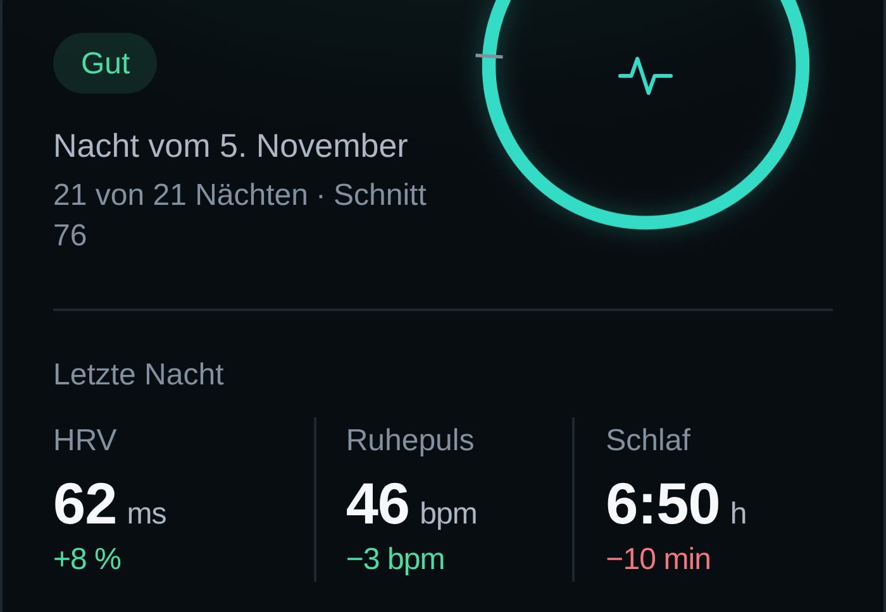
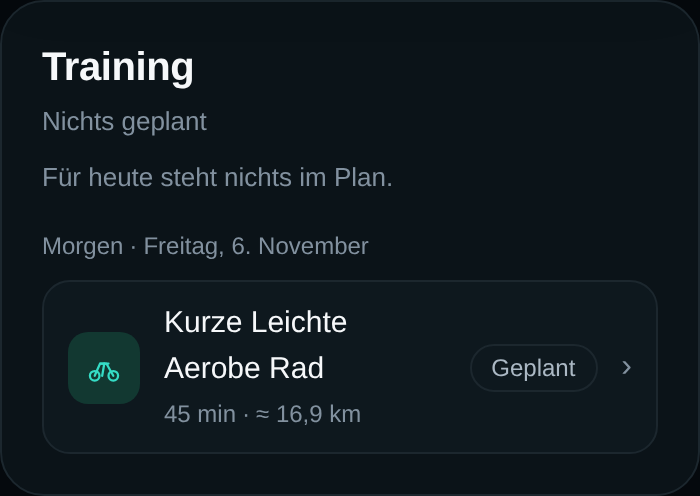

# Recovery-Label am Trend-Token

**Ticket:** TB-11 · **Stand:** 05.11.2026 · **Branch:** `feature/tb-11-design-recovery-label-am-trend-token-aus`
**Basis:** `develop` (TB-10-Stand). Der im Ticket beschriebene sichtbare Stand (D-66, `--positive`, gedämpfte Label-Fläche) liegt nur auf `develop`; `main` ist Vorfahr (wie bei TB-6–TB-10). `main` enthält diese Tokens und Klassen nicht.
**Ziel:** Das Statuslabel „Gut" liest seine Schriftfarbe aus demselben semantischen Token wie die positiven Trendtexte. Optik, Fläche, Maße und alle anderen Zustände bleiben unverändert.
**Nacharbeit (05.11.2026):** Der Review hat den Stand ohne Befund freigegeben und nach `develop` gemergt. Für den erneuten Nachweis wurden die 390×844-Vollansichten zusätzlich mit dem Projekt-Skript `web/scripts/audit-shots.mjs` reproduziert. Code, Design und Entscheidung bleiben unverändert; der Branch wurde nach dem Merge neu von `develop` angelegt.

---

## 0. Kurzfassung

- **Eine Deklaration geändert:** `.badge--band-good { color: var(--band-good) }` → `.badge--band-good { color: var(--positive) }` in `web/src/styles.css`.
- Der Band-Alias `--band-good: var(--positive)` bleibt für die Erholungsskala bestehen.
- **Befund bestätigt:** Vor der Änderung lasen die positiven Trendtexte `var(--positive)`, das Label `var(--band-good)`. Beide lösten bereits auf **`rgb(73, 222, 164)` / `#49dea4`** auf; der Unterschied war nur der Weg über den Alias.
- **Optisch identisch:** Alle sechs Detailpaare (390 × 844, DPR 2, sowie die 4x-Ausschnitte) sind byte-identisch (`sha256`); das zusätzliche `audit-shots`-Vollansicht-Paar ebenfalls. Das ist der Nachweis, dass nur die Token-Bindung und nicht die Darstellung geändert wurde.
- **Kontraste:** Labeltext **9,28:1** auf seiner Fläche, beide Trendtexte **11,40:1** auf der Erholungskarte, „Geplant" **8,89:1**. Fläche gegen Karte: **1,23:1** (gewollt zurückhaltende 12-%-Tönung).
- Keine Änderung an Karte, Ring, Navigation, Trendtexten, Statusberechnung, Datenlogik, Maßen oder Typografie.

---

## 1. Befund vor der Änderung

Gemessen am Vorschau-Bau des Ausgangsstands (`develop` / TB-10, CSS-Hash `index-CNcAhsju.css`), Chromium, 390 × 844, `deviceScaleFactor` 2, Demo-Zustand `?demo=recovery`.

| Stelle | Deklaration vorher | Aufgelöster Wert |
|---|---|---|
| `.night-delta--good` (HRV) | `color: var(--positive)` | `#49dea4` / `rgb(73, 222, 164)` |
| `.night-delta--good` (Ruhepuls) | `color: var(--positive)` | `#49dea4` / `rgb(73, 222, 164)` |
| `.badge--band-good` („Gut") | `color: var(--band-good)` | `#49dea4` / `rgb(73, 222, 164)` — über den Alias |
| `.badge--band-good` Fläche | `background: var(--positive-soft)` | `rgba(73, 222, 164, 0.12)` |
| Erholungskarte | `background: var(--recovery-surface)` | `#080d11` / `rgb(8, 13, 17)` |

Der Alias steht in `:root`:

```css
--positive: #49dea4;
--positive-soft: rgba(73, 222, 164, 0.12);
--band-good: var(--positive);
```

Damit war der sichtbare Wert schon gleich. Die Kopplung war aber indirekt: Das Label hing an der Band-Skala, die Trendtexte am semantischen Text-Token. Genau diese letzte Verbindung zieht TB-11 gerade.

Label-Maße vor und nach identisch: **41,34 × 24 px**, `padding: 0 10px`, `border: 1px solid transparent`, `border-radius: 999px`, `font-size: 12px`, `font-weight: 500`, `opacity: 1`.

---

## 2. Umsetzung

`web/src/styles.css`, `.badge--band-good`:

```diff
 .badge--band-good {
   border-color: transparent;
   background: var(--positive-soft);
-  color: var(--band-good);
+  color: var(--positive);
 }
```

Sonst nichts: Die Fläche bleibt `--positive-soft`, der Band-Alias bleibt definiert, alle anderen Badge-Regeln und die Trendtexte sind unberührt. Kein Glow, kein Verlauf, keine Umrandung, keine reduzierte Deckkraft.

---

## 3. Token und aufgelöste Werte

| Token | Definition | Aufgelöst |
|---|---|---|
| `--positive` | `#49dea4` | `rgb(73, 222, 164)` |
| `--band-good` | `var(--positive)` | `rgb(73, 222, 164)` |
| `--positive-soft` | `rgba(73, 222, 164, 0.12)` | `rgba(73, 222, 164, 0.12)` |
| `--recovery-surface` | `#080d11` | `rgb(8, 13, 17)` |

Computed Styles aus dem laufenden Vorschau-Bau (vorher = `develop`, nachher = dieser Branch):

| Element | CSSOM-Deklaration vorher | CSSOM-Deklaration nachher | `color` computed | `background-color` computed |
|---|---|---|---|---|
| `.badge--band-good` „Gut" | `var(--band-good)` | **`var(--positive)`** | `rgb(73, 222, 164)` | `rgba(73, 222, 164, 0.12)` |
| `.night-delta--good` HRV `+8 %` | `var(--positive)` | `var(--positive)` | `rgb(73, 222, 164)` | `rgba(0, 0, 0, 0)` |
| `.night-delta--good` Ruhepuls `−3 bpm` | `var(--positive)` | `var(--positive)` | `rgb(73, 222, 164)` | `rgba(0, 0, 0, 0)` |
| `.night-delta--bad` Schlaf `−10 min` | `var(--negative)` | `var(--negative)` | `rgb(241, 120, 127)` | `rgba(0, 0, 0, 0)` |

**Gleichheit belegt:** Labeltext und beide positiven Trendtexte liefern nach der Änderung exakt denselben Computed Value `rgb(73, 222, 164)`. Die CSSOM zeigt für alle drei Stellen dieselbe Deklaration `color: var(--positive)`; beim Label ist der Alias `var(--band-good)` verschwunden. Vorher war der aufgelöste Wert ebenfalls gleich — deshalb bleiben die Bilder identisch.

---

## 4. Fläche und Kontraste

WCAG-2.x-Relative-Luminanz, berechnet aus den aufgelösten sRGB-Werten. Die Label-Fläche ist die 12-%-Tönung `rgba(73, 222, 164, 0.12)` über `--recovery-surface`; sie ergibt rechnerisch `#102623` und im gerenderten Pixel **`#102622`** (der lokale Lichtschein liegt an dieser Stelle noch schwach darüber). Für die Kontraste wird der gemessene Pixel verwendet.

| Paar | Farben | Kontrast |
|---|---|---|
| Labeltext auf Label-Fläche | `#49dea4` auf `#102622` | **9,28:1** |
| Label-Fläche gegen Erholungskarte | `#102622` auf `#080d11` | **1,23:1** |
| Trendtext HRV auf Erholungskarte | `#49dea4` auf `#080d11` | **11,40:1** |
| Trendtext Ruhepuls auf Erholungskarte | `#49dea4` auf `#080d11` | **11,40:1** |
| Schlaf-Delta (Gegenprobe, negativ) | `#f1787f` auf `#080d11` | **7,19:1** |
| „Geplant" neutral (Gegenprobe) | `#abb8c4` auf `#0e181e` | **8,89:1** |

Einordnung:

- **Text auf Fläche** liegt mit 9,28:1 deutlich über WCAG AA (4,5:1) und über AAA (7:1) für normalen Text.
- **Fläche gegen Karte** ist mit 1,23:1 bewusst zurückhaltend: Die 12-%-Tönung ist eine semantische Markierung, kein Textkontrast. Sie bleibt unverändert; die 1-px-Kontur ist weiterhin `transparent`, wie seit D-66.
- **Beide Trendtexte** tragen denselben Token und damit denselben Kontrast 11,40:1. Vor und nach der Änderung identisch.
- Die Kontraste des Labels sind vor und nach identisch, weil `--band-good` und `--positive` auf denselben Wert zeigen.

---

## 5. Bilder

Alle Aufnahmen: Vorschau-Bau (`VITE_APP_VARIANT=preview`), Chromium, `--force-color-profile=srgb`, 390 × 844, `deviceScaleFactor` 2. Der Score-Zustand kommt aus `?demo=recovery` (Demo-Abzeichen sichtbar); die API-Antwort wurde einmal von `http://127.0.0.1:8101` eingefroren, damit Vorher und Nachher dieselben Daten sehen. Der Vorher-Bau hatte dieselben Asset-Hashes wie die damals laufende Vorschau (`index-CNcAhsju.css`, `index-CLiMYuXk.js`); der Nachher-Bau entspricht dem deployten Stand (`index-DnbPmkBP.css`, `index-DWScooWB.js`).

### 5.1 Karte mit „Gut" und den Trendtexten

| Vorher | Nachher |
|---|---|
|  |  |

Ganze Ansicht bei 390 × 844:

| Vorher | Nachher |
|---|---|
| [vorher-heute-390.png](screens/recovery-label/vorher-heute-390.png) | [nachher-heute-390.png](screens/recovery-label/nachher-heute-390.png) |

### 5.2 4x-Ausschnitte

Label „Gut":

| Vorher | Nachher |
|---|---|
|  |  |

Die drei Deltas unter HRV, Ruhepuls und Schlaf:

| Vorher | Nachher |
|---|---|
|  |  |

Label und Deltas gemeinsam:

| Vorher | Nachher |
|---|---|
|  |  |

### 5.3 Byte-Vergleich

| Paar | SHA-256 (vorher = nachher) |
|---|---|
| Karte 390 | `16cb8f4c0c656a3a01d72dfb19f213ddcaa25636dea80ac204199a8f82674517` |
| Ganze Ansicht 390 | `4d826d2d0f8ad55994bda238975999264e1b8e8f14db69027b049332e34f4098` |
| Label 4x | `9da7b0e15837907e821bad02ea51dc62728b9708a70083cd1eeb05767a104e88` |
| Deltas 4x | `830f1bd8756616e499fe8f43c591ac90a3d99ef106b8956b255821f30980641c` |
| Label + Deltas 4x | `281711342d9a89761fcbb9c2ae72b8c4c44e4bc6f7b106952a3de39e8998e7a8` |
| Training 390 | `239116b77ff072492ac4d9a3ffb9dd1acf51e34783662281b19b35e467dd9da8` |

Alle sechs Paare sind mit `cmp` byte-identisch. Es gibt keine sichtbare Änderung — genau das ist die Abnahme dieser Story.

### 5.4 Reproduktion mit `audit-shots.mjs`

Zusätzlich wurden die Vollansichten mit dem Projekt-Skript erzeugt, nicht nur mit dem Puppeteer-Skript der Detailaufnahmen:

```bash
cd web
node scripts/audit-shots.mjs 'http://127.0.0.1:8111/?demo=recovery'   # Vorher
node scripts/audit-shots.mjs 'http://127.0.0.1:8112/?demo=recovery'   # Nachher
```

Das Skript nimmt `fullPage` auf; für den Vergleich wurde die 390er-Aufnahme auf 390 × 844 (DPR 2, 780 × 1688 px) beschnitten. Beide Läufe sind byte-identisch (`sha256 ddcbf356e5df7960c12a67a6055410feba75302df9694113789330db2c29bb7e`). Die Bytes unterscheiden sich von den sRGB-Detailaufnahmen (anderes Chromium-Farbprofil, kein zusätzlicher Warte-Schritt); sichtbar und im Layout sind sie identisch.

| Vorher | Nachher |
|---|---|
| [vorher-heute-390-audit.png](screens/recovery-label/vorher-heute-390-audit.png) | [nachher-heute-390-audit.png](screens/recovery-label/nachher-heute-390-audit.png) |

---

## 6. Andere Labels und „Geplant"

„Geplant" bleibt neutral: `rgb(171, 184, 196)` auf `rgb(14, 24, 30)`, 1-px-Kontur `rgb(28, 39, 46)`, 8,89:1. Vor und nach identisch.

| Vorher | Nachher |
|---|---|
|  |  |

Zusätzlich wurden alle Badge-Töne im laufenden Dokument als temporäre Probe-Elemente gemessen (nicht in den Aufnahmen sichtbar). Die Computed Styles sind vorher und nachher in **allen** Tönen identisch:

| Ton | `color` | `background-color` | vorher = nachher |
|---|---|---|---|
| `neutral` („Geplant") | `rgb(171, 184, 196)` | `rgb(14, 24, 30)` | ja |
| `positive` | `rgb(73, 222, 164)` | `rgba(73, 222, 164, 0.12)` | ja |
| `warning` | `rgb(243, 190, 106)` | `rgba(243, 190, 106, 0.12)` | ja |
| `negative` | `rgb(241, 120, 127)` | `rgba(241, 120, 127, 0.12)` | ja |
| `band-top` | `rgb(126, 240, 192)` | `rgba(126, 240, 192, 0.12)` | ja |
| `band-good` | `rgb(73, 222, 164)` | `rgba(73, 222, 164, 0.12)` | ja |
| `band-mid` | `rgb(243, 190, 106)` | `rgba(243, 190, 106, 0.12)` | ja |
| `band-low` | `rgb(232, 146, 95)` | `rgba(232, 146, 95, 0.12)` | ja |
| `band-bad` | `rgb(241, 120, 127)` | `rgba(241, 120, 127, 0.12)` | ja |

Der CSSOM-Vergleich zeigt genau **eine** geänderte Deklaration: `.badge--band-good { color: ... }`. Alle anderen Badge-Regeln (Fläche, Kontur, `band-top`, `band-mid`, `band-low`, `band-bad`, `positive`, `warning`, `negative`, `neutral`) sind textgleich.

---

## 7. Prüfungen

| Prüfung | Ergebnis |
|---|---|
| `uv run pytest` | **148 passed**, 1 bestehende Starlette-Deprecation-Warnung |
| `npm run build` (stabil) | grün, 53 Module, CSS 35,55 kB, JS 266,82 kB; Demo-Zweig nicht enthalten |
| `npm run build` (Vorschau) | grün, CSS 35,55 kB, JS 268,13 kB |
| Computed Styles | Label + beide positiven Trendtexte = `rgb(73, 222, 164)`; CSSOM alle drei `var(--positive)` |
| Layout | Erholungskarte 350 × 431,39 px, Position 20 / 241,09 px; Label 41,34 × 24 px — vor/nach identisch |
| Überlauf | `scrollWidth == clientWidth == 390`; kein horizontaler Überlauf |
| Konsole | keine Konsolen- oder Seitenfehler |
| Bilder | alle sechs Detailpaare byte-identisch; das zusätzliche `audit-shots`-Paar ebenfalls (siehe 5.4) |
| Status „Geplant" | neutral, `rgb(171, 184, 196)` auf `rgb(14, 24, 30)`, unverändert |
| Umfang | nur eine CSS-Deklaration, Doku und Bilder; keine API-, Berechnungs-, Recovery-, Datenbank- oder Sync-Änderung |

**Nicht geprüft / offen:** Die Vorschau `http://127.0.0.1:8101` liefert nach dem Merge/Deploy den Nachher-Stand (`index-DnbPmkBP.css`, `index-DWScooWB.js`); die Messungen stammen aus dem eingefrorenen Vorschau-Bau, nicht aus dem Live-Betrieb. Der echte 21-Nächte-Score ist weiterhin nicht vorhanden (2 von 21 Nächten); der Score-Zustand ist der dokumentierte Demo-Zustand aus D-60.
