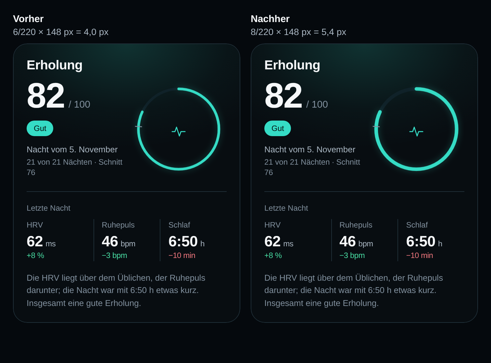
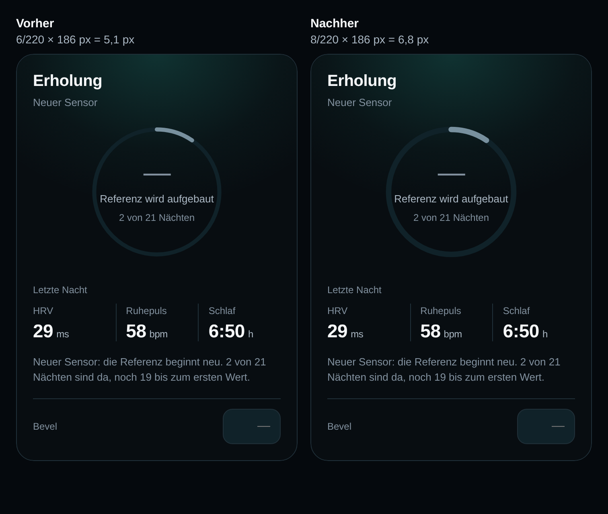

# Erholungsring etwas dicker

**Ticket:** TB-8 · **Stand:** 05.11.2026 · **Basis:** `develop` (TB-7-Stand), Branch `feature/tb-8-design-erholungsring-etwas-dicker`
**Ziel:** Der Ring der Erholungskarte wird ein wenig kräftiger. Radius, Farben, Schein, Referenzmarker, Layout und Kartenmaße bleiben unverändert.

---

## 0. Kurzfassung

- Eine Zahl: `STROKE` in `web/src/components/RecoveryDial.tsx` geht von **6 auf 8** (viewBox 220).
- Dargestellt wächst der Strich bei 390 px von **4,0 auf 5,4 px** (mit Score, Ring 148 px) bzw. von **5,1 auf 6,8 px** (ohne Score, Ring 186 px).
- Beide Zustände hängen an derselben Konstante; der Ring ist sichtbar kräftiger und bleibt filigran.
- Kartenmaße, Positionen, Texte, Farben, Ring-Schein (`--recovery-ring-glow`), Referenzmarker, `strokeLinecap` und das Layout sind vor und nach der Änderung identisch.

---

## 1. Umsetzung

In `web/src/components/RecoveryDial.tsx`:

```diff
 const SIZE = 220;
 const CENTER = SIZE / 2;
 const RING = 92;
-const STROKE = 6;
+const STROKE = 8;
```

`STROKE` wird sowohl vom Grundring (`stroke="var(--raised)"`) als auch vom Fortschrittsbogen verwendet. Es war keine zweite Stelle anzupassen.

**Strichbreite, ausgerechnet** (Strich liegt mittig auf dem Radius; das SVG wird aus dem viewBox 220 auf die Layoutbreite skaliert):

| Zustand | Ring im Layout bei 390 px | vorher (6/220) | nachher (8/220) |
|---|---|---|---|
| mit Score (`?demo=recovery`) | 148,19 px (`clamp(120px, 38vw, 150px)`) | 6/220 × 148,19 = **4,04 ≈ 4,0 px** | 8/220 × 148,19 = **5,39 ≈ 5,4 px** |
| ohne Score | 186 px | 6/220 × 186 = **5,07 ≈ 5,1 px** | 8/220 × 186 = **6,76 ≈ 6,8 px** |

Im DOM steht `stroke-width` als Attributeinheit (6 bzw. 8, gemessen auch als `getComputedStyle(...).strokeWidth` = `6px`/`8px`); die dargestellte Breite ergibt sich erst aus der Skalierung des viewBox auf 148,19 bzw. 186 px.

---

## 2. Vorher/nachher

Alle Aufnahmen: Vorschau-Build (`VITE_APP_VARIANT=preview`), Chromium, Viewport **390 × 844**, `deviceScaleFactor: 2`, Ausschnitt ausschließlich der Erholungskarte. Die API-Daten wurden einmalig von der laufenden Vorschau `http://127.0.0.1:8101` eingefroren, damit vorher und nachher denselben Stand zeigen (2 von 21 Nächten, „Referenz wird aufgebaut"; `generated_at` wandert sonst je Aufnahme). Der Vorher-Build ist der ausgelieferte Stand von 8101: gleicher JS-Hash `index-B847jTLl.js`.

### Mit Score (`?demo=recovery`)



Einzelbilder: [vorher](screens/recovery-dunkel/mit-score-390x844.png) · [nachher](screens/ring-dicker/nachher-mit-score.png) · ganze Ansicht: [vorher](screens/ring-dicker/vorher-ansicht-mit-score.png) · [nachher](screens/ring-dicker/nachher-ansicht-mit-score.png)

### Ohne Score



Einzelbilder: [vorher](screens/recovery-dunkel/ohne-score-390x844.png) · [nachher](screens/ring-dicker/nachher-ohne-score.png)

Die Vergleichsbilder stellen beide Karten mit derselben Breite von 350 CSS-px dar (2×-Aufnahmen, wieder auf 350 px gesetzt); die Oberkanten sind bündig. Der Unterschied ist der Strich; Beschriftungen, Abstände und Kartenkanten liegen deckungsgleich.

**Ablage der Aufnahmen:** `docs/design/screens/ring-dicker/`
`nachher-mit-score.png`, `vergleich-mit-score.png`, `nachher-ohne-score.png`, `vergleich-ohne-score.png`, `vorher-ansicht-mit-score.png`, `nachher-ansicht-mit-score.png`.
Die beiden Vorher-Bilder liegen als `mit-score-390x844.png` und `ohne-score-390x844.png` in `docs/design/screens/recovery-dunkel/` und werden mit dem dortigen Bericht geteilt.

---

## 3. Gemessene Werte

Aufgenommen und gemessen mit Puppeteer (Basis: `web/scripts/audit-shots.mjs`) im selben Lauf wie die Bilder.

| Messpunkt | mit Score vorher | mit Score nachher | ohne Score vorher | ohne Score nachher |
|---|---|---|---|---|
| Karte | 350 × 431,39 px | **350 × 431,39 px** | 350 × 506,80 px | **350 × 506,80 px** |
| Karte links / oben | 20 / 241,09 px | 20 / 241,09 px | 20 / 241,09 px | 20 / 241,09 px |
| Ring (SVG) | 148,19 × 148,19 px | 148,19 × 148,19 px | 186 × 186 px | 186 × 186 px |
| `stroke-width` | 6 | 8 | 6 | 8 |
| Grundring | `rgb(16, 34, 41)` | unverändert | `rgb(16, 34, 41)` | unverändert |
| Fortschrittsbogen | `rgb(53, 220, 197)` | unverändert | `rgb(120, 144, 158)` | unverändert |
| Ring-Schein | `drop-shadow(rgba(53, 220, 197, 0.3) 0 0 7px)` | unverändert | keiner | keiner |
| `strokeLinecap` | `round` | `round` | `round` | `round` |
| `viewBox` | `0 0 220 220` | unverändert | `0 0 220 220` | unverändert |
| horizontale Ausdehnung | `scrollWidth` 390 | 390 | 390 | 390 |

Der Kartenrahmen bleibt bei 390 px Breite **350 × 431,39 px** (mit Score) bzw. **350 × 506,80 px** (ohne Score). Kein horizontaler Überlauf, keine Konsolen- oder Seitenfehler in den Aufnahmeläufen.

---

## 4. Umfang

**Geändert:**

- `web/src/components/RecoveryDial.tsx` — `STROKE` 6 → 8
- `docs/ENTSCHEIDUNGEN.md` — D-65 und Log-Zeile
- `docs/design/ring-dicker.md` — dieser Bericht
- `docs/design/screens/ring-dicker/` — sechs Nachweisbilder; die beiden Vorher-Bilder liegen geteilt unter `docs/design/screens/recovery-dunkel/`

**Unverändert:**

- `SIZE` 220, `RING` 92, `CENTER`, `CIRCUMFERENCE`
- Farben (`--raised`, `--accent`, `--chart-neutral-strong`), Ring-Schein `--recovery-ring-glow`, Referenzmarker
- `strokeLinecap`, Layout, Positionen, Kartenmaße, Abstände, Typografie, Inhalte und Zustände
- `web/src/pages/Today.tsx`, `web/src/styles.css`, API, Berechnungen, Datenbank, Sync, Demo-Logik
- `DESIGN.md` bleibt in diesem Ticket unberührt (folgt im nächsten Ticket)

---

## 5. Prüfung

- `uv run pytest`: **148 passed**, 1 bestehende Starlette-Warnung.
- `npm run build` (stabil): grün, 53 Module, CSS 35,04 kB, JS 266,70 kB.
- `VITE_APP_VARIANT=preview npm run build`: grün, CSS 35,04 kB, JS 268,00 kB; die Nachweisbilder stammen aus diesem Build.
- Sichtprüfung beider Zustände bei 390 × 844: Ring sichtbar kräftiger, weiter filigran; Karte, Texte, Farben und Anordnung unverändert; ohne Score wird kein Wert erfunden.
- Branch von `develop` statt `main` abgezweigt: Der im Ticket beschriebene Stand (`SIZE` 220, `RING` 92, `--recovery-ring-glow`, Ring 148 px mit Score) liegt nur auf `develop` (TB-3 bis TB-7); `main` ist ein Vorfahr und enthält diese Datei in der alten Fassung.

---

## 6. Offene Punkte

- Die laufende Vorschau `8101` zeigt den dickeren Ring erst nach Merge und Deploy; die Nachweisbilder stammen aus dem lokalen Vorschau-Build desselben Branch.
- Der echte 21-Nächte-Score entsteht erst ab 24.11.2026; der Score-Zustand bleibt bis dahin nur über `?demo=recovery` im Vorschau-Build beurteilbar.
