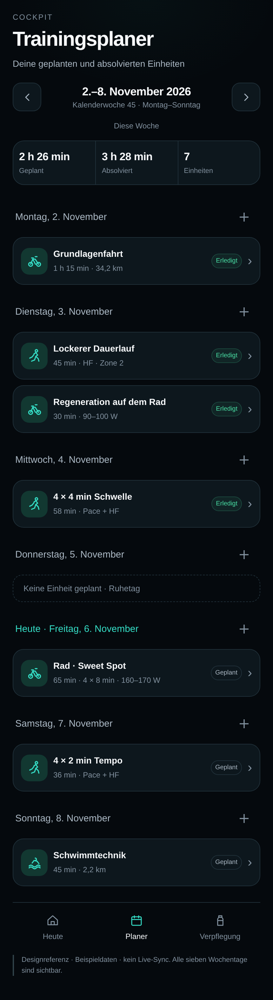
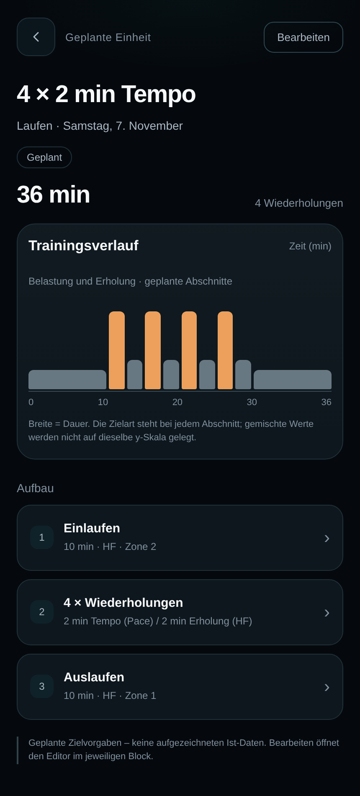
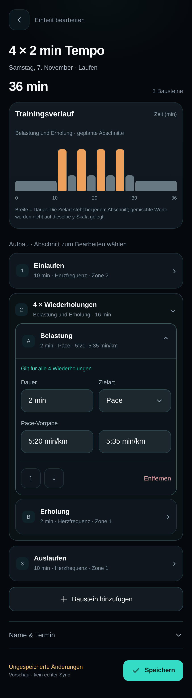
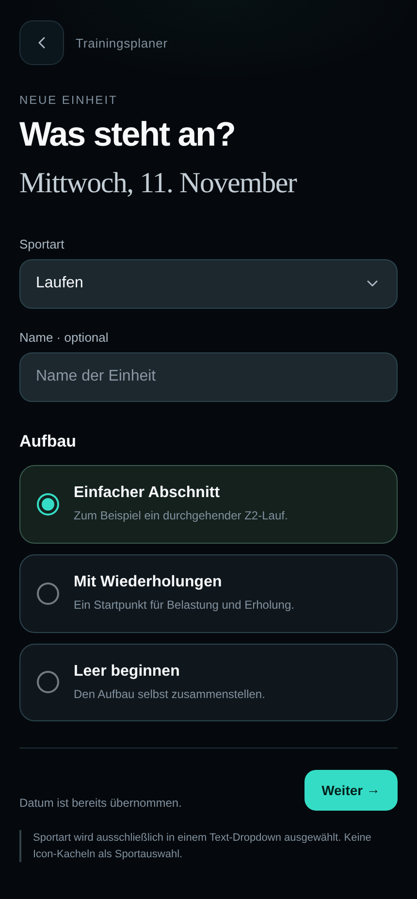
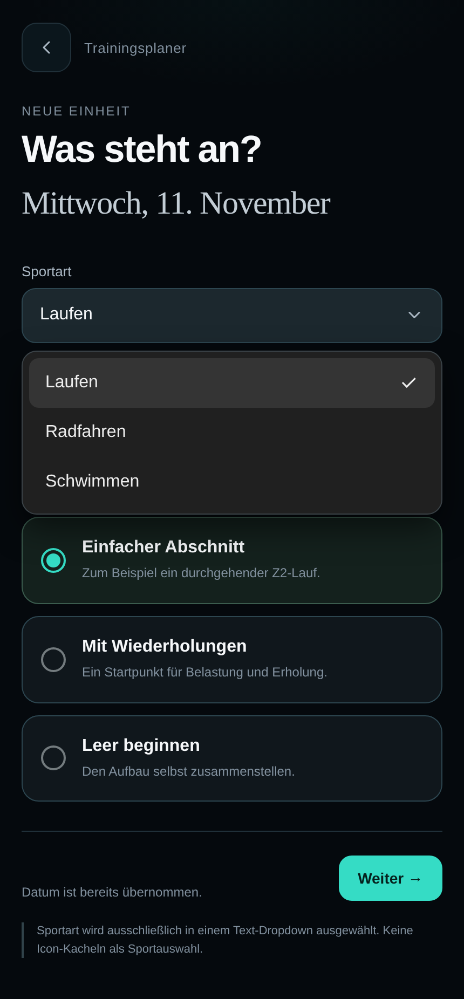
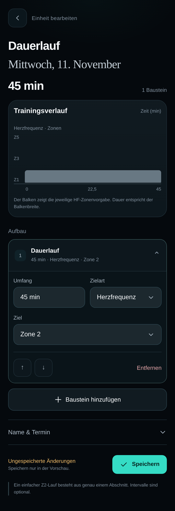
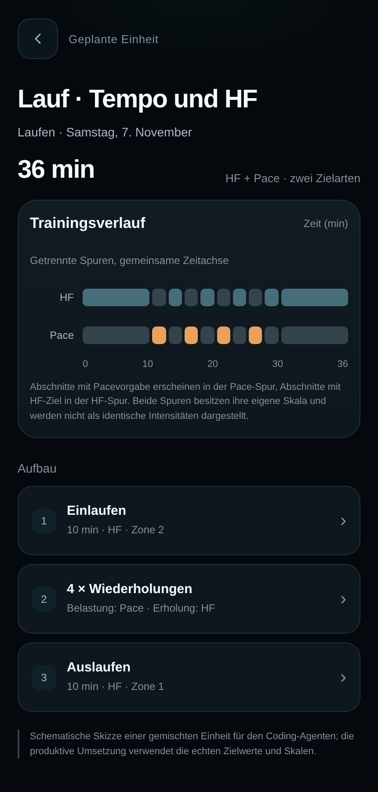

# Trainingsplaner — verbindlicher Implementierungsplan

**Produkt:** Cockpit · bestehendes persönliches Trainingsdashboard  
**Stand:** 06.11.2026  
**Revision:** 1.6 · Eigene, neu gerenderte Designreferenzen statt Nutzer-Screenshots; Sportartauswahl als Dropdown verbindlich  
**Zielgruppe:** Coding-Agent, der kleine, ausdrücklich beschriebene Arbeitspakete abarbeitet  
**Designgrundlage:** die bereits im Repository hinterlegte `DESIGN.md` sowie die unter `references/` mitgelieferten, eigens für diesen Plan gerenderten Referenzbilder  
**Fachliche Grundlage:** der freigegebene Wochenplaner mit Trainingsdetails, Trainingsverlauf und Bearbeitung direkt im ausgewählten Aufbau-Block  
**Integration:** bestehende bidirektionale Synchronisierung mit Intervals.icu weiterverwenden

> **Verbindliche Integrationsentscheidung:** Die bisherige eigenständige Trainingsliste „Letzte 7 Tage“ wird zum Trainingsplaner umgebaut und als separate Ansicht ersetzt. Die Dashboard-Karte „Letzte 7 Tage“ mit Volumeninformation und ihren bestehenden Kennzahlen bleibt bestehen. „Umfang“ ist eine reine Kennzahlenanzeige und öffnet den Trainingsplaner nicht. Der bisherige Umfang-Link samt Navigationshandler und Chevron entfällt; kein neuer Zielbildschirm wird dafür erfunden. Der reguläre Einstieg in den Planer ist sein eigener Haupttab. Es gibt keinen zusätzlichen rollierenden Listenmodus. Vorhandene Karten, Datenwege und Aktivitätsdetails werden weiterverwendet. Der neue Inline-Editor bearbeitet ausschließlich geplante Einheiten.

> Diese Datei ist ein ausführbarer Arbeitsauftrag für die Implementierung. Sie beschreibt das Zielverhalten, fachliche Regeln, Integrationsgrenzen, die Reihenfolge der Umsetzung und die Abnahme. Sie ist kein Auftrag, das Dashboard, dessen Framework oder dessen Synchronisierung vollständig neu zu schreiben.

## Inhaltsverzeichnis

- [1. Arbeitsauftrag und Arbeitsweise](#1-arbeitsauftrag-und-arbeitsweise)
- [2. Verbindlicher Funktionsumfang](#2-verbindlicher-funktionsumfang)
- [3. Design und Komponentenwirkung](#3-design-und-komponentenwirkung)
- [4. Fachliches Datenmodell](#4-fachliches-datenmodell)
- [5. Wochenansicht, Detailansicht und neue Einheiten](#5-wochenansicht-detailansicht-und-neue-einheiten)
- [6. Inline-Editor und Eingabeverhalten](#6-inline-editor-und-eingabeverhalten)
- [7. Trainingsverlauf und Berechnungen](#7-trainingsverlauf-und-berechnungen)
- [8. Intervals.icu: Integrationsvertrag](#8-intervalsicu-integrationsvertrag)
- [9. Speichern, Synchronisierung und Konflikte](#9-speichern-synchronisierung-und-konflikte)
- [10. Komponenten und Verantwortlichkeiten](#10-komponenten-und-verantwortlichkeiten)
- [11. Verbindliche Beispieldaten für die Abnahme](#11-verbindliche-beispieldaten-für-die-abnahme)
- [12. Implementierung in 28 Arbeitspaketen](#12-implementierung-in-28-arbeitspaketen)
- [13. Testmatrix und manuelle Abnahme](#13-testmatrix-und-manuelle-abnahme)
- [14. Definition of Done und Übergabe](#14-definition-of-done-und-übergabe)
- [15. Häufige Fehlumsetzungen](#15-häufige-fehlumsetzungen)
- [16. Quellen, Annahmen und noch zu verifizierende Verträge](#16-quellen-annahmen-und-noch-zu-verifizierende-verträge)
- [17. Startauftrag zum Kopieren](#17-startauftrag-zum-kopieren)

---

## 1. Arbeitsauftrag und Arbeitsweise

### 1.1 Ziel

Baue die vorhandene Trainingsliste des Cockpits zum Hauptbereich **Trainingsplaner** um. Dort werden immer die sieben Tage einer Kalenderwoche von **Montag bis Sonntag** angezeigt. Die Wochenübersicht verbindet geplante Einheiten mit vorhandenen absolvierten Aktivitäten. Der Nutzer kann durch Wochen wechseln, mehrere Einträge je Tag sehen, passende Details öffnen, neue geplante Einheiten anlegen und den Aufbau bestehender Planungen bearbeiten. Die separate alte Sieben-Tage-Liste entfällt; die rollierende Volumeninformation im Dashboard bleibt als Kennzahl erhalten. Den Planer öffnet der Nutzer über seinen eigenen Tab, nicht über den Umfang.

Eine geplante Einheit besteht aus frei kombinierbaren Einzelabschnitten und Wiederholungsblöcken. Jeder Einzelabschnitt kann eine eigene Vorgabe haben: Herzfrequenz, Pace, Leistung oder kein Intensitätsziel. Die Bearbeitung erfolgt **innerhalb des ausgewählten Blocks im Aufbau**. Ein Diagramm zeigt den geplanten Verlauf und reagiert unmittelbar auf gültige Änderungen.

Lesen, Erstellen und Aktualisieren geplanter Events müssen mit der bereits vorhandenen Intervals.icu-Anbindung funktionieren. Aufzeichnungen verwenden weiterhin den bestehenden Historien- und Aktivitätsdatenweg. Eine nur lokal funktionierende Demo gilt nicht als fertige Implementierung.

### 1.2 Verbindliche Reihenfolge bei Entscheidungen

1. Aktuelle ausdrückliche Nutzeranweisungen und Freigaben.
2. Projektanweisungen, vorhandene Architektur und aktuelle `DESIGN.md`, soweit sie den Nutzeranweisungen nicht widersprechen.
3. Die in diesem Dokument beschriebenen Funktions- und Interaktionsverträge.
4. Die freigegebene Vorschau als Referenz für Anordnung und Wirkung.
5. Eigene Implementierungsentscheidungen nur dort, wo die vorherigen Punkte keine Vorgabe machen.

Die Vorschau enthält vereinfachte Technik und Beispieldaten. Ihre Farben, DOM-Manipulationen, festen Datumswerte und simulierten Speicheraktionen dürfen nicht unbesehen in die Produktivimplementierung kopiert werden.

### 1.3 Arbeitsmodus für den Agenten

- Lies vor Änderungen diese Datei und `DESIGN.md` vollständig.
- Prüfe zusätzlich, dass der Ordner `references/` mit den acht eigenständig gerenderten Designreferenzen P1–P8 vorhanden ist und öffne die Bilder vor der UI-Arbeit. Fehlt ein Bild, ist das ein konkreter Übergabefehler und darf nicht stillschweigend ignoriert werden.
- Ermittle in P00 die tatsächlichen Projektpfade, das Framework und die bestehenden Datenflüsse. In dieser Datei genannte Komponenten- und Funktionsnamen sind **Verantwortlichkeiten**, keine Behauptung über bereits existierende Dateien.
- Arbeite die Pakete P00 bis P27 in der angegebenen Reihenfolge ab. Ein Paket darf bei Bedarf weiter geteilt werden; zwei fachlich unabhängige Änderungen nicht zu einem großen Umbau zusammenziehen.
- Standardmodus: Ein beauftragtes Paket implementieren, gezielt prüfen, nachvollziehbar berichten und zur manuellen Abnahme bereitstellen. Hat der Nutzer mehrere Pakete oder eine autonome Umsetzung freigegeben, gilt diese Freigabe; nicht erneut um dieselbe Erlaubnis bitten.
- Ändere nur Dateien, die das aktuelle Paket benötigt. Bewahre bestehende Nutzeränderungen.
- Verwende vorhandene Komponenten, Formmechanismen, Router, Datenzugriffe, Persistenz und Tests. Neue Bibliotheken nur bei einer konkreten Lücke, nicht als Standardlösung.
- Keine Produktivdaten als Testdaten überschreiben. Externe Schreibtests brauchen einen dafür vorgesehenen Testdatensatz und eine entsprechende Freigabe.
- Kein Deployment, keine Veröffentlichung und kein Merge allein deshalb, weil die Implementierung lokal fertig ist.
- Für eine echte technische Unklarheit zuerst Code, vorhandene Tests und Primärdokumentation prüfen. Danach eine konkrete Frage mit Befund stellen, statt einen API-Vertrag zu erfinden.

### 1.4 Pflichtbericht nach jedem Paket

Verwende dieses kurze Format:

```text
Paket: Pxx — Titel
Ergebnis: Was jetzt konkret funktioniert.
Geänderte Dateien: Tatsächliche Pfade und jeweiliger Zweck.
Prüfung: Ausgeführte Befehle oder manuelle Schritte und deren Ergebnis.
Offene Punkte: Nur konkrete verbleibende Probleme; sonst „keine“.
Nächstes Paket: Nummer und Ziel.
```

Eine Aufgabe ist nicht erledigt, wenn lediglich die UI sichtbar ist, ein Test nur die eigene Implementierung nachzeichnet oder eine noch fehlende Integration durch Mock-Daten kaschiert wird.

### 1.5 Fortschritt im Repository festhalten

Lege nach den Repository-Konventionen eine kleine Fortschrittsdatei an, beispielsweise `docs/training-planner-progress.md`. Dokumentiere dort:

- abgeschlossene Pakete und zugehörige Änderungen;
- die in P00 ermittelten tatsächlichen Pfade;
- nachgewiesene API-Fähigkeiten und konkrete offene Fragen;
- die verwendeten Testbefehle;
- den nächsten einzelnen Arbeitsschritt.

Diese Datei ist ein Arbeitsnachweis. Erstelle keine zusätzliche Dokumentationslandschaft und keine neue Projektverwaltung.

### 1.6 Bekannter Bestand und Integrationsentscheidung dieser Revision

Der Nutzer hat Screenshots der bisherigen Trainingsliste, der Aktivitätsdetails und der zugehörigen Dashboard-Karte bereitgestellt. Zusätzlich hat er klargestellt, dass die eigenständige Sieben-Tage-Liste ersetzt werden soll, solange die Volumeninformation im Dashboard erhalten bleibt. Folgende Funktionen sind als bestehende Oberfläche bekannt:

| Vorhandener Bereich | Sichtbare Funktionen | Vorgabe für die Umsetzung |
|---|---|---|
| Dashboard-Karte „Letzte 7 Tage“ | Balkenübersicht, Umfang, Belastung, Einheiten und Belastungsverhältnis; „Umfang“ öffnet bisher die Trainingsliste | Karte und bestehende Kennzahlensemantik erhalten; bisherigen Umfang-Link entfernen, keinen Planer-Shortcut daraus machen |
| Bisherige eigenständige Liste „Letzte 7 Tage“ | Rollierender Zeitraum, Zusammenfassung von Umfang/Belastung/Einheiten, Tagesgruppen in absteigender Reihenfolge | Zum Kalenderwochenplaner umbauen; geeignete Bausteine und Datenwege weiterverwenden, alte eigenständige Ansicht entfernen |
| Aktivitätskarten | Sportarten-Icon, Name, Ist-Dauer, Ist-Distanz, Belastung, mehrere Aktivitäten am Tag | Kartenstruktur für die gemeinsame Wochenliste nutzen; Datentyp und Kennzahlen ausdrücklich unterscheiden |
| Aktivitätsdetails | Status „Erledigt“, Zeitreihen, Ist-Dauer/-Distanz/-Last, Zonen, weitere Zahlen und Quellenangabe | Bestehende Details für Aufzeichnungen weiterverwenden; keinen zweiten Detailstack dafür entwickeln |
| Sportarten im Bestand | Unter anderem Laufen, Radfahren und Krafttraining | Die Historie nicht auf die drei Sportarten des neuen Anlegeeditors einschränken |

Im bereitgestellten Beispiel bezieht sich die Dashboard-Karte „Letzte 7 Tage“ auf den 31.10.–06.11.2026 und zeigt 8 h 56 min Umfang. Die entsprechende aktuelle Kalenderwoche ist 02.11.–08.11.2026. Diese Zeiträume sind fachlich verschieden; die Kalenderwochensumme muss daher nicht dem Dashboard-Wert entsprechen. Der abgebildete Wert ist nur ein Beispiel und wird niemals fest in Produktivcode übernommen.

### 1.7 Visuelle Referenzbilder — verbindlich mit dieser Datei mitliefern

**Version 1.6 korrigiert die vorangegangene Referenzlieferung.** Alle im Paket enthaltenen PNG-Dateien wurden **neu aus einer eigenständigen, lokal gerenderten HTML-Designreferenz** erstellt. Keine Nutzer-Screenshots, Bestands-App-Screenshots, fremden App-Screenshots oder Ausschnitte davon sind im Paket enthalten. Insbesondere sind die Screens der bestehenden Sieben-Tage-Liste nicht als optisches Ziel der neuen Oberfläche zu verwenden. Die fotografierten Nutzerbeispiele dienten nur zur Klärung der fachlichen Bestandssituation und der letzten Korrektur.

Die Bilder sind **neu angefertigte Nachzeichnungen der besprochenen und freigegebenen Bedienidee**, nicht pixelidentische Exporte eines historischen, nicht mitgelieferten Prototyps. Verbindlich sind die ausdrücklich bestätigten Interaktionen, die Gestaltung gemäß `DESIGN.md` und die hier gezeigte Informationshierarchie. Nimm keine nicht spezifizierten Funktionen aus der Demo als technische Vorgabe.

**Dateistruktur (alle Pfade relativ zu diesem Markdown):**

```text
TRAININGSPLANER_IMPLEMENTIERUNGSPLAN.md
references/
  06-approved-training-planner-week.png
  07-approved-planned-workout-detail.png
  08-approved-inline-block-editor.png
  09-approved-add-workout.png
  10-approved-sport-dropdown.png
  11-approved-simple-run-editor.png
  12-approved-add-workout-desktop.png
  13-approved-mixed-target-graph.png
prototype/
  Trainingsplaner-Referenz.html
```

Die HTML-Datei ist die **eigene Renderquelle** für die Screenshots. Sie dient dem visuellen Verständnis und enthält bewusst vereinfachte, lokale Beispieldaten; sie ist **kein produktionsfertiger Code und kein Intervals.icu-Client**. Die reale Implementierung nutzt die Projektarchitektur und die vorhandene `DESIGN.md`.

#### P1 — Wochenübersicht Montag bis Sonntag



**Datei:** `references/06-approved-training-planner-week.png`  
**Verbindlich:** Wochenkopf mit Navigation zurück/vor; „Diese Woche“ nur als ruhiger Zustandstext in der aktuellen Woche, in anderen Wochen bleibt die Zeile leer (D-82). Zusammenfassung, chronologische Tagesblöcke Montag bis Sonntag, mehrere Einheiten pro Tag, Ruhetag, Status und Plus am jeweiligen Tag. Der Haupttab öffnet diesen Planer. Keine zusätzliche eigenständige „Letzte 7 Tage“-Listenansicht.

#### P2 — Detailansicht einer geplanten Einheit



**Datei:** `references/07-approved-planned-workout-detail.png`  
**Verbindlich:** Titel, Sport/Datum, Planstatus, zusammenfassender Umfang, deutlich sichtbarer Graph für den geplanten Verlauf und darunter die geordnete Abschnittsstruktur. Eine absolvierte Aktivität öffnet stattdessen die vorhandene echte Aktivitätsdetailansicht mit Ist-Messwerten.

#### P3 — Inline-Editor unmittelbar innerhalb des gewählten Blocks



**Datei:** `references/08-approved-inline-block-editor.png`  
**Höchste Priorität für die Bearbeitung:** Nur der **aktuell ausgewählte Abschnitt** öffnet sich. Seine Felder liegen **unter seinem eigenen Blockkopf, innerhalb dieses Blocks** und bei Wiederholungen innerhalb der Wiederholungsgruppe. Keine separate Bearbeitungsfläche oberhalb des Aufbaus. Die Ansicht zeigt „Gilt für alle 4 Wiederholungen“, Dauer, Zielart, Pacebereich sowie Verschieben und Entfernen am selben Block. Der Graph muss auf gültige Änderungen reagieren, ohne Eingabefokus zu verlieren.

#### P4 — Neue Einheit: Sportart, Name und Aufbau



**Datei:** `references/09-approved-add-workout.png`  
**Wichtigste Korrektur von Version 1.6:** Die Sportartauswahl ist **ein einziges Text-Dropdown** mit dem aktuellen Wert und Pfeil. **Keine drei Sportarten-Iconkacheln, kein Segment-Control, keine Sportbuttons nebeneinander.** Darunter folgen das optionale Namensfeld und die drei Radio-Optionen **„Einfacher Abschnitt“**, **„Mit Wiederholungen“** und **„Leer beginnen“**. Das Datum kommt vom Plus am Tag. „Weiter“ erstellt einen **lokalen** Entwurf, keinen Remote-Event.

#### P5 — Dasselbe Sportart-Dropdown im geöffneten Zustand



**Datei:** `references/10-approved-sport-dropdown.png`  
**Verbindlich:** Optionen heißen **Laufen**, **Radfahren**, **Schwimmen** und erscheinen als **Textzeilen in einer Dropdown-Liste**; aktuelle Auswahl ist mit Häkchen und hinterlegter Zeile markiert. Es gibt **keine Sportart-Icons in der Auswahl**. Die Nutzung einer bestehenden barrierearmen Select-Komponente oder eines nativen Selects ist erlaubt, solange die Bedienidee stimmt. Das Bild zeigt den aufgeklappten Zustand der **gleichen** Auswahl aus P4.

#### P6 — Einfacher Z2-Dauerlauf nach „Weiter“



**Datei:** `references/11-approved-simple-run-editor.png`  
**Verbindlich:** Eine durchgehende Einheit braucht **genau einen Abschnitt**, keine künstlichen Intervalle. Der Graph zeigt einen gleichmäßigen Balken, darunter ist **derselbe Inline-Editor** wie bei bestehenden Planungen geöffnet. „Baustein hinzufügen“, „Name & Termin“ und „Speichern“ gehören zum Aufbau-/Bearbeitungsablauf. Kein Remote-Create vor dem expliziten Speichern.

#### P7 — Responsive Vergleichsansicht des Anlegeformulars


**Datei:** `references/12-approved-add-workout-desktop.png`  
**Verbindlich:** Dieselbe Formularhierarchie wie P4 auf breiteren Screens, weiterhin nur **ein Dropdown für die Sportart** und vertikal gestapelte Aufbauoptionen. Nicht auf Desktop in Sport-Icon-Kacheln umwandeln.

#### P8 — gemischte HF- und Pace-Vorgaben im Trainingsverlauf



**Datei:** `references/13-approved-mixed-target-graph.png`  
**Verbindlich:** Werden Ziele verschiedener Art innerhalb einer Einheit gemischt, erscheinen sie auf **einer gemeinsamen Zeitachse, aber in getrennten, ausdrücklich beschrifteten Spuren**. Die Grafik darf nicht suggerieren, dass Pace, Herzfrequenz und Watt dieselbe vertikale Skala teilen. Eine reine HF- oder reine Watt-Einheit benötigt nicht künstlich alle Spuren.

#### Pflichtprüfung der Bilder

- Der Agent prüft bei P00, dass **alle acht PNGs** sowie `prototype/Trainingsplaner-Referenz.html` vorhanden und lesbar sind.
- Vor Abschluss der Wochenansicht gegen **P1**, der geplanten Details gegen **P2**, des Editors gegen **P3**, des Anlegeablaufs gegen **P4–P7** und des gemischten Trainingsgraphen gegen **P8** vergleichen.
- Die **vorhandene `DESIGN.md` ist das alleinige Designsystem**. Deren zentrale Tokens, Kontrastziele, Abstände, Schrift- und Accent-Regeln sind der verbindliche Maßstab. Das HTML ist keine zweite Tokenquelle.
- Bei abgezeichneten Features gelten ausdrücklich: **Sportauswahl = Dropdown**, **Aufbauauswahl = Radio-Karten**, **Blockbearbeitung = Inline im ausgewählten Block**, **Bausteine optional statt erzwungene Intervalle**.
- Die Bilder zeigen nur Demonstrationswerte. Echte Plandaten, Historie und Sync kommen aus der bereits vorhandenen Anwendung.
- Die zuvor mitgelieferten Screenshots der bestehenden Anwendung oder des fremden Graphen werden **nicht mehr referenziert oder mitgeliefert**. Das reale Repository ist die Quelle der Wahrheit für Bestandskomponenten und Ist-Daten; Abschnitt 1.6 beschreibt die bekannten Anforderungen.
- **Regressionsregel:** `Umfang` in der Dashboard-Karte „Letzte 7 Tage“ ist **nicht klickbar** und öffnet **nicht** den Planer. Einstieg nur über den Planer-Tab.

---

## 2. Verbindlicher Funktionsumfang

### 2.1 Muss umgesetzt werden

| Bereich | Verbindliches Verhalten |
|---|---|
| Wochenansicht | Montag bis Sonntag, alle sieben Tage, auch ohne Einheiten |
| Navigation | Vorherige Woche, nächste Woche; „Diese Woche“ nur als Zustandstext in der aktuellen Woche, sonst bleibt die Zeile leer (D-82) |
| Tagesinhalt | Beliebig mehrere Einheiten als Liste, keine künstliche Beschränkung auf eine Einheit |
| Historienintegration | Vorhandene absolvierte Aktivitäten in der jeweiligen Woche zeigen; vorhandene Historienbausteine wiederverwenden |
| Dashboard-Volumen | Karte „Letzte 7 Tage“ behält rollierenden Zeitraum und bestehende Kennzahlendefinitionen einschließlich Umfang |
| Umbau der bisherigen Liste | Alte eigenständige Sieben-Tage-Liste durch den Kalenderwochenplaner ersetzen; kein zusätzlicher rollierender Listenmodus |
| Dashboard-Umfang | Reine Kennzahl ohne Planer-Navigation, bisherigen Link/Handler/Chevron entfernen |
| Planer-Einstieg | Eigener Haupttab „Trainingsplaner“ gemäß bestehender App-Navigation |
| Neue Einheit | Plus am jeweiligen Tag; Datum wird übernommen |
| Details | Planung öffnet Planungsdetails; Aufzeichnung öffnet die bestehende Aktivitätsdetailansicht |
| Plan und Durchführung | Nur belegte Beziehungen zusammenführen; eindeutige Zuordnung ohne doppelte Ist-Zählung |
| Bearbeitung | Ein lokaler Entwurf; erst „Speichern“ löst einen Schreibvorgang aus |
| Inline-Formular | Höchstens ein geöffneter Editor direkt im ausgewählten Aufbau-Block; alle dürfen geschlossen sein |
| Einzelabschnitte | Erstellen, ändern, entfernen, innerhalb ihrer Ebene verschieben |
| Wiederholungen | Gruppe mit Anzahl und Schritten; Änderungen am Schritt gelten für alle Wiederholungen |
| Einfaches Training | Eine Einheit darf aus genau einem durchgehenden Abschnitt bestehen |
| Umfang je Abschnitt | Zeit oder Distanz als Ende-Bedingung |
| Intensitätsziel je Abschnitt | Herzfrequenz, Pace, Leistung oder ohne Ziel |
| Gemischte Vorgaben | Unterschiedliche Zielarten in aufeinanderfolgenden Abschnitten derselben Einheit |
| Diagramm | Proportionale Breiten bei vergleichbaren Umfängen; eigene Skala je Zielart/Einheit |
| Synchronisierung | Bestehende Events lesen, dieselbe Remote-Einheit aktualisieren, neue Events gezielt anlegen |
| Robustheit | Keine verlorenen Eingaben, keine stillen Datenverluste, keine unbemerkten Doppelanlagen |

### 2.2 Bewusst begrenzter erster Lieferumfang

Die Umsetzung benötigt keinen neuen Trainingsgenerator, keine automatische Periodisierung, keine eigene Trainingslastformel und keine neue Garmin-Direktanbindung.

Folgendes ist für diese Lieferung ebenfalls nicht erforderlich:

- ganze Wochen kopieren;
- Drag-and-drop von Einheiten zwischen Tagen;
- eine neue Vorlagenbibliothek mit eigener Synchronisierung;
- mehrere gleichzeitig zu erfüllende Intensitätsziele in einem neu erstellten Schritt;
- das Anlegen beliebig verschachtelter Wiederholungsgruppen;
- ein universeller Editor für alle Intervals.icu-Spezialfunktionen;
- automatisches Überschreiben bei Synchronisierungskonflikten;
- eine neue Funktion zum endgültigen Löschen ganzer Remote-Einheiten;
- eine zweite Aktivitätsdatenbank oder eine neue parallele Historien-Synchronisierung;
- ein neuer Algorithmus, der Plan und Aufzeichnung anhand ähnlicher Namen oder Werte automatisch zusammenführt;
- ein nachträgliches Bearbeiten aufgezeichneter Messwerte durch den Trainingsplaner.

**Wichtig:** „Abschnitt entfernen“ bedeutet das Entfernen eines Abschnitts aus dem lokalen Trainingsentwurf. Es bedeutet nicht, die gesamte Einheit oder eine aufgezeichnete Aktivität zu löschen.

### 2.3 Umgang mit mehr Funktionen in vorhandenen Daten

Vorhandene Trainings können Funktionen enthalten, die der erste Editor nicht neu erstellen kann, etwa Rampen, Rundentasten-Schritte, Zusatzvorgaben, verschachtelte Wiederholungen oder besondere Schwimmanweisungen.

Diese Daten müssen erhalten bleiben. Der Adapter klassifiziert eine Einheit deshalb als vollständig bearbeitbar, nur in ihren Basisdaten bearbeitbar oder nur lesbar. Ein nicht unterstützter Aufbau darf nicht durch das Öffnen oder Speichern zu einer einfacheren Einheit werden.

Die Anzeige soll den konkreten Grund nennen, beispielsweise: „Dieser Aufbau enthält eine Rampe. Die Struktur kann hier derzeit nur angesehen werden.“ Eine sichere Basisdatenänderung ist nur erlaubt, wenn nachgewiesen ist, dass der verwendete API-Schreibweg den übrigen Aufbau unverändert erhält.

---

## 3. Design und Komponentenwirkung

### 3.1 Bestehendes Designsystem verwenden

`DESIGN.md` ist bereits vorhanden. Lies sie; erzeuge keine zweite konkurrierende Design-Datei. Wiederverwende die tatsächlichen zentralen Tokens und Komponenten des Projekts.

Die gewünschte Wirkung:

- fast schwarze, ruhige Oberfläche;
- neutral dunkle Karten und zurückhaltende Konturen;
- klare Systemschrift; Serif-Akzent ausschließlich beim Datum beziehungsweise Wochenzeitraum;
- wenig Türkis, gezielt für Auswahl und Hauptaktionen;
- keine breiten türkisen Flächen, keine auffälligen Hue-Wolken;
- positive Statusfarbe nur bei sachlich positiven Zuständen;
- einheitliche Outline-Icons, beispielsweise die bereits verwendete Lucide-Familie;
- keine Emojis als Bedienelemente;
- großzügige, konsistente Abstände und mindestens 44 × 44 CSS-Pixel große Touchziele.

Die spätere Nutzerfreigabe einer zurückhaltenderen, neutraleren Oberfläche ist zu berücksichtigen. Hat das Repository bereits entsprechend korrigierte Tokens, verwende genau diese. Ändere nicht eigenmächtig die Farben des ganzen Dashboards, um einen einzelnen Planer-Screen anzupassen.

### 3.2 Visuelle Hierarchie der Woche

1. Bestehende App-Navigation mit aktivem Bereich „Trainingsplaner“.
2. Titel und Wochenzeitraum.
3. Kleine Buttons für vorherige und nächste Woche; „Diese Woche“ als ruhiger Zustandstext, nur in der aktuellen Woche sichtbar, nicht als Aktion (D-82).
4. Klar als „Absolviert“ bezeichnete Ist-Zusammenfassung; offene Planung in einer getrennten, zurückhaltenden Zeile ausweisen. Dafür die vorhandene Zusammenfassungskomponente soweit geeignet weiterverwenden.
5. Sieben Tagesbereiche in chronologischer Reihenfolge.
6. Pro Tageskopf Datum, Wochentag und Plus-Aktion.
7. Darunter geplante und absolvierte Einträge dieses Tages oder ein belegter Leerzustand.

Auf dem Telefon ist die Woche eine vertikale Agenda. Alle sieben Tage müssen Bestandteil derselben Ansicht sein; sie müssen nicht gleichzeitig ohne vertikales Scrollen auf den Bildschirm passen. Keine horizontal zu scrollenden sieben engen Spalten auf 320 Pixeln.

### 3.3 Visuelle Hierarchie des Trainingsdetails einer Planung

1. Zurückfunktion und „Bearbeiten“ beziehungsweise Bearbeitungsstatus.
2. Sportart, Name und Datum.
3. Sicher bekannte Dauer oder Distanz; keine erfundenen Zusatzkennzahlen.
4. Trainingsverlauf.
5. Aufbau mit Einzelabschnitten und Wiederholungsgruppen.
6. Aktion zum Hinzufügen eines Bausteins.
7. Eingeklappte Basisdaten „Name & Termin“ und gegebenenfalls bestehende Notizen.
8. Speicherstatus und „Speichern“ im Bearbeitungsmodus.

### 3.4 Visuelle Hierarchie des geöffneten Blocks

Der Blockkopf bleibt sichtbar und bildet mit den darunterliegenden Feldern **eine gemeinsame Einheit**. Es entsteht kein zusätzlicher großer Kartencontainer über dem Aufbau.

- Kopf: Abschnittsname, kompakte Zusammenfassung, Auf-/Zuklappindikator.
- Darunter: die Felder dieses Abschnitts.
- Bei einem Kind einer Wiederholungsgruppe: „Gilt für alle N Wiederholungen.“
- Unten im selben Block: nach oben, nach unten, entfernen.
- Bei einer Wiederholungsgruppe: Gruppeneinstellungen unter dem Gruppenkopf; die Kinder bleiben in dieser Gruppe sichtbar.

Die Auswahl darf durch eine subtile Kontur oder Hinterlegung kenntlich sein. Unterabschnitte werden durch Einrückung und eine ruhige Strukturkante gruppiert. Vermeide mehrere vollwertige Karten ineinander.

### 3.5 Diagrammfarben

Die warme Hervorhebung von Belastungsabschnitten und die neutraleren Erholungsabschnitte aus der Referenz dürfen übernommen werden. Verwende dafür vorhandene Diagramm-Tokens oder ein zentral definiertes, fachlich benanntes Diagramm-Token. Verwende eine Warnfarbe nicht automatisch als semantische Warnung, nur weil sie ähnlich aussieht.

Farbe ersetzt weder Zielart noch Einheit. Ein Pace-Balken braucht seine Pace-Spur; ein Watt-Balken seine Leistungs-Spur. Der ausgewählte Abschnitt erhält einen sparsamen, konsistenten Auswahlakzent.

### 3.6 Responsive Mindestabnahme

Prüfe mindestens 320, 375/393, 430 und 1280 CSS-Pixel Breite. Auf kleinen Bildschirmen:

- dürfen Feldpaare untereinander umbrechen;
- müssen lange Trainingsnamen umbrechen;
- dürfen Zahlen, Einheiten und Fehlermeldungen nicht abgeschnitten werden;
- darf die Einrückung von Intervallschritten die Eingaben nicht unbrauchbar verengen;
- darf weder die Bottom-Navigation noch die iOS-Tastatur die letzte Aktion dauerhaft verdecken;
- müssen vorhandene Safe-Area-Regeln weiter gelten.

### 3.7 Bestehende Aktivitätsansichten bewahren

Die vorliegenden Aktivitätsdetails zeigen gemessene Verläufe und tatsächliche Kennzahlen. Sie bleiben als bestehende Ansicht erhalten. Gemeinsame Header, Kennzahlenreihen und Navigationsbausteine dürfen wiederverwendet werden; der neue Blockgraph ersetzt keine Messdatenkurve.

Die Bedeutung der einzelnen vorhandenen Kurven am bestehenden Datenbinding prüfen. Insbesondere eine im Screenshot nicht eindeutig beschriftete zweite Kurve nicht als neuen Sollverlauf interpretieren. Vorhandene Zonenherkunft und Datenherkunft beibehalten; Änderungen an Planungszonen dürfen keine historischen „Zonen nach Garmin“ umberechnen.

Die bisherige absteigende Sieben-Tage-Liste wird zur aufsteigenden Wochenagenda Montag bis Sonntag umgebaut. Ihre Karten und Tagesgruppen dürfen dafür angepasst werden. Im Dashboard bleibt die kompakte rollierende Sieben-Tage-Karte erhalten; sie ist eine Kennzahlenübersicht und kein zweiter Historienbildschirm. Ein Wochenwechsel im Planer verändert weder ihren Zeitraum noch ihre vorhandene Diagramm- und Kennzahlenlogik.

---

## 4. Fachliches Datenmodell

### 4.1 Vier Dinge strikt auseinanderhalten

| Ebene | Zweck | Darf nicht passieren |
|---|---|---|
| Remote-Rohdaten | Vollständige gelesene Quelle und Metadaten erhalten | Unbekannte Felder beim Einlesen verwerfen |
| Fachmodell | UI-unabhängiger Aufbau, Werte und Identitäten | API-Feldnamen über alle Komponenten verteilen |
| Editorentwurf | Lokale Änderungen und unfertige Eingaben | Beim Tippen das gespeicherte Original verändern |
| Abgeleitete Darstellung | Summen, Graphsegmente, Beschriftungen | Abgeleitete Schätzwerte als neue Vorgabe zurückschreiben |

Verwende die bestehenden Schichten, sofern das Projekt diese bereits besitzt. Ergänze nur die fehlende Trennung.

### 4.2 Beispiel eines internen Vertrags

Die folgende TypeScript-Notation beschreibt die Semantik. Sie ist **kein vorgeschriebenes Framework**, kein Remote-API-Schema und kein Auftrag, bestehende gleichwertige Modelle zu duplizieren.

```ts
type NodeId = string;
type LocalDate = string; // validiertes YYYY-MM-DD, kein UTC-Zeitpunkt

type ValueSpec =
  | { kind: "value"; value: number }
  | { kind: "range"; min: number; max: number };

type StepEnd =
  | { kind: "time"; seconds: number }
  | { kind: "distance"; metres: number };

type StepTarget =
  | { kind: "none" }
  | {
      kind: "zone";
      metric: "heartRate" | "power" | "pace";
      zoneId: string;
      zoneSetId?: string;
    }
  | {
      kind: "heartRate";
      unit: "bpm";
      values: ValueSpec;
    }
  | {
      kind: "power";
      unit: "watts" | "percentFtp";
      values: ValueSpec;
    }
  | {
      kind: "pace";
      unit: "secondsPerKm" | "secondsPer100m";
      values: ValueSpec;
    };

type StepRole = "steady" | "warmup" | "work" | "recovery" | "cooldown";

interface StepNode {
  id: NodeId;
  kind: "step";
  name: string;
  role: StepRole;
  end: StepEnd;
  target: StepTarget;
  notes?: string;
  sourceRef?: string; // Referenz in den erhaltenen Rohdaten; kein Schreibfeld
}

interface RepeatNode {
  id: NodeId;
  kind: "repeat";
  name: string;
  repetitions: number;
  skipFinalRecovery: boolean;
  children: StepNode[]; // erste Editorversion erstellt genau diese Tiefe
  sourceRef?: string;
}

interface UnsupportedNode {
  id: NodeId;
  kind: "unsupported";
  label: string;
  reason: string;
  sourceRef: string;
}

type WorkoutNode = StepNode | RepeatNode | UnsupportedNode;

interface PlannedWorkout {
  localId: string;
  remoteId?: string;
  externalId?: string;
  name: string;
  sport: string; // vorhandene Sportarten-ID, nicht durch UI-Texte ersetzen
  date: LocalDate;
  localTime?: string; // vorhandene Uhrzeit bewahren
  timeZone: string;
  nodes: WorkoutNode[];
  notes?: string;
  editability: "full" | "metadataOnly" | "readOnly";
  editabilityReason?: string;
}

interface SourceSnapshot {
  remoteId: string;
  fetchedAt: string;
  remoteUpdatedAt?: string;
  remoteVersion?: string; // nur wenn tatsächlich vom bestehenden Vertrag geliefert
  relevantContentHash: string;
  raw: unknown;
}

interface FieldBuffer {
  raw: string;
  parsed: unknown;
  validity: "valid" | "incomplete" | "invalid";
  message?: string;
}

interface WorkoutDraft {
  draftId: string;
  base: PlannedWorkout | null;
  baseSource: SourceSnapshot | null;
  current: PlannedWorkout;
  fieldBuffers: Record<string, FieldBuffer>; // Schlüssel: nodeId + fieldPath
  selectedNodeId: NodeId | null;
  expandedNodeId: NodeId | null;
  localRevision: number;
}
```

### 4.3 Identitäten

- Ein Remote-Event behält beim Bearbeiten seine Remote-ID.
- Ein neuer lokaler Entwurf erhält eine eigene stabile Identität.
- Jeder Abschnitt und jede Gruppe erhält eine stabile interne ID.
- Eine ID wird beim Editieren, Einklappen und Verschieben nicht neu erzeugt.
- Array-Indizes, Namen, Dauer und aktuelle Feldwerte sind keine Komponenten-Keys.
- Beim Kopieren durch „In einzelne Abschnitte auflösen“ entstehen neue unabhängige Knoten-IDs.
- Interne Knoten-IDs dürfen nur dann an die API übertragen werden, wenn ein entsprechendes Remote-Feld ausdrücklich dokumentiert ist. Normalerweise bleiben sie intern.

### 4.4 Kanonische Einheiten

Intern werden Zeiten in Sekunden und Distanzen in Metern gespeichert. Die Oberfläche darf Minuten, Kilometer oder Meter anzeigen.

Pace wird als numerische Zeit pro Referenzstrecke gespeichert. `5:30 min/km` entspricht beispielsweise 330 Sekunden pro Kilometer. Die Anzeigezeichenfolge `5:30` ist ein Feldwert für die Darstellung, nicht das einzige fachliche Speicherformat.

Leistung in Watt und Leistung in Prozent der FTP bleiben unterscheidbar. Eine Vorgabe von 70 % FTP darf beim Speichern nicht allein deshalb zu einem festen Wattwert werden, weil dieser zur Vorschau ausgerechnet wurde.

Das Gleiche gilt für Zonen: „HF Zone 2“ bleibt eine zonenbezogene Vorgabe. Ein zur Anzeige aufgelöster bpm-Bereich ist nicht automatisch die neue gespeicherte Vorgabe.

### 4.5 Zonen und Referenzwerte

- Verwende die sportartspezifischen Einstellungen aus dem vorhandenen Profil-/Intervals-Datenfluss.
- Erfinde keine Zonen aus einer allgemeinen Formel.
- Hardcode weder fünf noch sieben Zonen.
- Speichere Zonen-IDs als Strings einschließlich des zugehörigen Zonenmodells. Benutzerdefinierte Zonen können nichtnumerische IDs besitzen; der sichtbare Name ist nicht ihre Identität. [S7]
- Verwende keine im Prototyp enthaltene Beispiel-FTP als Nutzerwert.
- Wenn Referenzwerte fehlen, zeige beispielsweise „Zone 2 · Bereich nicht verfügbar“; erfinde keine bpm-Grenzen.
- Der Editor darf eine gültige relative Vorgabe anzeigen, auch wenn ihr absoluter Vorschauwert gerade nicht berechnet werden kann.
- Neue Zonen-Vorgaben benötigen eine nachgewiesene Auswahl aus dem gültigen Zonenmodell. Ohne diese Daten sollen absolute Vorgaben oder „Ohne Ziel“ weiter nutzbar sein.
- Werden Profilreferenzen während einer Bearbeitung aktualisiert, bleiben die ursprünglich gewählten Einheiten erhalten. Aktualisierte Vorschauwerte müssen als solche nachvollziehbar sein.

### 4.6 Gleichzeitige und aufeinanderfolgende Ziele

Für neu erstellte Schritte gibt es zunächst **ein primäres Intensitätsziel**. Ein Training darf trotzdem beliebig zwischen Zielarten wechseln, beispielsweise HF beim Einlaufen, Pace während der Belastungen und HF während der Erholung.

Enthält ein importierter Schritt zusätzlich Trittfrequenz, mehrere Zielarten oder weitere Anweisungen, darf der Adapter diese nicht still entfernen. Unterstützt der Schreibpfad deren Erhalt nicht vollständig, ist der betreffende Aufbau nur lesbar.

### 4.7 Ende-Bedingung ist nicht gleich Schätzwert

Remote-Daten können bei einem Distanzabschnitt zusätzlich eine berechnete Dauer enthalten. Das macht den Abschnitt nicht zu einem Zeitabschnitt. Ebenso kann ein Zeitabschnitt eine geschätzte Distanz besitzen.

Der Adapter muss anhand des nachgewiesenen Quellvertrags ermitteln, welche Größe die eigentliche Ende-Bedingung ist. Er darf nicht pauschal „duration vorhanden → Zeitabschnitt“ anwenden oder beide Werte als zwei unabhängige Abschnitte zählen.

Ist die ursprüngliche Ende-Bedingung nicht eindeutig rekonstruierbar, erhalte die Quelle und verhindere eine verlustbehaftete Strukturänderung. Der dazugehörige Testfall ist verpflichtend.

### 4.8 Geplante Einheit, Aufzeichnung und gemeinsame Listenprojektion

Das Modell aus Abschnitt 4.2 beschreibt ausschließlich geplante Workouts. Die Anwendung besitzt bereits ein Modell für absolvierte Aktivitäten; dieses wird weiterverwendet und nicht durch `PlannedWorkout` ersetzt.

Verbindliche Trennung:

- **Plan:** vorgegebene Abschnitte, Ziele, Plantermin und geplante Mengen; Schreibweg über den vorhandenen Event-Adapter.
- **Aufzeichnung:** tatsächlicher Start, Messreihen, Ist-Mengen, Zonen und weitere vorhandene Kennzahlen; bestehender Aktivitäts-Lese-/Detailpfad.
- **Zuordnung:** nachgewiesene Beziehung zwischen Plan und Durchführung; sie verwandelt die beiden Objekte nicht in dasselbe Objekt.
- **Listeneintrag:** reine Anzeigeprojektion, die auf eines der Objekte oder eine belegte Beziehung verweist.

Die dafür benötigten Verträge können beispielsweise so aussehen; die bestehenden Modelle und tatsächlichen Namen haben Vorrang:

```ts
interface TrainingRange {
  startDate: LocalDate;
  endDate: LocalDate;
  timeZone: string;
}

// Kalenderwochen und Dashboard-Zusammenfassung verwenden lokale Grenzen.
// Daraus entsteht kein sichtbarer Umschalter zwischen zwei Listenmodi.

interface ActivityReference {
  activityId: string; // vorhandene kanonische Aktivitäts-ID
  accountId: string;
  athleteId: string;
}

interface PlanReference {
  planId: string; // stabile Identität der geplanten Einheit
  accountId: string;
  athleteId: string;
}

type TrainingListEntry =
  | { kind: "planned"; key: string; date: LocalDate; plan: PlanReference }
  | { kind: "recorded"; key: string; date: LocalDate; activity: ActivityReference }
  | {
      kind: "linked";
      key: string;
      date: LocalDate; // tatsächlicher Aktivitätstag für den primären Eintrag
      plan: PlanReference;
      activities: ActivityReference[];
      relationshipId: string;
    }
  | {
      kind: "completionReference"; // optionale Referenz, keine Aufzeichnung
      key: string;
      date: LocalDate; // ursprünglicher Plantermin
      plan: PlanReference;
      activityDates: LocalDate[];
      relationshipId: string;
    };
```

Ein `linked`-Eintrag enthält nur Aktivitäten desselben tatsächlichen lokalen Kalendertags. Bei zugeordneten Aufzeichnungen an mehreren Tagen entstehen getrennte Tagesprojektionen mit derselben Beziehungsreferenz oder einzeln sichtbare Aktivitäten. Kein Eintrag zieht fremde Aktivitätstage auf das Datum der ersten Aufzeichnung. Eine `completionReference` ist nur bei nachgewiesen abgeschlossenem Plan zulässig, enthält keine eigenen Ist-Kennzahlen und wird in keiner Aktivitätssumme gezählt.

Eine Plan-ID `123` und eine Aktivitäts-ID `123` sind unterschiedliche Identitäten. Cache-, Listen- und Routingschlüssel müssen den Objekttyp und vorhandene Account-/Athletenzuordnungen berücksichtigen. Bereits bestehende Zuordnungen mehrerer Quellen zu einer kanonischen Aktivität weiterverwenden, damit ein Garmin-/Intervals-Abbild derselben Aufzeichnung nicht doppelt zählt.

Eine Aktivitätsreferenz darf niemals durch einen Typecast oder einen generischen „Training speichern“-Handler in den Event-Schreibpfad gelangen. Der Schreibkoordinator akzeptiert ausschließlich einen geplanten Workoutentwurf.

### 4.9 Verknüpfung und Zählung

Verwende vorhandene explizite Beziehungen oder bereits bestätigte Zuordnungen. Name, Datum, Sportart und ähnliche Dauer reichen nicht zum automatischen Matching. Auch die `external_id` einer App-Neuanlage ist für sich kein Beleg für eine Beziehung zu einer absolvierten Aktivität.

Die tatsächliche Beziehungskardinalität im Bestand prüfen. Der Agent darf weder grundsätzlich genau eine Aktivität pro Plan voraussetzen noch mehrere Aufzeichnungen zu einer einzigen Messreihe verschmelzen. Nur eindeutig verstandene Beziehungen in der UI zusammenfassen; bei nicht unterstützter Kardinalität die Einzeldatensätze sichtbar und ihre Beziehung nachvollziehbar erhalten.

Eine Beziehung allein ist keine universelle Erledigt-Markierung. Ob sie zugleich die vollständige Durchführung bestätigt, muss aus dem bestehenden Vertrag hervorgehen. Kennt der Bestand Teilzuordnungen oder weiterhin offene Planungen, werden diese Zustände erhalten. Der Planer berechnet keine eigene vermeintliche Restdauer aus „geplant minus absolviert“.

Für Summen gilt:

- Jede kanonische absolvierte Aktivität zählt genau einmal nach ihrem tatsächlichen Datum.
- Vorhandene Ist-Kennzahlen behalten ihre bestehende Berechnungsbasis, beispielsweise Bewegungszeit versus verstrichene Dauer. Diese Basis nicht beiläufig ändern.
- Offene Planungsmengen werden separat nach dem nachgewiesenen Planstatus berechnet. Bestätigt abgeschlossene Planungen erhöhen sie nicht erneut. Eine bloße Beziehung ohne Abschlussnachweis reicht nicht für den Ausschluss.
- 45 Minuten geplant und 42 Minuten absolviert ergeben 42 Minuten absolvierte Zeit. Eine Summe von 87 Minuten ist falsch.
- Ist-Belastung und geplante Belastung werden weder still addiert noch als dieselbe Kennzahl ausgegeben.
- Quellenbedingte Lücken bleiben als solche sichtbar; Teilmengen sind keine vollständige Wochensumme.

---

## 5. Wochenansicht, Detailansicht und neue Einheiten

### 5.1 Woche und Datum

Die gewählte Woche wird durch ihr lokales Montagsdatum identifiziert. Das ist ein Kalendertag in der App-/Athletenzeitzone und kein UTC-Zeitpunkt.

Implementiere oder verwende vorhandene äquivalente Funktionen:

```ts
startOfPlannerWeek(localDate, timeZone) -> mondayLocalDate
addCalendarDays(localDate, count) -> localDate
getWeekDays(mondayLocalDate) -> sieben LocalDate-Werte
isDateInWeek(localDate, mondayLocalDate) -> boolean
```

Verbindliche Regeln:

- Wochenbeginn ist immer Montag, unabhängig vom Browser-Locale.
- Sonntag gehört noch zur angezeigten Woche.
- Vor/zurück verändert die Woche um sieben **Kalendertage**.
- „Diese Woche“ berechnet die aktuelle Woche zur Laufzeit in der richtigen Zeitzone.
- Monats- und Jahreswechsel sowie Sommer-/Winterzeit dürfen keine Tage verschieben.
- Die URL beziehungsweise der vorhandene Routerzustand hält die ausgewählte Woche. Vorherige/nächste Woche aktualisieren denselben Planereintrag, etwa per Router-`replace`, statt jeden Wochenwechsel als weitere Zurück-Stufe zu stapeln. Aus Details führt Zurück zur tatsächlich angesehenen Woche; für Wechsel zwischen Hauptbereichen gelten die bestehenden Tab-Navigationskonventionen.
- Bei schnellem Wechsel darf eine langsame ältere Anfrage die zuletzt ausgewählte Woche nicht überschreiben.

Für die App-Zeitzone die vorhandene Konfiguration verwenden. Falls das Projekt keine solche Einstellung besitzt, in P00 den vorhandenen Datenvertrag klären und einen klaren Standard festlegen; nicht ungeprüft die Serverzeitzone verwenden.

### 5.2 Einträge pro Tag

Jeder Tag wird gerendert. Die Hauptwochenansicht kombiniert vorhandene Planungen und absolvierte Aktivitäten gemäß Abschnitt 4.8. Sind beide relevanten Datenmengen erfolgreich und vollständig geladen und gibt es keine Einträge, zeigt der Tag beispielsweise „Keine Einheiten“. Sind Aktivitäten vorhanden, darf „Nichts geplant“ höchstens den fehlenden Planungsanteil beschreiben und niemals die Aufzeichnungen verdecken. Die Plus-Aktion bleibt erreichbar und legt eine zusätzliche geplante Einheit an.

Pro Einheit anzeigen:

- zurückhaltendes Sportarten-Icon;
- Trainingsname;
- je nach Eintragstyp geplante oder tatsächliche Dauer/Distanz, eindeutig unterschieden; Schätzungen gekennzeichnet;
- Status aus dem tatsächlichen Planungs-/Aktivitätsmodell;
- eine eindeutige Möglichkeit, die Details zu öffnen.

Sortierung in der Kalenderwoche: Tage aufsteigend, innerhalb eines Tages vorhandene lokale Startzeit aufsteigend; Einträge ohne Uhrzeit in stabiler, dokumentierter Reihenfolge. Bei Gleichstand einen stabilen sekundären Schlüssel verwenden. Die alte absteigende Sieben-Tage-Listenansicht wird durch diese Agenda ersetzt.

Der Status „Erledigt“ darf nur aus dem vorhandenen Matching-/Aktivitätsmodell kommen. Das vergangene Datum allein bedeutet nicht, dass eine Einheit erledigt wurde. Aufgezeichnete Aktivitäten und geplante Events nicht versehentlich doppelt als zwei geplante Einheiten rendern.

### 5.3 Trainingsdetail einer geplanten Einheit

Eine bereits gespeicherte Einheit öffnet zunächst in der Leseansicht. „Bearbeiten“ erzeugt einen Entwurf aus dem zuletzt geladenen Zustand.

Diese Bearbeitungsregel gilt für geplante Events. Aufzeichnungen öffnen die vorhandene Aktivitätsdetailansicht nach Abschnitt 5.8.

Im Lesemodus kann die Auswahl eines Diagrammsegments oder Aufbau-Blocks dessen Informationen hervorheben. Sie startet keinen Schreibzugriff und erzeugt keine ungespeicherte Änderung.

Beim Eintritt in den Bearbeitungsmodus kann der zuvor ausgewählte bearbeitbare Abschnitt geöffnet werden. Ohne vorherige Auswahl einen sinnvollen ersten Abschnitt öffnen. Keine Bildschirmtastatur automatisch öffnen.

### 5.4 Neue Einheit an einem Tag

Ablauf:

1. Nutzer betätigt Plus am gewünschten Tag.
2. Der Anlegebildschirm übernimmt dieses Datum.
3. Sportart über **ein Text-Dropdown** auswählen (Laufen, Radfahren, Schwimmen; vorhandene Select-Komponente wiederverwenden). **Keine Sportarten-Icons/-Kacheln** für diese Auswahl. Diese Icons bleiben ausschließlich als mögliche Kennzeichnung von Einheiten in der Wochenliste erhalten.
4. Optional einen Namen eingeben.
5. Startaufbau wählen: „Einfacher Abschnitt“, „Mit Wiederholungen“ oder „Leer beginnen“.
6. „Weiter“ erstellt nur einen lokalen Entwurf.
7. Der Entwurf öffnet im selben Inline-Editor wie eine bestehende Einheit.
8. Erst „Speichern“ erzeugt das Remote-Event.
9. Nach bestätigtem Speichern die Woche des gespeicherten Datums zeigen; die neue Einheit steht am richtigen Tag neben allen vorhandenen Einheiten.

Abbrechen vor dem ersten Speichern darf kein leeres Event hinterlassen.

### 5.5 Startwerte

Die Vorschau verwendete bequeme Beispiele. Produktiv gilt:

- Ein einfacher Lauf kann mit einem einzigen Abschnitt und dem Namen „Dauerlauf“ beginnen.
- Ein Standardumfang darf als klarer, editierbarer Startwert eingesetzt werden, etwa 45 Minuten; er ist keine Trainingsvorschrift.
- Zone 2 nur vorauswählen, wenn das tatsächliche Sportprofil diese Zone unterstützt. Andernfalls „Ohne Ziel“ verwenden.
- Ein Wiederholungsaufbau darf mit Belastung und Erholung beginnen, beispielsweise vier Wiederholungen mit jeweils zwei Minuten. Auch das sind Startwerte.
- Ein leerer Aufbau darf lokal existieren. Speichern bleibt deaktiviert, bis mindestens ein ausführbarer Abschnitt vorhanden ist.
- Die Anlegevorlagen sind lokale Startformen; es wird dafür keine zusätzliche Vorlagenbibliothek in Intervals.icu erzeugt.

### 5.6 Name und Termin

„Name & Termin“ bleibt als zurückhaltender, aufklappbarer Bereich unter dem Aufbau. Eine Datumsänderung verschiebt die bestehende Einheit, statt eine neue anzulegen.

Eine vorhandene Uhrzeit bleibt erhalten, wenn nur das Datum geändert wird. Eine nur tageweise geplante Einheit bekommt nicht zufällig eine neue Uhrzeit durch UTC-Konvertierung.

Die Sportart bestehender Einheiten ist in dieser ersten Lieferung nicht beiläufig editierbar: Ein Sportartwechsel kann Zonen, Pace-Einheiten und Gerätekompatibilität ändern. Er ist ein eigenes späteres Feature, sofern das bestehende Produkt dafür keinen bereits abgesicherten Ablauf besitzt.

### 5.7 Dashboard-Kennzahl und eigenständiger Planer-Tab

| Oberfläche beziehungsweise Einstieg | Zeitraum / Ziel | Verbindliches Verhalten |
|---|---|---|
| Dashboard-Karte „Letzte 7 Tage“ | bestehender rollierender Sieben-Tage-Zeitraum | Volumeninfo, vorhandene Kennzahlen und Diagrammsemantik bleiben erhalten |
| Dashboard-Zeile „Umfang“ | bestehende rollierende Volumenkennzahl | Keine Navigation; bisherigen Link, Klick-/Tastaturhandler und Chevron entfernen |
| Neuer Haupttab „Trainingsplaner“ | beim ersten Öffnen aktuelle Kalenderwoche; danach vorhandene sinnvolle Wiederherstellung der gewählten Woche | Regulärer Einstieg in den einzigen Kalenderwochenplaner |
| Gespeicherte alte Listen-URL | kompatible Weiterleitung in den Kalenderwochenplaner | Keine zweite Liste und kein aktiver Dashboard-Verweis darauf |

Im Screenshot entsprechen die letzten sieben Tage heute plus sechs vorherigen lokalen Kalendertagen. P00 prüft die bestehende Grenzberechnung und bewahrt deren beabsichtigte Semantik für die Dashboard-Karte; keine unbeabsichtigte Umstellung auf die Kalenderwoche oder auf ein gleitendes UTC-168-Stunden-Fenster. Die Berechnung bleibt unabhängig von der im Planer ausgewählten Woche.

„Umfang“ bleibt lesbare Information. Entferne die zugehörige Navigation vollständig: kein Link, kein Button, kein interaktiver Chevron, keine Button-/Link-Rolle, kein eigener Tabstopp, kein Pointer-Cursor, kein Öffnen-Tooltip und keine Enter-/Space-Aktion für diese Kennzahl. Beschriftung, Wert, Einheit und Zeitraum bleiben gemäß dem bestehenden nicht interaktiven Kennzahlenmuster für Screenreader lesbar. Prüfe auch einen eventuell klickbaren umschließenden Kartencontainer, damit ein Tap auf den Wert nicht indirekt doch den Planer öffnet. Keine deaktivierte Schein-Schaltfläche und keinen Ersatzdialog einführen. Die entfernte Aktion nicht auf „Belastung“, „Einheiten“ oder die ganze Karte verlagern. Andere tatsächlich unabhängige Dashboard-Aktionen behalten ihre bestehenden Ziele.

Der Planerkopf zeigt den vollständigen Wochenzeitraum. Es gibt keinen versteckten Sieben-Tage-Filter. Die unterschiedliche Datumsbasis ist anhand von „Letzte 7 Tage“ im Dashboard und der konkreten Wochenbeschriftung im Planer erkennbar; ein weiterer Modusumschalter ist nicht erforderlich. Die Dashboard-Kennzahl und der Planer sind zwei getrennte Oberflächen mit gemeinsam nutzbaren Daten, ohne Navigationsverbindung über den Umfang.

Die vorhandene Zeitraumabstraktion darf für beide Berechnungen wiederverwendet werden. Die gemeinsamen Rohdaten können nach bestehender Architektur geteilt werden; die Dashboard-Aggregation und die Wochenprojektion erhalten getrennte fachliche Parameter. Keine Liste ausschließlich für die Dashboard-Zahl beibehalten.

Alle bisherigen Aufrufstellen der alten Listenroute in P00 inventarisieren. Links auf die entfallende Liste aus den Dashboard-Kennzahlen entfernen, statt sie auf den Planer umzubiegen; dies betrifft auch „Einheiten“, **falls diese Zeile im bestehenden Code genau dieselbe Liste öffnet**. Die Kennzahlen bleiben sichtbar. Unabhängige andere Detailziele nicht pauschal entfernen oder ersetzen.

Für bereits gespeicherte externe URLs darf die alte Listenroute als schlanke Kompatibilitätsweiterleitung bestehen: ohne gültigen Datumsbezug in die aktuelle Woche, mit einem nachweislich unterstützten Einzeldatum in dessen Woche; bei einem vorhandenen gültigen Datumsbereich dessen Enddatum als Wochenanker verwenden. Parameter validieren und ungültige Daten auf die aktuelle Woche zurückführen. Die Weiterleitung ersetzt den alten Verlaufseintrag, damit Zurück keine Schleife erzeugt. **Diese URL-Kompatibilität ist kein Auftrag, einen aktiven Dashboard-Link zu behalten.** Direkte Aktivitätslinks behalten ihr Aktivitätsziel. Tatsächliche Pfade und vorhandene Parameternamen erst in P00 bestimmen.

### 5.8 Öffnen nach Eintragstyp und Rücknavigation

| Gewählter Eintrag | Zielansicht |
|---|---|
| Geplantes Workout | Neue Planungsdetails mit freigegebenem Inline-Editor |
| Absolvierte Aktivität ohne Planbezug | Bereits vorhandene Aktivitätsdetails |
| Eindeutig verknüpfter Plan mit einer Aktivität | Primär vorhandene Aktivitätsdetails; klare Aktion „Plan ansehen“ für die Vorgaben |
| Verknüpfung mit mehreren Aufzeichnungen | Zugehörige Aufzeichnungen einzeln zugänglich halten; keine willkürliche Auswahl oder Summenverschmelzung |

„Plan ansehen“ führt zum Planungsobjekt. Ein gegebenenfalls dort erlaubtes Bearbeiten verändert nur dessen Vorgaben, keine Messwerte, Kalorien, historischen Zonen oder abgeschlossenen Aktivitäten.

Ohne Speicherung führt Zurück aus „Plan ansehen“ zur aufrufenden Aktivitätsdetailansicht. Deren eigener Rücksprungkontext bleibt erhalten. Ein direkt aus der Kalenderwoche geöffneter Plan führt ohne Speicherung wieder zu dieser Woche.

Bei einer Aktivitätsdetailansicht den Ursprung einschließlich ausgewählter Kalenderwoche und Scrollposition erhalten. Öffnen aus der Woche und Zurück führt zu dieser Woche. Für den Planer-Haupttab gelten die bestehenden Tab-Navigationskonventionen. Es wird weder eine entfernte Sieben-Tage-Seite noch ein erfundener Umfang-Einstieg als Rücksprungziel hinterlegt. Direkte Aktivitätslinks und tatsächlich bestehende unabhängige Detailaufrufe behalten ihren sinnvollen bisherigen Rücksprung beziehungsweise Fallback. Nach erfolgreichem Speichern einer Planung die Woche des gespeicherten Plantermins zeigen.

Die aktuelle Woche beim ersten Öffnen des Tabs ist kein Effekt bei jedem Mount der Planerseite. Nach Rückkehr aus Details muss die zuvor gewählte, gegebenenfalls ältere Woche erscheinen. Wochenwechsel verlängern die Rücksprungkette nicht. Nach erfolgreichem Speichern die abgearbeitete Editor-/Detailkette kontrolliert verlassen beziehungsweise ersetzen, sodass Browser-Zurück keinen bereits abgeschlossenen Editorentwurf erneut öffnet. Keine spezielle Dashboard-Umfang-Rücksprungkette implementieren.

### 5.9 Geplant und absolviert ohne doppelte Sitzung

Bei einer eindeutigen bestätigten Zuordnung am selben Tag zeigt die gemeinsame Woche einen primären absolvierten Eintrag mit erreichbar bleibendem Plan. Seine Hauptkennzahlen sind Ist-Werte. Ein kurzer Planbezug ist zulässig; eine zweite unmarkierte Karte mit denselben Trainingsminuten ist es nicht.

Ohne belegte Beziehung bleiben Plan und Aktivität getrennt. Ein gleichnamiger Lauf am selben Tag ist kein ausreichender Grund, eine Karte zu verstecken oder den Plan als erledigt zu markieren. Ebenso bleibt eine ungeplante Aktivität sichtbar.

Der tatsächliche Aktivitätstag bleibt maßgeblich für absolvierte Daten. Bei abweichendem Plantermin:

1. Der primäre absolvierte Eintrag steht am tatsächlichen Aktivitätstag.
2. Der ursprüngliche Plantermin bleibt in den Plandetails beziehungsweise als klare Zusatzinformation erhalten.
3. Liegt der Plantermin in der ausgewählten Woche, die belegte Durchführung aber außerhalb und bestätigt die vorhandene Fachlogik den Abschluss, darf am Plantermin eine kompakte Referenz „Erledigt am …“ stehen. Sie ist keine zusätzliche Aufzeichnung und erhöht weder Ist-Summen noch offene Planungsmengen. Bei Teilzuordnung bleibt der tatsächliche offene/teilweise Zustand erhalten; kein erfundener Abschluss und keine selbst berechnete Restdauer.
4. Zuordnungen daher nicht ausschließlich innerhalb derselben Tagesliste suchen; vorhandene Beziehungsinformationen über Tages-/Wochengrenzen berücksichtigen.
5. Bei unvollständigen Beziehungsdaten keine fremden Mengen erfinden oder Datensätze still ausblenden.

Ein vergangenes unverknüpftes Plandatum bedeutet weder automatisch „Erledigt“ noch „Ausgefallen“. Nur belegte Zustände aus der vorhandenen Fachlogik verwenden. Eine vorhandene manuelle Erledigt-Markierung ohne verfügbare Aufzeichnung liefert keine gemessene Trainingszeit; deren Herkunft und fehlende Ist-Daten müssen unterscheidbar bleiben.

### 5.10 Ältere Aktivitäten und Teilverfügbarkeit

P00 muss ermitteln, weshalb der Bestand derzeit nur die letzten sieben Tage zeigt:

- feste UI-/Query-Parameter;
- eine Begrenzung oder Pagination im vorhandenen Backend;
- tatsächlich nur sieben Tage lokal gespeicherte Daten;
- eine Einschränkung des angebundenen Datenzugriffs.

Diese Ursachen benötigen unterschiedliche Änderungen. Generalisiere den bestehenden Aktivitäts-Leseweg zu gezielten Zeitraumabfragen, soweit die vorhandene Quelle das erlaubt. Lade ältere Wochen bei Bedarf und berücksichtige vorhandene Pagination. Starte beim Öffnen des Planers keinen unkontrollierten Import der gesamten Historie.

„Keine Aktivitäten“ ist nur nach einer vollständigen erfolgreichen Abfrage richtig. Bei noch nicht geladenen oder nicht verfügbaren älteren Daten einen konkreten Hinweis wie „Aufzeichnungen für diesen Zeitraum noch nicht verfügbar“ zeigen. Die neue Wochenumschaltung allein beweist keine historische Datenverfügbarkeit.

Planungsquelle und Aktivitätsquelle haben getrennte Lade-/Fehlerzustände. Erfolgreich geladene Aktivitäten bleiben sichtbar, wenn Planungen fehlschlagen, und umgekehrt. Unvollständige Summen und fehlende Beziehungsinformationen werden kenntlich gemacht. Ein Ausfall einer Quelle darf die andere Quelle nicht als leer erscheinen lassen.

### 5.11 Zusammenfassung der Woche

Die vorhandene Zusammenfassung für Umfang, Belastung und Einheiten kann als gemeinsame Komponente verwendet werden. Die Dashboard-Karte behält ihre rollierende Berechnung und die bisherigen Kennzahlendefinitionen. Ihre Zahl darf nicht aus der aktuell im Planer ausgewählten Woche abgeleitet werden. Die im Dashboard zusätzlich vorhandenen Kennzahlen, etwa das Belastungsverhältnis, und die Bedeutung seiner Balken werden im Zuge dieses Umbaus nicht neu definiert.

Im Planer werden dieselben Werte ausdrücklich als **absolviert** bezeichnet und ausschließlich aus den eindeutigen Aufzeichnungen der gewählten Woche berechnet. Offene Planung wird separat als kurze Zeile ausgewiesen, beispielsweise „Noch geplant: 3 Einheiten · 2 h 10 min“. Auch diese Zeile muss gemischte Zeit-/Distanzvorgaben und unbekannte Werte korrekt berücksichtigen. Eine vollständig bekannte leere Teilmenge darf null beziehungsweise „Keine offenen Planungen“ zeigen; Laden, Fehler oder fehlende Datenabdeckung dürfen keine scheinbar bestätigte Null erzeugen.

Nicht allein die Anzahl sichtbarer Karten als Einheitensumme verwenden: Verknüpfungsreferenzen sind keine zusätzlichen Trainings, und eine Beziehung kann mehrere Aufzeichnungen enthalten. Die Zählbasis muss zum vorhandenen Aktivitätsmodell passen und im UI eindeutig sein.

---

## 6. Inline-Editor und Eingabeverhalten

### 6.1 Position und Aufklappen

Das Formular steht als eigenes semantisches Element **direkt nach dem Kopf des ausgewählten Blocks und innerhalb desselben Blocks**.

Es gibt keinen separaten Bearbeitungsbereich oberhalb des Aufbaus, kein dafür notwendiges Modal und keine zweite ausgewählte Karte mit denselben Eingaben.

Verbindliche Interaktionen:

| Aktion | Ergebnis |
|---|---|
| Geschlossenen Blockkopf antippen | Diesen Block öffnen; bisher geöffneten Editor schließen |
| Bereits offenen Blockkopf antippen | Editor schließen |
| Anderen Blockkopf antippen | Neue Felder an dieser Position öffnen |
| Diagrammsegment im Bearbeitungsmodus wählen | Zugehörigen Abschnitt auswählen und öffnen |
| Diagrammsegment derselben Auswahl erneut wählen | Auswahl beibehalten; nicht überraschend zuklappen |
| Gruppenüberschrift wählen | Anzahl und Gruppeneinstellungen innerhalb der Gruppe öffnen |
| Kind einer Gruppe wählen | Formular direkt unter diesem Kind öffnen |
| In ein Feld tippen | Nur dieses Feld fokussieren; Auswahl nicht erneut auslösen |

Der Editor darf nicht innerhalb eines HTML-Buttons liegen. Auswahlhandler am Blockkopf dürfen Klicks auf untergeordnete Inputs nicht versehentlich als erneute Blockauswahl behandeln.

### 6.2 Felder eines Einzelabschnitts

In dieser Reihenfolge:

1. Name.
2. „Abschnitt endet nach“: Zeit oder Distanz.
3. Dazu passender Wert und Einheit.
4. „Zielart“: Herzfrequenz, Pace, Leistung oder ohne Ziel.
5. Passende Zieleinheit.
6. Einzelwert oder Bereich, sofern für die Zieleinheit sinnvoll.
7. Zielwert beziehungsweise Unter-/Obergrenze.
8. Optional eingeklappter Abschnittstyp: gleichmäßig, Aufwärmen, Belastung, Erholung, Abwärmen.
9. Verschieben und Entfernen.

Vorhandene Schrittanweisungen/Notizen müssen beim Editieren erhalten bleiben. Wenn das bestehende Produkt diese bereits bearbeitbar macht, verwende dessen Eingabemuster; anderenfalls unverändert anzeigen und erhalten.

### 6.3 Zieleinheiten und Feldbeschriftung

| Zielart | In dieser Lieferung editierbar | Anzeige im Bereichsmodus |
|---|---|---|
| Herzfrequenz | tatsächliche Profilzone; bpm nach nachgewiesenem Schreibvertrag | „Von (bpm)“ / „Bis (bpm)“ |
| Pace | min/km oder min/100 m, sportartgerecht | „Schneller“ / „Langsamer“, jeweils mit Einheit |
| Leistung | Watt, % FTP, Profilzone soweit nachgewiesen unterstützt | „Von“ / „Bis“, jeweils mit Einheit |
| Ohne Ziel | keine Intensitätsfelder | keine künstlichen Nullwerte |

Eine Zone ist eine Auswahl aus dem vorhandenen Zonenmodell. In der ersten Version keine beliebigen Zonenbereiche vortäuschen, wenn der Adapter sie nicht sauber schreiben kann.

Weitere importierte Einheiten, beispielsweise prozentuale HF-/Pace-Ziele, bleiben im Rohmodell erhalten. Wenn sie nicht im Editor unterstützt werden, greift die definierte Einschränkung der Bearbeitbarkeit.

**API-Gate für absolute HF:** Die Darstellung eines bpm-Werts beweist noch keine schreibbare `150bpm`-Textsyntax. Diese Schreibfähigkeit muss am vorhandenen Adapter nachgewiesen werden. Bis dahin absolute bpm-Eingaben nicht als synchronisierbare Funktion freischalten; HF-Zonen bleiben der dokumentierte grundlegende Weg. Keine stillschweigende Umrechnung in Prozent eines vermuteten Maximalpulses. Siehe Abschnitt 8.4. [S8]

### 6.4 Zielart oder Einheit wechseln

- HF → Pace oder Pace → Watt ist keine numerische Umrechnung. Alte Zielwerte löschen und neue passende Felder zeigen.
- Watt → % FTP beziehungsweise bpm → Zone ebenfalls nicht still umdeuten. Die neue Vorgabe muss bewusst gesetzt werden, sofern keine ausdrücklich gewählte und nachgewiesene Umrechnungsfunktion existiert.
- Zeit → Distanz oder Distanz → Zeit löscht den bisherigen Umfangswert. Keine fiktive Geschwindigkeit zur Umrechnung annehmen.
- Meter ↔ Kilometer ist eine echte Einheitenumrechnung. Den vorhandenen Wert mathematisch korrekt erhalten.
- Pace-Einheitenwechsel min/km ↔ min/100 m darf nur eine echte Einheitenumrechnung sein, falls beide für diese Sportart angeboten werden. Keine Leistungseinschätzung damit verbinden.
- Bereich → Einzelwert übernimmt den bisherigen ersten Wert und entfernt die zweite Grenze; diese Entscheidung zentral implementieren.
- Einzelwert → Bereich behält den ersten Wert und verlangt die zweite Grenze.

Die vorherige Eingabe darf durch lokales Undo oder Abbrechen zurückgewonnen werden, soweit das bestehende Formularsystem dies unterstützt. Vermeide zusätzliche Bestätigungsdialoge für jeden Dropdownwechsel.

Bei einem bewusst löschenden Wechsel werden auch die nicht mehr aktiven Feldpuffer und deren Fehler entfernt. Ein alter ungültiger Pacewert darf nach Auswahl von „Ohne Ziel“ nicht unsichtbar das Speichern sperren. Eine echte Einheitenumrechnung darf nur gültige Werte verwenden; bei einem betroffenen unfertigen Wert die Umrechnung bis zur Korrektur sperren und den Grund am Feld anzeigen.

### 6.5 Eingaben dürfen unfertig sein

Ein Nutzer kann während des Tippens kurz `5:`, eine leere Dauer oder `1,` eingeben. Das ist ein zulässiger **Formularzwischenzustand**, aber kein speicherbarer Trainingswert.

Deshalb:

- Rohtext getrennt vom zuletzt gültigen fachlichen Wert speichern.
- Feldpuffer nach Knoten-ID und Feldpfad verwalten.
- Unfertige Werte auch beim Einklappen und erneuten Öffnen erhalten.
- Keine leere Eingabe automatisch in `0` verwandeln.
- Eine deutsche Dezimaleingabe wie `1,5` korrekt verarbeiten.
- Keine wiederholten Fehlertoasts während jedes Tastendrucks.
- Feldbezogene Fehler spätestens nach Verlassen des Felds beziehungsweise bei einem Speicherversuch zeigen.
- Speichern sperren, solange ein erforderlicher Wert fehlt oder ungültig ist.

Der Wechsel zu einem anderen Block darf Eingaben nicht löschen. Ein ungültiger Block erhält eine ruhige Fehlerkennzeichnung. Bei Bedarf öffnet die Fehlerzusammenfassung diesen Block und fokussiert das betreffende Feld.

### 6.6 Fokus und Tastatur

Dies ist ein kritisches Abnahmekriterium:

> Beim Tippen darf der aktive Input nicht neu gemountet oder ersetzt werden. Fokus, Cursorposition und mobile Tastatur bleiben erhalten, während Diagramm, Zusammenfassung und Speicherstatus aktualisiert werden.

Konkrete Vorgaben:

- Stabile Komponenten-Keys auf Basis der Knoten-ID.
- Kein kompletter Neuaufbau der Aufbau-Liste über `innerHTML` bei jeder Eingabe.
- Keine Keys aus Namen, Zielwerten, Arrayposition oder Renderzeit.
- Abgeleitete Zeilentexte und Graphdaten getrennt aktualisieren.
- Nach einem notwendigen Feldtypwechsel den entsprechenden neuen Control fokussieren, sofern es noch existiert.
- Nach einer Blockauswahl den tatsächlichen Blockkopf ansprechen, nicht zufällig einen früher im DOM stehenden SVG-Balken mit derselben ID-Referenz.
- Nur dann scrollen, wenn der gewählte Kopf beziehungsweise das relevante Feld außerhalb des sichtbaren Bereichs liegt. Kein Zurückspringen zum Anfang der Seite.
- Beim normalen Aufklappen eines Blocks keine Bildschirmtastatur automatisch öffnen.

### 6.7 Abschnitte hinzufügen und verschieben

„Baustein hinzufügen“ bietet Einzelabschnitt und Wiederholungsblock an. Neue Wurzelbausteine werden zunächst am Ende des Aufbaus eingefügt und direkt geöffnet.

Innerhalb einer Gruppe gibt es „Schritt im Block“. Dieser Schritt wird in genau dieser Gruppe angelegt, nicht auf Wurzelebene.

Pfeile nach oben/unten verschieben einen Baustein nur innerhalb seiner aktuellen Liste. Am ersten beziehungsweise letzten Platz ist die entsprechende Aktion deaktiviert. Das Verschieben zwischen Ebenen ist kein impliziter Nebeneffekt dieser Pfeile.

### 6.8 Entfernen und Rückgängig

Entfernen verändert ausschließlich den Entwurf. Anschließend:

- kurze Meldung „Abschnitt entfernt“ beziehungsweise „Wiederholungsblock entfernt“;
- Aktion „Rückgängig“;
- nächste sinnvolle Auswahl: nächstes Geschwister, sonst vorheriges, sonst die übergeordnete Gruppe, sonst kein Block;
- Diagramm und Summen sofort aktualisieren.

Eine Ebene Rückgängig reicht für diese Lieferung. Sie muss den entfernten Inhalt, die Position und die Auswahl wiederherstellen. Bei einer nachfolgenden fachlichen Änderung wird dieser einfache Undo-Snapshot verworfen, damit späteres Rückgängig nicht zwischenzeitliche Eingaben löscht.

Der Undo-Snapshot enthält auch die Feldpuffer und Fehler der entfernten Unterstruktur sowie den zuvor geöffneten Block. Entfernen eines Kindes mit der Eingabe `5:` und anschließendes Rückgängig muss genau `5:` wiederherstellen. Verschieben erhält diese Puffer unter derselben Knoten-ID.

Bei der letzten entfernten Struktur darf der Entwurf leer werden; Speichern ist dann gesperrt. Das ist kein Auftrag, das Remote-Event zu löschen.

### 6.9 Wiederholungsgruppe

Die Gruppe enthält:

- einen Namen;
- eine positive ganzzahlige Wiederholungszahl;
- die Liste ihrer Schritte;
- optional „Letzte Erholung auslassen“;
- „Schritt im Block“;
- „In einzelne Abschnitte auflösen“.

Es wird nur eine Vorlage der Kinder bearbeitet. Bei vier Wiederholungen erscheint die Belastung nicht viermal als getrenntes Formular. Der Graph darf vier Ausführungen zeigen, die auf dieselbe interne Kind-ID verweisen.

Ändert der Nutzer die Belastung von zwei auf drei Minuten, ändern sich alle Wiederholungen dieses Schritts. Soll nur eine einzelne Ausführung abweichen, wird die Gruppe vorher explizit aufgelöst.

### 6.10 Letzte Erholung auslassen

Für den ersten Editor gilt eine eindeutige Regel:

- Die Option bezieht sich auf das **letzte Kind** der Gruppe.
- Dieses Kind muss als Erholung gekennzeichnet sein.
- Nur in der letzten Ausführung der Gruppe wird genau dieses Kind ausgelassen.
- Gibt es kein abschließendes Erholungskind, ist die Option nicht aktivierbar.
- Nach jeder Änderung der Kinderliste oder ihrer Rollen die Regel erneut prüfen: Hinzufügen, Entfernen, Umsortieren und Rollenwechsel eingeschlossen. Ist das zuvor gemeinte abschließende Erholungskind nicht mehr das passende letzte Kind, die Option kontrolliert deaktivieren und den neuen Aufbau sichtbar aktualisieren; nicht ungefragt auf ein neues Kind übertragen.
- Nicht irgendeine frühere Erholung innerhalb der Gruppe entfernen.
- Entsteht dadurch kein einziger ausgeführter Abschnitt, ist Speichern gesperrt.

Diese Semantik ist eine präzise Produktregel. Ausführung und weiterhin gemeinsam bearbeitbare Editorgruppe müssen beim Speichern erhalten bleiben. Bevorzuge eine nachgewiesene native Darstellung. Wenn der Remote-Schreibweg nur eine äquivalente explizite Ausführungsfolge erlaubt, gilt ausschließlich der abgesicherte Metadatenweg aus Abschnitt 8.10. Kein stilles Abflachen nach dem Speichern.

### 6.11 Wiederholungen auflösen

Beim Auflösen die tatsächliche Ausführungsfolge erzeugen. Anzahl, Reihenfolge, Werte, Rollen, Notizen und das Auslassen der letzten Erholung berücksichtigen.

Beispiel: `4 × [2 min Belastung, 2 min Erholung]` wird zu acht unabhängigen Schritten. Mit ausgelassener letzter Erholung werden es sieben. Die Gesamtdauer darf sich durch das Auflösen nicht verändern.

Jede Kopie erhält eine neue ID und eigene Objekte. Eine spätere Änderung am ersten kopierten Schritt darf nicht alle Kopien verändern. Ein lokales Rückgängig für das Auflösen verwenden, wenn derselbe Undo-Mechanismus dafür geeignet ist.

Auflösen ist gesperrt, solange innerhalb der betroffenen Gruppe ausführungsrelevante Feldpuffer ungültig oder unvollständig sind. Ein kurzer Hinweis nennt den Grund. Insbesondere nicht mit der alten gültigen Wiederholungszahl auflösen, während der Nutzer das Anzahlfeld gerade geleert hat. Ein Wechsel in einen anderen Block bleibt möglich.

---

## 7. Trainingsverlauf und Berechnungen

### 7.1 Zweck des Diagramms

Der Trainingsverlauf visualisiert die **geplanten Vorgaben**. Er ist keine Aufzeichnung der tatsächlich erbrachten Leistung und kein neu erfundener sportübergreifender Effort-Score.

Die visuelle Referenz mit abgerundeten Belastungsbalken dient als Stilidee. Ihre Verständlichkeit muss auch dann erhalten bleiben, wenn sich Zielarten, Umfangsarten oder Wiederholungen ändern.

Die bestehende Aktivitätsdetailansicht zeigt dagegen aufgezeichnete Messreihen. Ihre Diagramme bleiben bestehen. Ein Klick auf eine absolvierte Aktivität darf sie nicht durch die neuen Vorgabenbalken ersetzen. „Plan ansehen“ kann separat die ursprünglichen Vorgaben öffnen. Ein neuer Plan-/Ist-Overlayvergleich ist für diese Lieferung nicht erforderlich; vorhandene graue und türkise Kurven nicht ohne Prüfung ihrer Datenbindung umdeuten.

### 7.2 Eine gemeinsame Ableitung

Erzeuge für die Vorschau zuerst eine Projektion aus `current + fieldBuffers`. Ein aktiver ungültiger oder unvollständiger Feldpuffer setzt den betroffenen Vorschauwert ausdrücklich auf „offen“; er fällt nicht still auf den letzten gültigen Fachwert zurück. Ein ungültiges Ziel lässt einen weiterhin gültigen Umfang bestehen. Ein ungültiger Umfang macht die Positionierung dieses Abschnitts unbestimmt. Eine ungültige Wiederholungszahl lässt die Gruppe als unvollständigen Platzhalter erscheinen, nicht als die alte Anzahl von Ausführungen.

Berechne aus dieser Projektion beziehungsweise aus einem vollständig gültigen Fachmodell die Ausführungsfolge. Jede abgeleitete Ausführung enthält mindestens:

- ID des ursprünglichen Abschnitts;
- übergeordnete Gruppen-ID, sofern vorhanden;
- Wiederholungsindex;
- Rolle, Name und Ziel;
- Ende-Bedingung;
- Position im Ablauf;
- Kennzeichnung unvollständiger oder nicht unterstützter Daten.

Dieselbe fachliche Ausführungssemantik verwenden für Gesamtsummen, Diagramm, Auflösen von Wiederholungen und Serializer. Nicht vier unabhängig voneinander implementierte Interpretationen von „letzte Erholung auslassen“ einführen.

Die Berechnung ist eine reine Funktion ohne Netzwerk, DOM-Zugriff oder Veränderung des Entwurfs. Der Graph konsumiert ihre Ausgabe.

### 7.3 Horizontale Achse

| Inhalt der Einheit | Breite der Abschnitte | Achsentitel | Umfangsanzeige |
|---|---|---|---|
| Alle Abschnitte enden nach Zeit | proportional zu Sekunden | Zeit | genaue Summe der vorgegebenen Zeiten |
| Alle Abschnitte enden nach Distanz | proportional zu Metern | Distanz | genaue Summe der vorgegebenen Distanzen |
| Zeit und Distanz gemischt | gleich breite Ausführungen | Abschnitte · schematisch | getrennte sichere Teilmengen, z. B. `28 min + 4 km` |
| Offene/unklare Ende-Bedingung | schematisch, offene Stellen kenntlich | Abschnitte · schematisch | bekannte Teilmenge plus Hinweis auf offene Abschnitte |
| Ungültige Eingabe im Entwurf | betroffene Stelle unvollständig markieren | abhängig vom übrigen Aufbau | keine unkommentierte scheinexakte Gesamtsumme |

Eine Distanz darf nicht mit einer vermuteten Pace in Zeit umgerechnet werden, nur damit der Graph eine gleichmäßige Zeitachse bekommt.

Wenn das bestehende Backend eine geschätzte Dauer liefert, darf diese zusätzlich als „ca.“ erscheinen. Die ursprüngliche Distanz-Ende-Bedingung und die als Schätzung gekennzeichnete Dauer bleiben getrennt.

### 7.4 Vertikale Spuren

Eine Spur besitzt eine eindeutig benannte Zielmetrik und Einheit. Die einfachste verbindliche Regel lautet: **eine Spur je Zielmetrik und Zieleinheit**.

Beispiele:

- Herzfrequenz · bpm;
- Herzfrequenz · Zonen;
- Pace · min/km;
- Leistung · W;
- Leistung · % FTP;
- ohne Ziel.

Die Spuren teilen sich dieselbe horizontale Ausführungsposition. Ein leerer Bereich innerhalb der Watt-Spur kann bedeuten, dass dieser Abschnitt über HF gesteuert wird. Er darf nicht als `0 W` dargestellt werden.

Der Graph darf numerisch unterschiedliche Einheiten nicht auf einer unbeschrifteten gemeinsamen Y-Achse mischen. Auch eine jeweils auf 0–100 % skalierte Höhe wäre ohne klare Erklärung kein einheitliches Belastungsmaß.

### 7.5 Werte, Bereiche und Pace-Richtung

- Ein konkreter Zielwert hat eine dazu passende Höhe und eine zugängliche Wertbeschriftung.
- Ein Zielbereich wird als Bereich dargestellt; nicht als scheinbar exakter Mittelwert.
- Schnellere Pace liegt höher: `5:00 min/km` höher als `6:00 min/km`.
- Die UI nennt bei Pace „Schneller“ und „Langsamer“.
- Für eine Umrechnung in Geschwindigkeit gilt mathematisch: Geschwindigkeit = Referenzstrecke / Zeit. Dabei dreht sich die Reihenfolge eines Pacebereichs um.
- Ein Bereich von 330–345 s/km entspricht daher einer Geschwindigkeit von `1000/345` bis `1000/330` m/s. Die Grenzen nicht in derselben Zahlenreihenfolge kopieren.
- `0 W` ist ein expliziter Wert und muss von „Ziel fehlt“ unterschieden werden.
- „Ohne Ziel“ erhält eine neutrale Darstellung, ohne eine angebliche Intensität zu erfinden.

### 7.6 Zonen im Graphen

Standardzonen können auf einer stabilen, aus der tatsächlichen Konfiguration abgeleiteten ordinalen Skala gezeigt werden. Verwende Zonen-IDs und Labels, nicht einen starren Zahlenbereich 1–5.

Bei benutzerdefinierten, überlappenden oder nicht eindeutig geordneten Zonen keine physiologische Rangfolge aus dem Namen ableiten. In diesem Fall Zielbeschriftung und neutrale Form verwenden oder einen nachweislich aufgelösten Bereich in einer explizit benannten numerischen Spur darstellen. Die gespeicherte Zonenvorgabe bleibt erhalten. [S7]

### 7.7 Skalen und Beschriftung

- Domänen aus den gültigen Werten und Bereichen dieser Einheit ableiten.
- Stabile Grenzen während einer laufenden Eingabe bevorzugen, soweit das ohne Abschneiden möglich ist; keine nervöse Achsenskalierung bei jedem Zwischenzeichen.
- Ein einzelner Wert darf nicht zu einer Division durch null oder einem unsichtbaren Graphen führen.
- Wenn pro Einheit automatisch skaliert wird, ist das keine Vergleichsskala zwischen unterschiedlichen Workouts. Kennzeichne die lokale Skalierung dezent.
- Achsen, Einheiten und wichtige Labels bleiben bei 320 Pixeln lesbar.
- Keine feste breite SVG lediglich herunterskalieren, bis die Schrift winzig ist.
- Große Datenmengen dürfen den Browser nicht blockieren. Berechne Summen ohne vollständiges Expandieren; verwende für die Darstellung ein begrenztes Segmentbudget und eine ausdrücklich als Wiederholung gekennzeichnete Komprimierung.
- Niemals still die ersten 100 Schritte zeichnen und den Rest so aussehen lassen, als existiere er nicht.

### 7.8 Auswahlverhalten

Eine Ausführung im Diagramm verweist auf den ursprünglichen Abschnitt. Bei einer Gruppen-Kind-ID werden alle Ausführungen dieses Kindes hervorgehoben. Bei einer Gruppen-ID wird die ganze Gruppe hervorgehoben.

Schmale Balken benötigen keine winzigen exklusiven Tap-Ziele: Die Aufbauliste bietet immer eine vollständige, gut bedienbare Alternative. Tooltip oder fokussierbare Detailinformation nennt Name, Umfang und Ziel; beim Gruppen-Kind zusätzlich die Wiederholungsposition.

### 7.9 Kein doppeltes fachliches Wissen

Implementiere die folgenden Verantwortlichkeiten zentral und wiederverwendbar:

```text
parseFieldInput
validateWorkoutDraft
deriveExecutionSequence
calculateKnownTotals
buildWorkoutProfileData
formatTarget
formatExtent
```

Formular, Graph, Speichervalidierung und Serializer müssen dieselben Regeln verwenden. Ein Wert darf nicht im Graphen akzeptiert und beim Speichern aus einem anderen Parser heraus abgelehnt werden.

---

## 8. Intervals.icu: Integrationsvertrag

### 8.1 Bestehende Integration zuerst

Der Nutzer hat bereits Lesen und Schreiben/Aktualisieren eingerichtet. Ermittle diese Implementierung und erweitere sie. Erzeuge keinen zweiten API-Client, keine zweite Zugangsdatenverwaltung und keine konkurrierende Synchronisierungsstrecke im Frontend.

Falls das Repository tatsächlich keinen entsprechenden Code enthält, dokumentiere den Befund. Die UI kann lesend beziehungsweise als lokaler Entwurf weiter vorbereitet werden; Remote-Speichern darf dann nicht als fertig gelten.

Für absolvierte Aktivitäten zusätzlich den **bereits vorhandenen Historien- und Detaildatenweg** untersuchen. Dessen tatsächliche Quelle, IDs, Zeitraumabfragen, Messreihen und Quellenangaben bleiben maßgeblich. Eine Anzeige „Aufzeichnung aus Garmin“ berechtigt nicht zur Annahme einer direkten Garmin-API. Die folgenden Event-Endpunkte betreffen geplante Einheiten; sie ersetzen keinen Aktivitäts-Leseweg. Für die Erweiterung über sieben Tage hinaus wird der vorhandene Weg parametrisiert und bei Bedarf paginiert. Neue Endpunkte oder Beziehungen nur nach tatsächlichem Code-/Vertragsnachweis verwenden.

### 8.2 Verifizierte Wege für Kalender-Events

Die aktuelle öffentliche Dokumentation enthält die folgenden Wege. Die konkret vorhandene Abstraktion im Projekt hat Vorrang vor einer weiteren direkten HTTP-Implementierung. [S1], [S2]

| Zweck | HTTP-Weg |
|---|---|
| Ereignisse eines Zeitraums | `GET /api/v1/athlete/{id}/events` |
| Einzelnes Ereignis | `GET /api/v1/athlete/{id}/events/{eventId}` |
| Bestehendes Ereignis aktualisieren | `PUT /api/v1/athlete/{id}/events/{eventId}` |
| Neues Ereignis | `POST /api/v1/athlete/{id}/events` |
| App-eigene Ereignisse mit externer Identität anlegen/aktualisieren | `POST /api/v1/athlete/{id}/events/bulk?upsert=true` |

Für die Wochenabfrage `oldest` und `newest` ausdrücklich setzen, die Kategorie geplanter Workouts berücksichtigen und die inklusive lokale Datumsgrenze des Endpunkts beachten. Der Wochenadapter übergibt Montag bis Sonntag; die genaue Datumsdarstellung wird in einem Vertragstest abgesichert. [S1], [S3]

Verwechsle diese Kalender-Events nicht mit abgeschlossenen Aktivitäten oder Bibliotheksvorlagen. Ein allgemeines Update auf dem gesamten Zeitraum ist nicht der Ersatz für das gezielte Update einer Einheit.

### 8.3 Struktur lesen, dokumentierten Schreibpfad verwenden

`workout_doc` liefert eine strukturierte Lesedarstellung, unter anderem Schritte, Wiederholungen und Ziele. `resolve=true` kann zusätzliche aufgelöste Werte liefern. Ursprüngliche Vorgaben und aufgelöste Vorschauwerte müssen getrennt bleiben. Der Download-Leitfaden beschreibt `threshold_pace` in Metern pro Sekunde. [S3]

Als Schreibweg für den Planer wird der vorhandene, nachgewiesene Adapter verwendet. Der offizielle Upload-Leitfaden dokumentiert native Workout-Syntax im Feld `description` oder den Upload einer unterstützten Workout-Datei. Er beschreibt außerdem die erforderlichen Kalender-Schreibberechtigungen. [S2]

**Integrationsentscheidung für diese Umsetzung:** `workout_doc` wird zunächst als Lesemodell behandelt. Nicht einfach den bearbeiteten internen Schrittbaum in dieses Feld senden und aus einem HTTP-Erfolg auf eine korrekt aktualisierte Einheit schließen.

Diese Entscheidung behauptet nicht, dass ein aktuelles API-Schema zwingend ein `readOnly: true`-Flag für `workout_doc` enthält. Ein alternativer strukturierter Schreibweg darf nur benutzt werden, wenn seine tatsächliche Wirkung durch den vorhandenen Code und einen überprüften Vertrag belegt ist.

### 8.4 Fähigkeitsmatrix vor Freischaltung

Lege eine kleine explizite Matrix an. Jede Fähigkeit hat getrennte Spalten für Lesen, Darstellen, Bearbeiten und Rückschreiben. „Darstellbar“ bedeutet nicht automatisch „sicher speicherbar“.

| Fähigkeit | Verbindliche Behandlung |
|---|---|
| Zeitabschnitte | Unterstützen; Syntax und Präzision durch Fixture absichern |
| Distanzabschnitte | Unterstützen; Meter/Minuten-Verwechslung ausdrücklich testen |
| Einfache Wiederholungen | Unterstützen; identische Ausführungsfolge nach Rücklesen |
| HF-Standardzonen | Unterstützen mit tatsächlichem Sportprofil |
| Absolute Pace und Pacebereich | Unterstützen mit expliziter Einheit |
| Watt und Wattbereich | Unterstützen |
| % FTP | Relative Semantik erhalten |
| Leistungszonen | Freischalten, wenn vorhandenes Profil und Serializer sie vollständig unterstützen |
| Absolute bpm-Werte | Schreibvertrag zuerst nachweisen; keine erfundene Textsyntax verwenden |
| Benutzerdefinierte Zonen | Identität erhalten; neue Eingabe nur bei vollständig geprüfter Unterstützung |
| Mehrere Ziele in einem Schritt | Import unverändert erhalten; ohne sicheren Export Strukturbearbeitung sperren |
| Rampen, Lap-Taste, Spezialschritte | Keine verlustbehaftete Vereinfachung; gegebenenfalls nur lesen |
| Verschachtelte Wiederholungen | Nicht allein aus rekursiven Lesefeldern auf schreibbare Textgrammatik schließen |
| Globale Zielpriorität | Vorhandene Einstellung erhalten; für neu gemischte Workouts den konkreten Auto-/Prioritätsvertrag prüfen |

Für absolute bpm-Ziele liegt in den hier geprüften Primärquellen kein ausreichend aktueller eindeutiger Schreibbeleg vor. Ein älterer offizieller Beitrag bezeichnet die Funktion als offen. Daraus folgt weder ein endgültiges „unmöglich“ noch die Erlaubnis, `150bpm` zu erfinden. Prüfe den bestehenden funktionierenden Pfad oder eine aktuelle offizielle Bestätigung. Bis dahin den nicht belegten Schreibmodus sichtbar begrenzen. [S8]

### 8.5 Serializer-Regeln

Der Serializer wird als eigenständige fachliche Funktion umgesetzt, nicht als Stringverkettung in Komponenten.

Verbindliche Regeln:

- Nur die durch den Editor tatsächlich kontrollierten Änderungen serialisieren.
- Bei reinen Namens-/Datumsänderungen den ursprünglichen Workouttext unverändert erhalten.
- Bei Strukturänderungen eine kanonische, geprüfte Ausgabe erzeugen.
- Notizen und Schrittanweisungen erhalten; die Bedeutung von Freitext und Strukturtext nicht durch pauschales Entfernen von Zeilen zerstören.
- Rollen ausdrücklich auf die nachgewiesenen Remote-Kennzeichnungen abbilden. Die frei wählbaren Namen „Einlaufen“ oder „Auslaufen“ sind kein ausreichender Nachweis einer Warmup-/Cooldown-Rolle.
- Kein unkontrolliertes Einfügen eines vom Nutzer eingegebenen Namens als ausführbare Workoutsyntax. Zeilenumbrüche und reservierte Konstrukte nach dem geprüften Format behandeln.
- Zahlen für das Remote-Format unabhängig vom deutschen UI-Zahlenformat ausgeben.
- Zeitwerte ohne Präzisionsverlust in unterstützte Zeitnotation überführen.
- Meter explizit als dokumentierte Distanznotation ausgeben, etwa `400mtr`. `400m` würde Minuten ausdrücken. [S5]
- Bei absoluter Pace die Referenzstrecke ausdrücklich ausgeben, beispielsweise `/km` beziehungsweise `/100m`. [S6]
- Relative Ziele und Zonen nicht durch aufgelöste Absolutwerte ersetzen.
- Nicht jeden gelesenen Event-Schlüssel zurückschreiben. Schreibgeschützte, abgeleitete oder fremdverwaltete Werte aus dem Request heraushalten.
- `undefined`, bewusstes Leeren und bewusste Wertänderung unterscheiden. Die Semantik ausgelassener Felder beziehungsweise `null` muss zum vorhandenen API-Vertrag passen.

### 8.6 Kleine Syntaxreferenz für Vertragstests

Diese Beispiele sind eigens für diesen Plan zusammengestellt. Sie sind fachliche Testeingaben; vor Produktivfreischaltung müssen sie über den verwendeten Adapter zurückgelesen und semantisch geprüft werden. Die Grundkonstrukte stammen aus den offiziellen Builder-, Distanz- und Pace-Leitfäden. [S4], [S5], [S6]

**Einfacher HF-Zonenlauf:**

```text
- Dauerlauf 45m Z2 HR
```

**Gemischte HF-/Pace-Vorgaben:**

```text
- Einlaufen 10m Z2 HR

4x
- Belastung 2m 5:30-5:45/km Pace
- Erholung 2m Z1 HR

- Auslaufen 10m Z1 HR
```

**Distanzabschnitt und Wattbereich als einzelne Serializerfälle:**

```text
- Belastung 400mtr 5:30/km Pace
- Tempo 10m 160-170w
```

Die Texte sind keine Empfehlung für das persönliche Training. Sie illustrieren Umfang, Ziel und Wiederholungsnotation; sie sind kein vollständiger Produktionsserializer einschließlich aller Rollen und Metadaten. Im Testprofil müssen die verwendeten Zonen definiert sein. Insbesondere Reihenfolge von Pacebereichsgrenzen, explizite Rollenabbildung und Gruppenabschluss beim Rücklesen prüfen; keine vermeintliche Gleichheit nur anhand eines Stringvergleichs annehmen.

### 8.7 Globales Ziel und gemischte Ziele

Der interne Editor darf keinen globalen HF-/Pace-/Power-Modus erzwingen, der alle Schritte umschreibt. Die primäre Zielart gehört an den jeweiligen Schritt.

Intervals.icu besitzt zusätzlich Ziel-/Prioritätsverhalten auf Workoutebene; aktuelle offizielle Diskussionen beschreiben die Bedeutung des Auto-Modus für gemischte Schritte. Für neu erstellte gemischte Einheiten muss der bestehende Adapter diese Auswahl korrekt abbilden. Das konkrete Schreibfeld und die zulässigen Werte in P00/P17 prüfen, statt sie allein aus einem Lesefeld abzuleiten. [S9]

Vorhandene globale Prioritäten nicht beim bloßen Öffnen auf einen neuen Standard setzen. Bei mehreren Zielen innerhalb eines importierten Schritts gelten außerdem die Erhaltungsregeln aus Abschnitt 4.6.

### 8.8 Rundlauf als Voraussetzung

Für jeden editierbaren Strukturtyp muss gelten:

```text
fachlicher Entwurf
→ erlaubter Schreibpayload
→ bestätigte Remote-Darstellung
→ erneutes Einlesen
→ semantisch derselbe Ablauf
```

Prüfe dabei:

- gleiche Anzahl tatsächlich ausgeführter Abschnitte;
- gleiche Reihenfolge und Gruppensemantik;
- gleiche fachliche Rollen beziehungsweise eine explizit definierte und geprüfte Zuordnung zu Remote-Kennzeichnungen;
- gleiche Ende-Bedingungen;
- gleiche Zielarten und Einheiten;
- gleiche Werte innerhalb der dokumentierten Präzision;
- erhaltene Notizen und fremde relevante Eigenschaften;
- gleiches Datum und dieselbe bestehende Identität.

Berechnete Remote-Felder dürfen abweichen, wenn die Abweichung zur bekannten Ableitung gehört. Sie dürfen nicht dazu führen, dass ein Distanzschritt beim nächsten Speichern in einen Zeitschritt umgewandelt wird.

### 8.9 Nachgelagerte Geräte

Ein bestätigtes Event in Intervals.icu ist nicht automatisch ein bestätigter Import auf Garmin, Wahoo oder einem anderen Gerät. Offizielle Beiträge dokumentieren Änderungen am Verhalten gemischter Ziele; eine pauschale Zusage für alle Geräte wäre daraus nicht ableitbar. [S9], [S10]

Die UI bestätigt deshalb zunächst: „In Intervals.icu gespeichert.“ Einen Gerätestatus nur anzeigen, wenn die vorhandene Integration einen solchen Status tatsächlich liefert.

### 8.10 Editorgruppierung bei einem abweichenden Remote-Format

Eine wiederholte Ausführungsfolge beweist nicht, dass der Nutzer eine gemeinsam bearbeitbare Gruppe angelegt hatte. Der Import darf daher gleich aussehende Einzelabschnitte nicht heuristisch zu einer Gruppe zusammenfassen.

Für eine im Editor angelegte Gruppe, deren exakte Editorform nicht nativ zurückgelesen werden kann, gilt dieser begrenzte Weg:

1. Die gespeicherte Remote-Ausführungsfolge muss vollständig semantisch korrekt sein.
2. Im vorhandenen dauerhaften App-Store wird eine kleine `EditorShapeMetadata`-Zuordnung zu Account, Athlet und Remote-ID gespeichert. Sie enthält die beabsichtigte Editorstruktur und einen Fingerprint der **bestätigten** normalisierten Remote-Struktur.
3. Der Fingerprint berücksichtigt ursprüngliche Vorgaben, Rollen, Schritttexte und relevante erhaltene Strukturattribute. Abgeleitete Schätzwerte und reine Abrufzeitpunkte werden ausgeschlossen.
4. Beim nächsten Lesen wird die gespeicherte Editorstruktur nur verwendet, wenn der aktuelle Fingerprint übereinstimmt **und** ihre abgeleitete Ausführungsfolge semantisch zum Remoteinhalt passt.
5. Bei abweichender externer Struktur wird diese Zuordnung nicht angewendet. Die tatsächliche Remote-Struktur erscheint mit einem nachvollziehbaren Hinweis; der lokale alte Baum wird nicht zurückgeschrieben.
6. Ein neues Bestätigungsergebnis ersetzt die Metadaten erst nach erfolgreicher Rundlaufprüfung. Ein Timeout darf noch keine angeblich bestätigte Gruppierung festschreiben.
7. Die Ablage muss zur bestehenden App-Persistenz passen und auf den vorgesehenen Clients verfügbar sein. Flüchtiger Komponentenstate allein genügt nicht.

Remote-Save und App-Metadatenspeicherung bilden keine gemeinsame Transaktion. Sichere deshalb vor dem Remote-Request einen **vorbereiteten** Eintrag mit Vorgangs-ID und Editorbaum. Erst nach bestätigtem Rücklesen wird er als geprüfte Gruppierungszuordnung markiert. Scheitert nur diese abschließende lokale Speicherung, bleibt der vorbereitete Baum für die Wiederherstellung erhalten; daraus darf kein neuer Remote-Create entstehen.

Nur eine maßgebliche aktuelle Remoteantwort darf eine bestätigte Zuordnung entwerten, nicht ein alter Cacheeintrag oder eine vor dem Save gestartete Anfrage. Versioniere das Metadatenschema und die Normalisierung. Relative und absolute Vorgaben sind auch bei aktuell identischen Zahlen nicht semantisch gleich. Bei unklarer Äquivalenz keine Zuordnung anwenden.

Aus den Metadaten wird ausschließlich die geprüfte Gruppierungsansicht rekonstruiert. Aktueller Name, Termin und andere Event-Metadaten kommen aus dem neu gelesenen Remote-Event. Die Rekonstruktion löst keinen automatischen Write aus.

Diese Metadaten erhalten die Bearbeitungsform; die Remoteeinheit bleibt die Quelle der synchronisierten Trainingsvorgaben. Keine undokumentierten Felder in Intervals.icu erfinden und keine versteckten JSON-Blöcke in die Workoutnotizen schreiben.

Wenn weder native Wiederherstellung noch diese sichere Zuordnung verfügbar ist, die betroffene Option nicht als vollständig implementiert freigeben. Die Kernfunktionen normaler Wiederholungen müssen trotzdem weiter umgesetzt werden. Das Fehlen des Zusatzwegs konkret als Restpunkt ausweisen, statt Gruppierung still zu verlieren.

---

## 9. Speichern, Synchronisierung und Konflikte

### 9.1 Lebenszyklus eines Entwurfs

Dieses Kapitel gilt für **geplante Workouts**. Eine aufgezeichnete Aktivität, eine gemeinsame Listenprojektion oder deren aggregierte Kennzahlen sind kein speicherbarer Workoutentwurf. Auch beim Einstieg über „Plan ansehen“ bleibt ausschließlich die Planidentität das Schreibziel.

Beim Bearbeitungsbeginn bleiben Basiszustand und Rohsnapshot unverändert erhalten. Alle Eingaben arbeiten am Entwurf. Hintergrund-Sync darf diesen Entwurf nicht ersetzen.

Eine fachliche Dirty-Prüfung vergleicht bearbeitbare Inhalte und unfertige Eingaben. Renderzustand, Auswahl, Remote-Sync-Zeitpunkte und andere Anzeige-Metadaten machen einen Entwurf nicht schmutzig.

`JSON.stringify` über das komplette Remote-Objekt ist dafür kein endgültiger Vertrag: Reihenfolgen, abgeleitete Felder und wechselnde Metadaten können falsche Unterschiede erzeugen. Verwende eine klar definierte normalisierte Vergleichsprojektion.

### 9.2 Speicherzustände

| Zustand | Bedeutung | Sichtbares Verhalten |
|---|---|---|
| `clean` | Keine fachliche Änderung | „Keine Änderungen“, Speichern deaktiviert |
| `dirty` | Gültige lokale Änderung | „Ungespeicherte Änderungen“, Speichern aktiv |
| `invalid` | Unfertige oder ungültige Eingabe | Felder erhalten, relevante Fehler, Speichern deaktiviert |
| `saving` | Schreibauftrag läuft | „Wird gespeichert …“, doppelte Aktion und Änderungen sperren |
| `saved` | Speicherung und erforderliche Rückprüfung bestätigt | Erfolg, bestätigte Daten übernehmen |
| `failed` | Nachweislich fehlgeschlagen | Entwurf erhalten, gezielte Wiederholen-Aktion |
| `conflict` | Remoteinhalt hat sich widersprüchlich geändert | Konflikt erklären, lokale Fassung erhalten |
| `unknown` | Request könnte verarbeitet worden sein | „Speicherstatus wird geprüft“, keine blinde Wiederholung |
| `savedUnverified` | Schreibantwort bestätigt, Darstellung noch nicht nachprüfbar | Remote-ID erhalten, Nachprüfung anbieten, nicht erneut anlegen |

Die Namen können an bestehende Projektkonventionen angepasst werden. Die fachlichen Unterschiede dürfen nicht in einem einzigen Boolean `isSaving` verschwinden.

### 9.3 Ein Schreibvorgang zur Zeit

Pro Einheit darf gleichzeitig höchstens ein logischer Schreibvorgang aktiv sein. Double-Tap, Enter plus Klick und mehrfache Eventhandler dürfen keinen zweiten Vorgang erzeugen.

Für diese erste Umsetzung werden fachliche Eingaben während des tatsächlichen Schreibvorgangs gesperrt. Dadurch kann eine spätere Antwort nicht still neuere Eingaben überschreiben. Wenn das Projekt bereits paralleles Weiterbearbeiten unterstützt, muss es stattdessen sauber mit Entwurfsrevisionen arbeiten; diese Komplexität nicht zusätzlich einführen, nur weil sie theoretisch möglich wäre.

Jeder Speicherauftrag enthält einen unveränderlichen Snapshot und eine lokale Vorgangs-ID. Die Zuordnung zu Account/Athlet, Einheit und Entwurfsrevision bleibt bis zum Abschluss erhalten.

### 9.4 Bestehende Einheit aktualisieren

Verbindlicher Ablauf:

1. Formular vollständig validieren, einschließlich tatsächlich ausgeführter Schritte.
2. Bei keiner Änderung ohne Request enden.
3. Schreibberechtigung und Adapterfähigkeit prüfen.
4. Neuen unveränderlichen Speichersnapshot erstellen.
5. Aktuellen Remote-Zustand zur bekannten Event-ID lesen, sofern der bestehende Sync keinen gleichwertigen aktuellen Konfliktschutz bereitstellt.
6. Relevante Remote-Inhalte mit dem Basissnapshot vergleichen.
7. Bei Konflikt nicht überschreiben; Entwurf erhalten.
8. Erlaubten Payload erzeugen und dieselbe Event-ID aktualisieren.
9. Remoteantwort und gegebenenfalls erforderliches Rücklesen verarbeiten.
10. Bestätigte Version in den vorhandenen Store/Cache übernehmen.
11. Betroffene Wochen und Tagesvorschauen aktualisieren.
12. Entwurf erst nach erfolgreichem Abschluss als sauber behandeln und zur Zielwoche zurückkehren.

Ein fehlgeschlagenes Update darf nie als Fallback in einen Create-Vorgang wechseln. Ein HTTP-404 kann bedeuten, dass die Einheit extern gelöscht wurde; es ist kein Auftrag, sie still neu anzulegen.

### 9.5 Neue Einheit erstellen

Eine Neuanlage benötigt vor dem ersten Request eine dauerhaft zuordenbare lokale Identität und, wenn der vorhandene Adapter den belegten Upsert verwendet, eine stabile externe Identität.

Der dokumentierte `external_id`-Abgleich gilt innerhalb der erstellenden Anwendung. Er ist kein allgemeines Matching beliebiger fremder Kalenderereignisse. [S2]

Implementierungsregeln:

- Die Identität gehört zur beabsichtigten Einheit, nicht zu einem einzelnen HTTP-Versuch.
- Ein Wiederholungsversuch derselben Anlage darf keine neue zufällige externe ID erzeugen.
- Account und Athlet sind Bestandteil der lokalen Zuordnung.
- Nach bestätigter Anlage die tatsächliche Remote-ID übernehmen.
- Name plus Datum sind niemals ein sicherer Identitätsschlüssel.
- Zwei bewusst angelegte gleichnamige Einheiten am gleichen Tag müssen zwei Einheiten bleiben können.
- Gibt es keinen nachgewiesenen sicheren Retry-Pfad, nach unklarer Antwort erst abgleichen und nicht automatisch erneut erstellen.

### 9.6 Timeout oder Verbindungsabbruch

Ein Timeout beweist nicht, dass der Server nichts gespeichert hat. Auch bei einem Fehler nach dem eigentlichen Commit kann die Änderung bereits vorhanden sein.

Deshalb:

1. Operation als unklar kennzeichnen.
2. Entwurf, unveränderlichen Speichersnapshot und Zuordnungsdaten erhalten.
3. Beim Update dieselbe Remote-ID erneut lesen.
4. Bei einer Neuanlage über den nachgewiesenen Korrelationsweg zunächst **lesend** nach dem Ergebnis suchen.
5. Entspricht die normalisierte fachliche Darstellung dem beabsichtigten Ergebnis, als bestätigt abschließen.
6. Entspricht sie weiterhin der Basis, liegt noch kein inhaltlicher Konflikt vor. Weiter prüfen oder nur nach dem belegten Retry-Vertrag erneut versuchen; ein früher GET beweist nicht, dass ein noch laufender Write später nicht mehr ankommt.
7. Weicht sie sowohl von der Basis als auch vom beabsichtigten Ergebnis ab, auf Konflikt beziehungsweise bekannte Servernormalisierung prüfen.
8. Bei weiter unklarer Lage den Status offen lassen und eine nachvollziehbare weitere Prüfung anbieten.

Nicht anhand eines ähnlich benannten Events behaupten, die Anlage sei erfolgreich gewesen.

Ein erneuter Upsert ist ein weiterer Schreibvorgang, keine lesende Statusabfrage. Er könnte ein inzwischen extern geändertes Event erneut überschreiben. Stabile externe Identität ersetzt deshalb weder die Konfliktprüfung noch einen geprüften Retry-Vertrag.

### 9.7 Persistenz offener Vorgänge

Nutze die vorhandene Persistenz der Anwendung, um mindestens nicht abgeschlossene Schreibvorgänge über Reload/App-Neustart zu erhalten. Vor dem Absenden müssen ihre Identität und ihr Snapshot gesichert sein.

Falls eine solche Persistenz fehlt, halte die Lücke in P00 fest und implementiere sowie prüfe spätestens in P22 einen kleinen, zum Projekt passenden Mechanismus. Erfinde dafür keinen zweiten vollständigen Sync-Dienst. Browserbasierte Ablage muss pro Account/Athlet getrennt werden; bei Logout dürfen Entwürfe nicht einem anderen Konto angezeigt werden.

Lokale Formulardrafts sollten im vorhandenen Entwurfsmechanismus erhalten werden. Falls ein neuer Wiederherstellungsmechanismus nötig ist, speichere mit einer kurzen Entprellung und zeige beim Wiederöffnen eine klare Entscheidung zwischen wiederhergestelltem Entwurf und aktuellem Remotezustand. Ein alter Entwurf darf nie ungefragt im Hintergrund synchronisiert werden.

### 9.8 Externe Änderungen und Konflikte

Der Nutzer kann dieselbe Einheit direkt in Intervals.icu ändern. Der Agent darf diese Möglichkeit nicht ignorieren.

In dieser Lieferung ist die sichere Standardregel: Bei relevanter Remote-Abweichung während einer lokalen Bearbeitung zunächst einen Konflikt anzeigen. Automatisches Zusammenführen ist nur für eindeutig unabhängige, bereits getestete Metadatenänderungen zulässig. Strukturbäume nicht mit einer generischen JSON-Merge-Funktion zusammenwerfen.

Die Konfliktansicht benennt die Änderung und bietet mindestens:

- aktuelle Remoteversion ansehen;
- zum eigenen Entwurf zurückkehren;
- eigene Änderungen bewusst verwerfen und Remoteversion übernehmen.

Eine explizite Aktion „Eigene Fassung trotzdem übernehmen“ darf nur implementiert werden, wenn sie zum vorhandenen Produkt passt und der Nutzer die Konsequenz konkret prüfen kann. Es gibt kein automatisches „last write wins“ als Standard.

**Grenze des Schutzes:** Für diese Planung ist kein belastbarer atomarer `If-Match`-/Versions-Schreibvertrag nachgewiesen. Vorab-Lesen und Vergleichen reduziert Konflikte, verhindert aber ohne serverseitige Vorbedingung nicht jede Änderung zwischen GET und PUT. Diese Restlücke dokumentieren; keine vollständige Konkurrenzsicherheit behaupten. Bestehende tatsächlich unterstützte atomare Mechanismen selbstverständlich verwenden. [S1]

### 9.9 Hintergrund-Sync und Cache

- Der Read eines Events erzeugt keinen Write allein wegen einer anderen Normalisierung.
- Ein Sync-Update aktualisiert gespeicherte Daten, aber nicht unbemerkt einen offenen Entwurf.
- Eigene bestätigte Writes werden beim nächsten Read anhand ihrer Identität wiedererkannt.
- Ältere Antworten dürfen neuere bestätigte Daten nicht zurücksetzen.
- Bei einer Terminänderung sowohl die alte als auch die neue Woche aktualisieren.
- Die bestehende Dashboard-Vorschau „Nächste Einheit“ muss denselben bestätigten Datenstand verwenden.
- Eine fehlende Berechtigung oder ein Netzwerkfehler ist kein leerer Trainingsplan.
- Neue Pollingschleifen nur einführen, wenn der bestehende Sync eine konkrete notwendige Aktualisierung sonst nicht leisten kann.
- Neu eingehende oder korrigierte Aufzeichnungen aktualisieren über den bestehenden Aktivitäts-Sync die betroffene Kalenderwoche, die betroffene rollierende Dashboard-Zusammenfassung und bereits offene Aktivitätsdetails.
- Neu bestätigte oder entfernte Plan-/Aktivitätsbeziehungen aktualisieren die gemeinsame Listenprojektion und die getrennten Summen. Das Erkennen einer Beziehung erzeugt keinen zusätzlichen Event-Write.
- Betroffene Zeiträume anhand der tatsächlichen Plan- und Aktivitätsdaten bestimmen; eine Durchführung in einer anderen Woche betrifft gegebenenfalls beide Wochen.
- Query-Schlüssel unterscheiden mindestens Objekttyp beziehungsweise Quelle, Account/Athlet, Zeitraumgrenzen und relevante Zeitzone. Kalenderwoche und Dashboard-Aggregation nur dann denselben Rohdaten-Cache nutzen lassen, wenn ihre Abfrageverträge tatsächlich identisch sind; ihre fachlichen Projektionen bleiben getrennt.
- Wochenwechsel verändert weder den Zeitraum noch die Kennzahlen der Dashboard-Karte „Letzte 7 Tage“. Cache-Invalidierung lädt nur betroffene aktive oder nach Projektkonvention relevante Abfragen nach. Nach Tageswechsel beziehungsweise App-Fortsetzung die Dashboard-Grenzen gemäß vorhandener Aktualisierungslogik neu bestimmen; nicht auf dem Datum des ersten Seitenaufrufs einfrieren.

### 9.10 Navigation und Abbrechen

Ohne Änderungen führt Zurück zum tatsächlichen Ursprung mit ausgewählter Woche und Scrollposition. Das kann die Kalenderwoche oder eine Aktivitätsdetailansicht mit geöffnetem Planbezug sein. Eine Navigation über „Plan ansehen“ benötigt eine nachvollziehbare Rücksprungkette; die entfernte Sieben-Tage-Liste ist kein Ziel mehr. Mit Änderungen erscheint eine konkrete Wahl: „Weiterbearbeiten“ oder „Verwerfen“. Erfolgreiches Speichern führt zur Woche des gespeicherten Plantermins. Die Hauptnavigation folgt dem vorhandenen Tab-Modell; einen Umfang-Einstieg mit zusätzlicher Rücksprunglogik gibt es nicht.

Das Schließen eines Inline-Blocks ist keine Navigation und braucht keine Verwerfen-Abfrage.

Während eines laufenden beziehungsweise unklaren Schreibvorgangs darf „Abbrechen“ nicht so tun, als könne es einen möglicherweise bereits ausgeführten Remote-Write rückgängig machen. Der Vorgang bleibt nachvollziehbar erhalten; die UI kommuniziert seinen tatsächlichen Status.

Browser-Zurück, Routerwechsel und vorhandene PWA-Navigation müssen dieselbe Schutzlogik verwenden. Für ein hartes Beenden des Browsers nicht allein auf einen unzuverlässigen Dialog vertrauen; dafür dient die Entwurfs-/Vorgangspersistenz.

### 9.11 Zugangsdaten und Protokollierung

Verwende ausschließlich die bestehende Authentifizierung und Account-/Athletenzuordnung. Keine Schlüssel in Komponenten, Browserlogs, Screenshots, Testfixtures oder Markdown einbauen.

Protokolliere für Diagnosezwecke Vorgangs-ID, Aktion, anonymisierte Zuordnung, Ergebnis, Laufzeit und einen begrenzten Fehlercode. Vollständige Workout-/Profilpayloads nur in der bereits vorgesehenen geschützten Diagnostik; keine neue unkontrollierte Vollprotokollierung.

---

## 10. Komponenten und Verantwortlichkeiten

Die tatsächlichen Pfade werden in P00 festgelegt. Folgende Aufteilung beschreibt die erforderlichen Zuständigkeiten, nicht die Mindestzahl neuer Dateien.

| Verantwortlichkeit | Aufgabe | Kennt keine |
|---|---|---|
| `TrainingPlannerPage` | Kalenderwoche, getrennte Quellenzustände, Navigation | Workouttext-Grammatik |
| bestehende Dashboard-Karte „Letzte 7 Tage“ | rollierende Volumeninfo und vorhandene Kennzahlen; Umfang bleibt reine Information | Planer-Navigation über den Umfang |
| alte Listenroute | schlanke validierte Weiterleitung auf die gemeinsame Planerroute | eigenen Historienbildschirm |
| `TrainingRange` / vorhandene Zeitraumabstraktion | explizite lokale Grenzen für Wochenprojektion beziehungsweise Dashboard-Aggregation | Kartenlayout oder UI-Modusumschalter |
| `WeekNavigator` | Vor/zurück/heute, Zeitraum | Netzwerkzugriffe |
| `TrainingDaySection` / vorhandene Tagesgruppe | Tageskopf, typisierte Einträge, optionale Plus-Aktion | Edit-Drafts anderer Tage |
| bestehende Aktivitätskarte | tatsächliche Werte und Aktivitätsdetail-Einstieg | Plan-Serialisierung |
| `PlannedWorkoutCard` | geplante Werte und Planungsdetails, gemeinsame Gestaltung mit bestehender Karte | Remote-Schreiblogik |
| gemeinsame Listenprojektion | vorhandene bestätigte Beziehungen darstellen, stabile typisierte Keys, getrennte Summen | heuristisches Matching |
| typabhängiges Detailrouting | Plan, Aktivität und Planbezug mit Rücksprungkontext öffnen | physiologische Kennzahlenberechnung |
| bestehende Aktivitätsdetailansicht | Messreihen, Ist-Werte, historische Zonen, Zahlen und Quellenangabe | neuen Aufbau-Editor für Messdaten |
| vorhandene Zusammenfassung | klar beschriftete Ist- beziehungsweise getrennte Planungsmengen rendern | eigene Lastformel |
| `WorkoutDetailPage` | Planungs-Lese-/Bearbeitungsmodus koordinieren | HTTP-Payloaddetails |
| `WorkoutProfile` | Graphdaten zeichnen, Auswahl melden | eigene Trainingslastformeln |
| `WorkoutStructure` | Geordnete Liste und Gruppen | API-Zugangsdaten |
| `WorkoutNodeRow` | Kopf, Auswahl, Inline-Region | globalen Arrayindex als Identität |
| `StepInlineEditor` | Felder eines Einzelabschnitts | direkte Remote-Updates |
| `RepeatInlineEditor` | Gruppenanzahl und Gruppenaktionen | zweite Wiederholungssemantik |
| `TargetFields` | passende Felder für Zielart/Einheit | physiologische Fantasieumrechnungen |
| `NewWorkoutFlow` | Datum, Sport, Startaufbau | Remote-Anlage vor Speichern |
| `WorkoutDraftStore` | Entwurf, Feldpuffer, Auswahl, Undo | Graph-Pixelkoordinaten |
| `WorkoutDomain` | Validierung, Mengen, Ausführungsfolge | Framework-Lebenszyklen |
| `IntervalsWorkoutAdapter` | Dekodieren, Fähigkeiten, Serialisieren | UI-Layout |
| bestehender Event-Repository-/Sync-Dienst | geplante Events lesen/schreiben, Identitäten, Fehler | neue parallel konkurrierende Datenhaltung |
| bestehender Aktivitäts-Repository-/Sync-Dienst | Aufzeichnungen und bekannte Beziehungen lesen, Zeitraum/Pagination, Abdeckung | zweiten Workout-Schreibpfad |

Falls das Projekt bereits gleichwertige Komponenten besitzt, erweitere sie. Erzeuge keinen großen generischen Formularbaukasten, wenn ein kleiner zielbezogener Editor genügt.

Diese Tabelle verlangt keine Aufspaltung eines bereits geeigneten gemeinsamen Repositorys in mehrere Dienste. Die fachlichen Grenzen müssen klar sein; bestehende sinnvolle technische Grenzen bleiben erhalten. Gemeinsam nutzbare Bausteine nur so weit abstrahieren, wie der Kalenderwochenplaner, die erhaltene Dashboard-Karte und die bestehenden Aktivitätsdetails es tatsächlich benötigen.

---

## 11. Verbindliche Beispieldaten für die Abnahme

Diese Beispiele sind Testfixtures, keine Produktivtrainings und keine persönlichen Trainingsempfehlungen. Verwende sie in Unit-/Integrationstests oder im bestehenden Komponenten-Testsystem, nicht als Fallback bei fehlenden echten Daten.

### F01 — Ein durchgehender Zone-2-Lauf

- Eine Einheit „Ruhiger Dauerlauf“.
- Ein Abschnitt „Dauerlauf“.
- 45 Minuten, HF Zone 2 aus einem definierten Testprofil.
- Erwartung: ein Aufbau-Block, eine zusammenhängende Ausführung, Gesamt 45 Minuten.
- Es gibt keine erzwungenen Warmup-/Cooldown-Blöcke und keine Wiederholungsgruppe.

### F02 — Gemischte HF-/Pace-Intervalle

| Baustein | Umfang | Ziel |
|---|---|---|
| Einlaufen | 10 min | HF Zone 2 |
| Belastung, innerhalb von 4 Wiederholungen | 2 min | 5:30–5:45 min/km |
| Erholung, innerhalb von 4 Wiederholungen | 2 min | HF Zone 1 |
| Auslaufen | 10 min | HF Zone 1 |

Erwartung: 36 Minuten, drei Wurzelbausteine, zehn ausgeführte Einzelabschnitte. Es gibt getrennte HF- und Pace-Spuren.

Varianten:

- Belastung auf 3 Minuten ändern → 40 Minuten.
- Im ursprünglichen Aufbau letzte Erholung auslassen → 34 Minuten und neun ausgeführte Abschnitte.
- Im ursprünglichen Aufbau die Gruppe entfernen → 20 Minuten.
- Rückgängig → wieder 36 Minuten und identische Werte.
- Gruppe auflösen → gleicher Ablauf und gleiche Dauer mit unabhängigen Einzelabschnitten.

### F03 — HF und Watt in einer Radeinheit

- 10 Minuten Einrollen mit HF Zone 1.
- Dreimal: 10 Minuten mit 160–170 W, danach 5 Minuten mit 90–110 W.
- 10 Minuten Ausrollen mit HF Zone 1.
- Erwartung: 65 Minuten, getrennte HF-/Watt-Spuren, eindeutige Wertebereiche.

Zusätzlicher Einzelwertfall: eine explizite Vorgabe `0 W` bleibt eine gültige Leistungsangabe und wird nicht als fehlend behandelt.

### F04 — Zeit und Distanz gemischt

- 10 Minuten Einlaufen.
- Viermal: 1.000 Meter Belastung, 2 Minuten Erholung.
- 10 Minuten Auslaufen.
- Erwartung: sicher bekannte Umfänge `28 min + 4 km`.
- Diagramm: `Abschnitte · schematisch`, keine angeblich exakte Gesamtzeit.
- Auch wenn die Quelle eine geschätzte Dauer liefert, bleiben die 1.000-Meter-Abschnitte distanzbasiert.

### F05 — Schwimmen mit Distanz und Zeitpause

- Achtmal: 100 Meter mit 2:00 min/100 m, danach 30 Sekunden Pause ohne Intensitätsziel.
- Erwartung: `800 m + 4 min`, gemischte Umfangsachse als schematische Abschnitte.
- Pace-Sekunden pro 100 Meter dürfen nicht als Sekunden pro Kilometer interpretiert werden.
- Einheiten-/Beckenoptionen aus einer importierten Quelle bleiben erhalten.

### F06 — Leerer und tatsächlich leer ausgeführter Aufbau

Prüfe separat:

1. keine Wurzelbausteine;
2. Wiederholungsgruppe ohne Kinder;
3. eine Wiederholung mit nur einem Erholungskind und aktivem Auslassen der letzten Erholung.

Alle drei Fälle verhindern das Speichern. Fall 3 enthält zwar ein strukturelles Blatt, aber keinen tatsächlich ausgeführten Abschnitt.

### F07 — Erhalt unbekannter Inhalte

Ein anonymisiertes importiertes Workout enthält mindestens eine nicht unterstützte Funktion und zusätzliche Notizen. Erwartung:

- Anzeige bricht nicht ab;
- Bearbeitbarkeit wird korrekt begrenzt;
- bloßes Öffnen erzeugt keinen Write;
- eine sichere Namensänderung erhält den ursprünglichen Strukturtext bytegleich, soweit der nachgewiesene Metadatenpfad das erlaubt;
- eine unsichere Strukturänderung wird nicht freigeschaltet.

### F08 — Kalendergrenzen und mehrere Einheiten

- Eine Woche über einen Monatswechsel.
- Eine Woche über einen Jahreswechsel.
- Wochen um beide Zeitumstellungen in der konfigurierten Zeitzone.
- Zwei gleichnamige Einheiten am selben Tag mit verschiedenen IDs.
- Eine neue dritte Einheit am selben Tag.
- Eine Einheit mit vorhandener lokaler Uhrzeit wird in die Folgewoche verschoben.

Erwartung: sieben richtige Tage, alle Einheiten erhalten, keine veränderte Uhrzeit, keine neue Remote-ID beim Verschieben.

### F09 — Unklare Speicherantwort

Der Testserver verarbeitet eine Neuanlage erfolgreich, die Antwort erreicht den Client jedoch nicht. Anschließend App neu laden und den Vorgang fortsetzen.

Erwartung: Die vorher gesicherte Vorgangsidentität bleibt vorhanden. Der Abgleich erkennt die bereits angelegte Einheit; es gibt genau eine Remote-Einheit für diesen logischen Vorgang.

### F10 — Externe Änderung

Eine Einheit lokal öffnen und bearbeiten. Danach im Test-Remote dieselbe Struktur ändern, bevor lokal gespeichert wird.

Erwartung: Konflikt, eigener Entwurf erhalten, keine automatische Überschreibung. Ein zusätzliches Szenario löscht das Remote-Event; der lokale Updateversuch erstellt es nicht neu.

### F11 — Dashboard-Volumen und Umbau der Trainingsliste

- Testuhr auf 06.11.2026 in der expliziten Testzeitzone `Europe/Vienna` setzen; keine feste Produktivzeitzone daraus ableiten.
- Aktivitäten am 31.10., 01.11., 02.11. und 06.11. mit jeweils 30, 40, 50 und 60 Minuten im vorhandenen Ist-Dauerfeld sowie eine Planung über 45 Minuten am 08.11. anlegen.
- Die Dashboard-Karte „Letzte 7 Tage“ umfasst 31.10.–06.11. und zeigt in diesem Test 3 h absolvierten Umfang. Die bestehende Kennzahlen- und Diagrammsemantik bleibt erhalten.
- Ein Tap auf „Umfang“ oder dessen nicht interaktive Kartenfläche löst keine Navigation und keine Änderung der ausgewählten Planerwoche aus. Der Wert besitzt keinen Chevron oder Tastaturfokus als Aktion.
- Den Planer über seinen Haupttab öffnen. Beim ersten Öffnen erscheint 02.11.–08.11.: sieben aufsteigende Tagesgruppen, 1 h 50 min absolvierte Zeit und separat die Sonntagsplanung. Die Abweichung von 3 h ist aufgrund unterschiedlicher Datumsgrenzen korrekt.
- Aus Aktivitätsdetails führt Zurück zur gewählten Woche. Zwischen Dashboard und Planer über die vorhandene Hauptnavigation wechseln; keinen Umfang-spezifischen Rücksprung erzeugen.
- Ein Wochenwechsel verändert den rollierenden Dashboard-Wert nicht. Nach Tageswechsel werden die Dashboard-Grenzen regulär neu bestimmt.
- Eine separat aufgerufene alte gespeicherte Listen-URL führt kompatibel in den Planer, ohne zweite Liste oder Rücksprungschleife. Aktive Dashboard-Verweise auf die entfernte Liste entfallen; sie werden nicht auf den Planer umgebogen. Unabhängige vorhandene Detailaktionen bleiben nutzbar.

### F12 — Bestätigte Beziehung, ähnliche Namen und Identitätskollision

- Ein Plan P1 umfasst 45 Minuten; die explizit zugeordnete Aufzeichnung A1 enthält 42 Minuten und die Testlast 40. Die vorhandene Test-Fachlogik bestätigt P1 als abgeschlossen.
- P1 und A1 liegen am selben lokalen Tag. Erwartung: ein primärer absolvierter Eintrag, „Plan ansehen“ erreichbar, Ist-Summe 42 Minuten / Last 40 / eine Aktivität. P1 erhöht nicht die offene Planung.
- Ein zweiter gleichnamiger Plan P2 über 30 Minuten besitzt keine bestätigte Beziehung. Er bleibt sichtbar und zählt separat als offene Planung.
- Wiederhole den Fall mit gleicher String-ID `123` für Plan und Aktivität: beide Objekte bleiben durch ihren Typ getrennt.
- Enthält der Bestand mehrere Quellabbilder von A1 mit bereits bestätigter kanonischer Zuordnung, zählt A1 weiterhin einmal.
- Eine Variante enthält mehrere bestätigte Aufzeichnungen pro Plan. Jede Aufzeichnung bleibt einzeln erreichbar und wird einmal an ihrem tatsächlichen Datum gezählt; keine willkürliche Auswahl einer „ersten“ Aktivität.
- Eine weitere Variante enthält eine Beziehung, aber einen laut Bestandsmodell weiterhin offenen beziehungsweise teilweisen Plan. Dessen Zustand bleibt erhalten; die Beziehung allein erzeugt weder „Erledigt“ noch eine frei berechnete Restdauer.

### F13 — Durchführung außerhalb der Planwoche

- Plan P1 liegt am Sonntag, 08.11.2026. Seine explizit zugeordnete Aktivität A1 liegt am Montag, 09.11.2026; der Plan ist nach dem vorhandenen Fachvertrag abgeschlossen.
- In der Woche 02.11.–08.11. bleibt der Planbezug nachvollziehbar, beispielsweise über „Erledigt am 9. November“. A1 erhöht dort keine Ist-Summe; P1 wird nicht nochmals als offen gezählt.
- In der Woche 09.11.–15.11. steht A1 am Montag mit tatsächlichen Werten und erreichbarem Plan.
- Das Öffnen von „Plan ansehen“ zeigt weiterhin den ursprünglichen Plantermin.
- Bei unvollständiger Beziehungsauflösung bleibt die Unsicherheit sichtbar; sie wird nicht durch Namensmatching ersetzt.

### F14 — Ältere Daten, Pagination und unvollständige Quellen

- Eine ältere Woche enthält mehr Aktivitäten als eine einzelne Seite des vorhandenen Lesewegs liefert. Alle Seiten müssen berücksichtigt oder die Anzeige ausdrücklich als unvollständig markiert werden.
- Eine weitere ältere Woche ist tatsächlich vollständig geladen und leer. Nur dieser Fall darf „Keine Aktivitäten“ beziehungsweise bei ebenfalls leeren Plänen „Keine Einheiten“ ergeben.
- Eine dritte Woche ist bisher nicht geladen oder von der Quelle nicht verfügbar. Erwartung: passender Lade-/Verfügbarkeitshinweis, keine falschen Nullsummen.
- Eine langsame Antwort dieser Woche trifft nach Wechsel in die nächste Woche ein. Der aktuelle Zeitraum wird nicht überschrieben.
- Variante A: Pläne erfolgreich, Aktivitäten fehlgeschlagen. Variante B: Aktivitäten erfolgreich, Pläne fehlgeschlagen. In beiden Fällen bleiben erfolgreiche Daten sichtbar und nur die betroffene Teilmenge als unvollständig gekennzeichnet.

### F15 — Bestehende Aktivitätsdetails und alle Sportarten erhalten

- Aufzeichnungen für Laufen, Radfahren und Krafttraining sowie eine bereits im Bestand unterstützte weitere Sportart verwenden.
- Aktivitäten aus der umgebauten Woche und bestehende direkte Aktivitätslinks öffnen den bisherigen Detailpfad mit derselben kanonischen Identität.
- Messreihen, tatsächliche Mengen, historische Zonen, Höhenmeter, Kalorien und Quellenangaben bleiben gemäß dem vorhandenen Modell erhalten. Fehlende Werte werden nicht erfunden.
- Die Neuanlageauswahl Laufen/Radfahren/Schwimmen filtert keine vorhandenen Aktivitäten aus der Historie.
- Wechsel in „Plan ansehen“ und Planänderung darf keinen Aktivitäts-Write, keine Änderung historischer Messwerte und keine neue Erledigt-Zuordnung auslösen.
- Sind keine bestätigten Planbeziehungen vorhanden, bleiben die Aktivitätsdetails ohne künstlichen Planbezug nutzbar.

---

## 12. Implementierung in 28 Arbeitspaketen

### 12.1 Reihenfolge und Freischaltung

| Phase | Pakete | Ergebnis |
|---|---|---|
| Grundlage | P00–P05 | vorhandene Architektur verstanden, Adapter/Fachmodell/Datumsregeln geklärt |
| Lesen | P06–P09 | bisherige Liste zum gemeinsamen Wochenplaner umgebaut, Dashboard-Volumen erhalten, Aktivitätsdetails und neues Vorgabendiagramm verbunden |
| Lokal bearbeiten | P10–P16 | vollständige Bedienung ohne Remote-Schreiben |
| Speichern integrieren | P17–P23 | geprüfte Serialisierung und zuverlässige bestehende Sync-Strecke |
| Fertigstellen | P24–P27 | Navigation, Mobilabnahme, Gesamttests, Übergabe |

Remote-Schreiben während P19–P22 ausschließlich über kontrollierte Testdaten beziehungsweise den Testadapter prüfen. Produktive Freischaltung erst, wenn Konflikte, unklare Ergebnisse und Identitäten abgesichert sind. Das ist eine Entwicklungsreihenfolge, kein zusätzlicher Bestätigungsdialog im fertigen Produkt.

Jedes Paket verwendet die Vorgaben der vorherigen Abschnitte. Wo ein Paket auf eine Prüfliste verweist, ist diese Teil seiner Abnahme.

### P00 — Repository und bestehenden Datenfluss erfassen

**Voraussetzung:** Keine.

**Ziel:** Tatsächliche Dateien und Verträge kennen, bevor neue Architektur erfunden wird.

**Arbeitsschritte:**

1. Projektanweisungen und `DESIGN.md` finden und lesen. Für Dateisuche bevorzugt `rg --files` und gezielte `rg`-Suchen verwenden.
2. Framework, Sprache, Paketmanager, Router, UI-Komponenten, zentralen Theme-/Tokenort und vorhandene Tests bestimmen.
3. Nach Intervals-/Workout-/Event-/Activity-/Sync-Begriffen sowie dem sichtbaren Text „Letzte 7 Tage“ suchen und die tatsächlichen Einstiegspunkte verfolgen.
4. Den Weg einer bestehenden geplanten Einheit vom Einlesen bis zur Anzeige und vom Bearbeiten bis zur Remoteantwort dokumentieren.
5. Die Dashboard-Karte „Letzte 7 Tage“, den zu entfernenden Umfang-Link samt möglichen Wrapper-Handlern, die bisherige Listenroute, Tagesgruppen, Aktivitätskarten, Summen und Aktivitätsdetails einschließlich Diagramm-/Zonendaten identifizieren. Konkrete Weiterverwendung, Umbau und Entfernung mit Dateinamen und Funktionen festhalten.
6. Die bisherige Sieben-Tage-Grenze bis zu ihrer Ursache verfolgen: UI-Filter, Query-Parameter, Backend/Pagination, Speicherung oder Quellverfügbarkeit. Die kleinste Änderung für gezielte ältere Wochen benennen; die weiterhin beabsichtigte Sieben-Tage-Aggregation des Dashboards erhalten und keine unbelegte vollständige Historie versprechen.
7. Tatsächliche Aktivitätsquelle, kanonische Identitäten, vorhandene Quell-Deduplizierung, Plan-/Aktivitätsbeziehungen und deren Kardinalität prüfen. Fehlende Beziehungen als fehlend dokumentieren, nicht erfinden.
8. Bestehende Definitionen für Dauer, Belastung, Einheitensumme, tatsächlichen Aktivitätstag und historische Zonen festhalten. Die Bedeutung vorhandener Diagrammkurven aus der Datenbindung bestimmen.
9. Account-/Athletenzuordnung, Zeitzone, Authentifizierung, lokale Persistenz, Cache und Hintergrundaktualisierung identifizieren.
10. Eine Tabelle „Verantwortlichkeit → tatsächliche Datei/Funktion → weiterverwenden/umbauen/entfernen“ erstellen. Zu entfernende Dashboard-Verweise auf die alte Liste einschließlich eines möglichen Einheiten-Links von unabhängigen Detailaktionen unterscheiden. Den eigenen Planer-Tab, alte URL-Kompatibilität und Aktivitäts-Deep-Links aufnehmen.
11. Existierende Build-, Typecheck-, Lint- und relevante Testbefehle feststellen und den Ausgangsstand ausführen, soweit verfügbar.
12. Vorhandene Fehler von neu verursachten Fehlern unterscheidbar dokumentieren.

**Abnahme:** Konkrete Pfade und verwendete Befehle sind bekannt. Der Befund erklärt die bisherige Sieben-Tage-Grenze, welche Bestandskomponenten weiterverwendet werden und welche Daten tatsächlich für ältere Wochen verfügbar sind. Offene Quellgrenzen werden konkret benannt. Keine Platzhalter wie „irgendwo API-Service anlegen“ bleiben im Arbeitsnachweis.

**Nicht tun:** Kein Frameworkwechsel, kein großflächiges Refactoring, keine API-Zugangsdaten ausgeben, keine Produktivdaten ändern.

**Stoppgrund:** Relevanter Projektteil fehlt oder die bestehende Schreibstrecke ist nicht identifizierbar. Dann den Befund und die kleinste erforderliche Klärung benennen.

### P01 — Referenzfälle und Fähigkeitsmatrix anlegen

**Voraussetzung:** P00.

**Ziel:** Ein stabiler fachlicher Prüfmaßstab für alle folgenden Pakete.

**Arbeitsschritte:**

1. F01–F15 als fachliche Fixtures im vorhandenen Testsystem oder dessen vorgesehenem Fixtureverzeichnis abbilden.
2. Vorhandene anonymisierte Remote-Beispiele für einfache Einheit, Wiederholung und Distanzabschnitt ergänzen.
3. Mindestens einen Import mit unbekanntem Inhalt aufnehmen.
4. Sportprofile als Testdaten separat halten. Zonen und Referenzwerte explizit definieren.
5. Die Matrix aus Abschnitt 8.4 mit dem Befund aus dem vorhandenen Adapter ergänzen: belegt, offen oder nicht unterstützt.
6. Für jede offene Schreibfähigkeit den fehlenden Nachweis benennen.
7. Historienfälle anhand anonymisierter Bestandsmodelle abbilden: explizite Beziehungen, ungeplante Aktivität, Krafttraining, ältere Daten und Quellausfall. Dashboard-Aggregation ohne Umfang-Navigation, Einstieg über den Planer-Tab und alte URL-Kompatibilität gemäß F11 ergänzen.

**Abnahme:** Testdaten sind reproduzierbar und enthalten keine Geheimnisse. Die spätere Prüfung hängt nicht von zufälligen aktuellen Nutzertrainings ab.

**Nicht tun:** Fixtures bei einem Ladefehler als echte UI-Daten anzeigen.

### P02 — Fachmodell und Identitäten ergänzen

**Voraussetzung:** P00–P01.

**Ziel:** Ein stabiles Planungsmodell und eine gemeinsame Anzeigeprojektion mit eindeutig getrennten Aktivitätsidentitäten.

**Arbeitsschritte:**

1. Bestehende Modelle mit Abschnitt 4 vergleichen; nur fehlende Eigenschaften ergänzen.
2. Knoten-IDs und Remote-/Draft-/Operationsidentitäten eindeutig unterscheiden.
3. Umfang in Sekunden/Metern und Ziele mit expliziten Einheiten modellieren.
4. Zonenreferenzen separat und mit String-ID führen.
5. Editierbarkeit und konkrete Einschränkungsgründe modellieren.
6. Herkunft und Basissnapshot erhalten.
7. Getrennte Feldpuffer für unfertige Eingaben vorbereiten.
8. Vorhandenes Aktivitätsmodell erhalten; `TrainingRange` und typisierte Listeneinträge nach Abschnitt 4.8 ergänzen oder bestehende Äquivalente erweitern.
9. Vorhandene explizite Beziehungen und kanonische Aktivitätszuordnung übernehmen. Typ, Account/Athlet und IDs bilden gemeinsam den Identitätskontext.
10. Die Grenze „Schreibkoordinator akzeptiert nur geplante Entwürfe“ im Typsystem und an der tatsächlichen Runtime-Eingangsgrenze festlegen.

**Abnahme:** Das Planungsmodell kann F01–F07 ohne UI oder Netzwerk darstellen. F12/F13 bleiben ohne Identitätsverschmelzung abbildbar. Verschieben verändert keine IDs; ein nicht unterstützter Quellbestandteil verschwindet nicht. Gleiche Plan- und Aktivitäts-ID verweist nicht auf dasselbe Objekt.

**Nicht tun:** Bestehende Remote-Schemata durch das interne Modell ersetzen oder jede neue Eigenschaft ungeprüft in die Datenbank migrieren.

### P03 — Wochen- und Datumsfunktionen absichern

**Voraussetzung:** P00, P02.

**Ziel:** Richtige Kalenderwochen und unveränderte geplante Tage.

**Arbeitsschritte:**

1. Vorhandene Datumsbibliothek und Zeitzonenregeln verwenden.
2. Montag bestimmen, sieben lokale Tage erzeugen, Kalenderwochen addieren.
3. Wochenbeschriftung für gleichen Monat, Monatswechsel und Jahreswechsel formatieren.
4. Für die API lokale Wochenparameter getrennt vom UI-Zeitpunktmodell erzeugen.
5. Eine Datumsverschiebung mit Erhalt der vorhandenen lokalen Uhrzeit implementieren.
6. Gezielt Tests für Sonntag, Jahreswechsel und beide Zeitumstellungen ergänzen.
7. Rollierende Dashboard-Aggregation und Kalenderwoche als getrennte Zeitraumverträge abbilden. F11 prüft unterschiedliche Datumsgrenzen, Tageswechsel und die aktuelle Woche beim ersten Öffnen des Planer-Tabs; kein zweiter Listenmodus und kein Zeitraumwechsel durch die Umfang-Kennzahl.
8. Tatsächliche Aktivitätszeitpunkte über den vorhandenen Datumspfad zuordnen. Geplantes Datum und Aufzeichnungsdatum bei einer Beziehung unabhängig erhalten; F13 nicht in eine Woche hineinverschieben.

**Abnahme:** Die Kalenderwochenfunktion erzeugt genau sieben richtige Tage. Ein lokaler Sonntag verschwindet nicht durch UTC-Konvertierung. „Diese Woche“ verwendet keinen festen Demotag. F11 zeigt zwei verschiedene korrekte Zeiträume; F13 behält beide ursprünglichen Daten.

**Nicht tun:** Wochen durch bloßes Addieren von `7 * 24` Stunden in einer lokalen Zeitzone modellieren.

### P04 — Remote-Leseadapter und Erhaltungsregeln implementieren

**Voraussetzung:** P01–P03.

**Ziel:** Echte geplante Workouts sicher einlesen und den vorhandenen Aktivitätslesepfad unverfälscht daneben nutzbar machen.

**Arbeitsschritte:**

1. Den bestehenden Leseadapter erweitern, keine zusätzliche Direktanbindung in Komponenten bauen.
2. Eventidentität, Name, Sport, lokalen Termin, Aufbau und Notizen übernehmen.
3. Ursprüngliche Vorgaben von aufgelösten oder geschätzten Werten trennen.
4. Bei Distanz plus berechneter Dauer die ursprüngliche Ende-Bedingung anhand des geprüften Vertrags feststellen.
5. Für unbekannte Konstrukte die Quelle erhalten und die Editierbarkeit begrenzen.
6. Nicht unterstützte Sportarten mit einem neutralen Fallback darstellen, statt den ganzen Tag abstürzen zu lassen.
7. Vorhandene Remote-Bearbeitungsrechte berücksichtigen.
8. Für Aufzeichnungen vorhandene Decoder, Messreihen und Quellenmetadaten weiterverwenden. Keinen Aktivitätsdatensatz als `PlannedWorkout` dekodieren.
9. Nachgewiesene Beziehungsinformationen in die Anzeigeprojektion übernehmen; unbekannte oder nicht unterstützte Beziehungen ausdrücklich behandeln.
10. Historische Sportarten einschließlich Krafttraining erhalten. Die Auswahl des Anlegeeditors ist kein Filter für den Aktivitätsimport.

**Abnahme:** Alle eingelesenen Fixtures bleiben darstellbar; unbekannte Felder und Texte sind im Source-Snapshot weiterhin vorhanden. F12/F15 bewahren kanonische Identitäten, historische Kennzahlen und Quellen. Reines Lesen löst keinen Write aus.

**Stoppgrund:** Der Adapter kann eine Struktur nur durch Datenverlust vereinfachen. Diese Struktur bleibt bis zur Lösung lesbar, nicht editierbar.

### P05 — Gemeinsame Validierung, Ausführungsfolge und Summen

**Voraussetzung:** P02, P04.

**Ziel:** Eine fachliche Wahrheit für Editor, Graph und Export.

**Arbeitsschritte:**

1. Gemeinsame Parser für Dauer, Distanz, Dezimalzahlen, Pace und Wertebereiche erstellen oder vorhandene erweitern.
2. Feldvalidierung und Workoutvalidierung trennen.
3. Wiederholungssemantik einschließlich letzter Erholung zentral implementieren.
4. Bekannte Gesamtzeiten und Gesamtdistanzen berechnen, ohne Schätzungen unterzumischen.
5. Ausführungen mit Knoten-ID und Wiederholungsindex ableiten.
6. Den Fall „strukturell vorhanden, tatsächlich null Ausführungen“ abfangen.
7. Große Wiederholungszahlen ohne unkontrolliertes Expandieren verarbeiten.
8. Ein Präzisionskonzept für Mengen und Pace festlegen; keine Rundung bei jedem Render.
9. Die bestehende Ist-Summenberechnung für Aufzeichnungen wiederverwenden. Eindeutige Aktivitäten nach tatsächlichem Datum zählen; keine Zählung über die Anzahl sichtbarer Karten.
10. Offene Planungsmengen als separate Ableitung implementieren. Verknüpfungsreferenzen und bestätigte abgeschlossene Planungen nicht erneut als offene Mengen addieren; fehlende Quellenabdeckung kennzeichnen.

**Abnahme:** F01–F06 liefern die angegebenen Ergebnisse. F12 ergibt 42 Minuten Ist-Zeit und separat 30 Minuten offene Planung; F13 zählt die Aufzeichnung ausschließlich in ihrer tatsächlichen Woche. `0 W`, fehlender Wert und „Ohne Ziel“ werden unterschiedlich behandelt. Fachlich gleiche Verbraucher verwenden dieselben Funktionen; die Planberechnung überschreibt keine bestehende Ist-Berechnungsbasis.

**Nicht tun:** Eine eigene Trainingslast- oder universelle Effort-Berechnung hinzufügen.

### P06 — Wochenabfrage und Cache an die vorhandene Datenstrecke anbinden

**Voraussetzung:** P03–P05.

**Ziel:** Echte Daten für eine gewählte Woche mit klaren Ladezuständen.

**Arbeitsschritte:**

1. Zeitraumabfragen für Planungen und bestehende Aktivitäten über deren vorhandene Dienste anbieten. Abhängigkeiten nur dort serialisieren, wo der reale Vertrag es verlangt.
2. Die in P00 identifizierte Sieben-Tage-Beschränkung gezielt aufheben beziehungsweise parametrisieren. Vorhandene Pagination vollständig berücksichtigen; verfügbare ältere Wochen bedarfsgerecht laden.
3. Cache-/Query-Schlüssel nach Abschnitt 9.9 bilden. Unterschiedliche Quellen, Zeitraumgrenzen und Ansichtsprojektionen nicht miteinander verwechseln.
4. Laden, erfolgreich vollständig leer, erfolgreich gefüllt, teilweise/veraltet, nicht verfügbar und Fehler je Datenquelle unterscheiden. Erfolgreiche Daten bei Fehler der anderen Quelle erhalten.
5. Vorhandene Beziehungen über Tages-/Wochengrenzen auflösen, soweit der bestehende Vertrag dies ermöglicht. Beziehungen nicht aus dem gleichzeitigen Vorkommen zweier Karten ableiten.
6. Veraltete Antworten bei schnellem Wochenwechsel ignorieren beziehungsweise richtig ihrem Query-Schlüssel zuordnen.
7. Eine Wiederholen-Aktion nur für den fehlgeschlagenen relevanten Datenzugriff anbieten.
8. Die weiterhin benötigte rollierende Dashboard-Aggregation über den bestehenden geeigneten Leseweg mit eigenen Grenzen versorgen. Sie darf nicht an die aktuell gewählte Planerwoche gekoppelt werden und benötigt keine separate Listenansicht.

**Abnahme:** F11, F13 und F14 liefern richtige Zeiträume und Datenabdeckung. Langsame Antworten der Vorwoche überschreiben die neue Woche nicht. Berechtigungsfehler erscheinen nicht als sieben leere Tage. Ein Ausfall der Planungsabfrage entfernt keine erfolgreich geladenen Aktivitäten und umgekehrt.

**Nicht tun:** Zusätzliche aggressive Pollingschleifen oder einen zweiten globalen Store einführen.

### P07 — Bestehende Liste zum Trainingsplaner umbauen und Dashboard-Links bereinigen

**Voraussetzung:** P06.

**Ziel:** Die erste vollständig nutzbare Leseansicht.

**Arbeitsschritte:**

1. Die bisherige eigenständige Sieben-Tage-Liste zum gemeinsamen Planer umbauen und den neuen Haupttab auf diese eine Planerroute führen.
2. Bestehende Header-/Button-, Tagesgruppen-, Aktivitätskarten- und Zusammenfassungskomponenten verwenden oder klein erweitern.
3. Wochenzeitraum und drei Navigationsaktionen anbinden.
4. Sieben Tagesbereiche mit Datum und Plus-Aktion rendern.
5. Geplante und absolvierte Einträge typabhängig und stabil sortiert anzeigen. Bestätigte Beziehungen nach Abschnitt 5.9 darstellen; Ist-Werte und Planungsmengen unterscheiden.
6. Leere Tage nur nach vollständigem erfolgreichem Laden der relevanten Quellen ruhig darstellen. Teilzustände sichtbar halten.
7. Ist-Zusammenfassung und separate offene Planung nach Abschnitt 5.11 integrieren.
8. Ausgewählte Woche und Scrollposition nach vorhandenen Navigationskonventionen erhalten.
9. Die Dashboard-Karte mit ihrer Volumeninfo und bisherigen Kennzahlendefinitionen erhalten. Umfang-Link, Handler, Chevron und interaktive Semantik einschließlich möglicher Karten-Wrapper entfernen. Weitere Kennzahlenlinks auf genau dieselbe entfernte Liste ebenfalls entfernen; unabhängige Detailaktionen erhalten.
10. Die alte Listenroute ausschließlich für gespeicherte URLs nach Abschnitt 5.7 kompatibel behandeln. Keine alte Liste als zweiten Modus und keinen aktiven Umfang-Link darauf erhalten.
11. Den eigenen Planer-Tab als regulären Einstieg nutzen. Vorhandene Tab-Konventionen und Rückkehr zur zuvor ausgewählten Woche erhalten; keine Umfang-spezifische Reset-/Rücksprunglogik implementieren.

**Abnahme:** F08 und F11–F15 sind in der Wochenansicht korrekt dargestellt. Dashboard-Volumen und Kennzahlen bleiben korrekt; Umfang und sein umschließender Kennzahlenbereich öffnen den Planer nicht. Der Planer ist über seinen Tab erreichbar. Die alte eigenständige Liste ist ersetzt; gespeicherte URLs führen nachvollziehbar weiter, ohne aktive Dashboard-Verlinkung. Plus ist an jedem Tag vorhanden. Unterschiedliche Einheiten am gleichen Tag bleiben getrennt; nur bestätigte Plan-/Aktivitätsbeziehungen erhalten die ausdrücklich beschriebene gemeinsame Darstellung. Kein doppeltes Zählen einer Aufzeichnung.

**Nicht tun:** Eine zweite komplette App-Shell aus dem Prototyp in das Dashboard einbetten.

### P08 — Planungsdetails und bestehende Aktivitätsdetails verbinden

**Voraussetzung:** P07.

**Ziel:** Jede vorhandene Einheit nachvollziehbar öffnen.

**Arbeitsschritte:**

1. Typabhängiges Routing nach Abschnitt 5.8 implementieren: Eventidentität für Planungen, vorhandene kanonische Aktivitätsidentität für Aufzeichnungen.
2. In Planungsdetails Name, Sport, Datum und sichere geplante Umfänge anzeigen.
3. Aufbau und Wiederholungsgruppen zunächst ohne Eingabefelder rendern.
4. Vorhandene Planungsnotizen sichtbar oder über das vorhandene Detailmuster zugänglich machen; Lese-/Bearbeitungsberechtigungen anzeigen.
5. Aufzeichnungen in der bestehenden Aktivitätsdetailansicht öffnen. Messreihen, Zonen, Zahlen und Quellen unverändert über ihren Bestandsvertrag laden.
6. Für bestätigte Beziehungen „Plan ansehen“ ergänzen. Mehrere Aufzeichnungen einzeln erreichbar halten.
7. Rücksprungkontext für gewählte Kalenderwoche und Planbezug erhalten. Bestehende Aktivitäts-Deep-Links weiter unterstützen; keine entfernte Liste oder künstlichen Umfang-Ursprung als Rücksprungziel verwenden.

**Abnahme:** F01, F02 und F07 lassen sich als Planungen öffnen. F15 verwendet aus Planer und direkten Aktivitätslinks dieselben Bestandsdetails. F11 und F13 behalten den richtigen tatsächlichen Rücksprungkontext. Nicht unterstützte Inhalte erzeugen eine konkrete Erklärung. Keine Speicherung durch Öffnen oder Auswahl.

### P09 — Trainingsverlauf als reine Darstellung integrieren

**Voraussetzung:** P05, P08.

**Ziel:** Das bestätigte Profil mit korrekten Breiten, Spuren und Auswahl.

**Arbeitsschritte:**

1. Graphdaten aus der zentralen Ausführungsfolge erzeugen.
2. Zeit-, Distanz- und schematische Achse implementieren.
3. Separate Zielspuren, Pace-Richtung, Bereiche und freie Ziele darstellen.
4. Gruppen-/Kind-Auswahl mit derselben Knotenidentität wie die Aufbauliste verbinden.
5. Responsive Breitenmessung und lesbare Labels implementieren.
6. Textalternative und zugängliche Informationen anbieten.
7. Große Wiederholungsmengen explizit komprimieren, ohne die Gesamtsumme zu ändern.
8. Das neue Diagramm ausschließlich an geplante Vorgaben binden. Vorhandene gemessene Aktivitätskurven und ihre Legenden nicht ersetzen oder als Planvorgaben interpretieren.

**Abnahme:** F01–F05 sind fachlich richtig. Der Graph bleibt auch ohne Zielwerte oder mit nur einem Abschnitt verständlich. Keine unerklärte gemeinsame Skala für Watt und HF.

**Nicht tun:** Diagrammgeometrie als Grundlage des späteren Serializers verwenden.

### P10 — Lokalen Entwurf und Feldpuffer einführen

**Voraussetzung:** P02, P08.

**Ziel:** Bearbeiten verändert zunächst ausschließlich einen lokalen Zustand.

**Arbeitsschritte:**

1. Basiszustand, Source-Snapshot und aktuellen Entwurf getrennt halten.
2. Bearbeitungsbeginn, Verwerfen und semantische Dirty-Prüfung implementieren.
3. Feldpuffer anhand von Knoten-ID plus Feldpfad verwalten.
4. Unfertige/ungültige Werte vom validierten Fachmodell trennen.
5. Den Entwurf vor überschreibenden Hintergrund-Reads schützen.
6. Auswahl und aufgeklappten Block als UI-Zustand führen; sie verändern nicht den Dirty-Status.

**Abnahme:** Bearbeiten und Verwerfen lässt gespeicherte Daten unverändert. `5:` und eine leere Dauer bleiben als Eingabe erhalten. Kein Remote-Request beim Tippen.

### P11 — Inline-Akkordeon und stabilen Fokus umsetzen

**Voraussetzung:** P09–P10.

**Ziel:** Genau das zuletzt freigegebene Bearbeitungsmuster.

**Arbeitsschritte:**

1. Formularregion direkt innerhalb des ausgewählten Blocks einfügen.
2. Höchstens einen geöffneten Editor erlauben; null offene Editoren sind ebenfalls gültig.
3. Kopfklick, erneuten Kopfklick, Wechsel und Graphauswahl gemäß Abschnitt 6.1 implementieren.
4. Gruppeneditor und Kindereditor korrekt verschachteln.
5. Stabile Komponentenidentität und DOM-Erhaltung beim Tippen sicherstellen.
6. Auswahlbuttons mit zugänglichem Namen, `aria-expanded` und gültiger Zuordnung zur Editorregion versehen.
7. Scrollen nur bei Bedarf, ohne automatische Tastaturöffnung.

**Abnahme:** Ein Cursor mitten im Namen bleibt beim Weiterschreiben an derselben Stelle. Graph und Kopfzeile aktualisieren sich. Ein Klick in ein Input klappt den Block nicht zu.

**Nicht tun:** Ein scheinbar integriertes Formular außerhalb des Blocks positionieren oder einen zweiten Editor oberhalb des Aufbaus belassen.

### P12 — Umfang und HF-Ziele eines Einzelabschnitts bearbeiten

**Voraussetzung:** P05, P11.

**Ziel:** Einen einfachen Lauf vollständig lokal bearbeiten.

**Arbeitsschritte:**

1. Abschnittsname und Rolle anbinden.
2. Zeit-/Distanzwahl und dazu passende Werte anbinden.
3. Meter/Kilometer korrekt umrechnen.
4. HF-Zonen aus dem tatsächlichen Profil anbieten.
5. Absolute bpm-Felder nur nach dem Adapter-Gate als synchronisierbar aktivieren; ihre reine lokale Modellfähigkeit von Remote-Unterstützung trennen.
6. Feldfehler und unbekannte Referenzwerte korrekt anzeigen.
7. Summen und Diagramm aus dem validierten Entwurf aktualisieren; unvollständige Stellen markieren.

**Abnahme:** F01 funktioniert ohne Intervallgruppe. `1,5 km` wird zu `1.500 m`. Ein Zeit-/Distanzwechsel erfindet keine Geschwindigkeit.

### P13 — Pace, Watt und gemischte Ziele ergänzen

**Voraussetzung:** P12.

**Ziel:** Zielarten unabhängig pro Abschnitt ändern.

**Arbeitsschritte:**

1. Pace-Einzelwert und Pacebereich implementieren.
2. Watt-Einzelwert, Wattbereich und % FTP implementieren.
3. Leistungszonen entsprechend der Fähigkeitsmatrix anbieten.
4. „Ohne Ziel“ als gültige Auswahl implementieren.
5. Zielart-/Zieleinheitenwechsel nach Abschnitt 6.4 behandeln.
6. Zielbeschriftung in Kopfzeile, Graph und Validierung zentral vereinheitlichen.
7. Importierte zusätzliche Ziele erhalten; keine globale Vereinfachung auslösen.

**Abnahme:** F02–F05 lassen sich bearbeiten. `5:75` und vertauschte Pacegrenzen werden erklärt, `0 W` funktioniert, neue Zielarten übernehmen keine Zahlen der alten Einheit.

---

### P14 — Einzelabschnitte hinzufügen, entfernen und verschieben

**Voraussetzung:** P10–P13.

**Ziel:** Den Aufbau ohne neue Remote-Einheit frei ändern können.

**Arbeitsschritte:**

1. „Baustein hinzufügen“ mit „Einzelabschnitt“ anbinden.
2. Einen neuen Abschnitt mit stabiler ID am Ende anlegen und öffnen.
3. Entfernen mit einem lokalen Undo-Snapshot implementieren.
4. Nach Entfernen eine sinnvolle benachbarte Auswahl setzen.
5. Pfeile zum Verschieben innerhalb derselben Ebene implementieren.
6. Ersten/letzten Platz sowie leeren Aufbau behandeln.
7. Bei einer späteren fachlichen Änderung den einfachen Undo-Snapshot kontrolliert verwerfen.

**Abnahme:** Aus F02 lassen sich die Intervalle entfernen, ohne Einlaufen/Auslaufen zu verlieren. Rückgängig stellt die Struktur wieder her. Nach Entfernen aller Abschnitte bleibt Hinzufügen erreichbar und Speichern gesperrt.

**Nicht tun:** Abschnittsentfernung mit einem Remote-Delete verbinden oder beim Verschieben neue Knoten-IDs vergeben.

### P15 — Wiederholungsgruppen vollständig bearbeiten

**Voraussetzung:** P05, P14.

**Ziel:** Gruppeneinstellungen und Unterabschnitte nach derselben zentralen Semantik bedienen.

**Arbeitsschritte:**

1. „Wiederholungsblock“ als neuen Wurzelbaustein anlegen.
2. Gruppenname und positive ganzzahlige Wiederholungszahl bearbeiten.
3. „Schritt im Block“ innerhalb der gewählten Gruppe anbieten.
4. Kindeditor mit „Gilt für alle N Wiederholungen“ versehen.
5. Kindverschieben auf die eigene Gruppe begrenzen.
6. Auslassen der abschließenden Erholung nach Abschnitt 6.10 implementieren.
7. Auflösen nach Abschnitt 6.11 implementieren.
8. Leere, ungültige und zu große Darstellungen sauber behandeln; keine willkürliche Demo-Obergrenze übernehmen.

**Abnahme:** F02 ergibt 36 beziehungsweise 34 Minuten; die 3-Minuten-Variante ergibt 40 Minuten. Auflösen verändert Ablauf und Summe nicht. F06 wird zuverlässig abgewiesen.

**Nicht tun:** Vier Instanzen desselben Intervalls als vier unabhängig bearbeitbare Vorlagen darstellen, solange die Gruppe nicht aufgelöst wurde.

### P16 — Anlegeablauf vom Tages-Plus zum Entwurf

**Voraussetzung:** P07, P10–P15.

**Ziel:** Eine zusätzliche Einheit am gewählten Tag vorbereiten.

**Arbeitsschritte:**

1. Plus-Aktion jedes Tages mit seinem lokalen Datum verbinden.
2. Sportart **als Text-Dropdown** (Laufen/Radfahren/Schwimmen), optionalen Namen und drei **vertikale Radio-Startaufbauten** anbieten. **Keine Sport-Iconkacheln** oder drei Sportbuttons; Referenzen P4–P7 beachten.
3. „Weiter“ in denselben Editor wie bei bestehenden Einheiten führen.
4. Sinnvolle, klar editierbare Startwerte einsetzen.
5. Neue Identität und bestehende Remote-ID sauber unterscheiden.
6. Abbrechen ohne Remote-Seiteneffekt implementieren.
7. „Name & Termin“ auch für neue Entwürfe anbinden.

**Abnahme:** Eine zweite Einheit an einem bereits belegten Tag wird als eigener Entwurf angelegt. „Leer beginnen“ öffnet einen leeren Editor. Vor Speichern gibt es keinen Create-Request.

### P17 — Serializer und Payload-Änderungen isoliert implementieren

**Voraussetzung:** P04–P05, P13–P16.

**Ziel:** Aus dem Entwurf einen zulässigen Schreibauftrag erzeugen, zunächst ohne produktives Schreiben.

**Arbeitsschritte:**

1. Den vorhandenen Beschreibung-/Dateiserializer wiederverwenden oder gezielt erweitern.
2. Einzelabschnitte, Zeit, Distanz, Zielwerte und einfache Wiederholungen abdecken.
3. Notizen, Rollen und nicht editierte Eigenschaften nach dem geprüften Format erhalten.
4. Reine Basisdatenänderungen von Strukturänderungen unterscheiden.
5. Bei Name/Datum den ursprünglichen Workouttext unverändert lassen.
6. Ungültige oder nicht vollständig unterstützte Entwürfe vor der Payload-Erzeugung ablehnen.
7. Exakt dokumentieren, welche Remote-Felder der Editor kontrolliert.
8. Vertragstests für F01–F07 sowie die Syntaxfallen aus Abschnitt 8 ergänzen.
9. Aktivitätsobjekte und Listenprojektionen an der Serializergrenze ablehnen. Auch gleiche numerische Plan-/Aktivitäts-IDs aus F12 erlauben keinen Wechsel des Objekttyps.

Falls die native Darstellung eine Editorgruppe nicht exakt zurückliefert, den begrenzten Vertrag aus Abschnitt 8.10 hier modellieren und in P22 dauerhaft absichern. Nicht nachträglich eine Heuristik zum Zusammenfassen ähnlicher Schritte ergänzen.

**Abnahme:** Die Ausgabe enthält keine Demo-IDs, keine internen Node-IDs und keine ungeprüften berechneten Remote-Felder. 400 Meter werden nicht zu 400 Minuten. Unbekannter Inhalt geht nicht verloren.

**Stoppgrund:** Ein gewünschter Schreibmodus ist nicht belegt oder eine Änderung würde fremde Inhalte verwerfen. Die betreffende Fähigkeit gesperrt lassen und die konkrete Lücke dokumentieren.

### P18 — Speicherkoordinator und Statusmodell einführen

**Voraussetzung:** P10, P17.

**Ziel:** Einen Speicherauftrag kontrolliert durch alle Zustände führen.

**Arbeitsschritte:**

1. Zustände aus Abschnitt 9.2 im vorhandenen State-/Mutation-System abbilden.
2. Pro Einheit eine aktive Operation zulassen.
3. Validierung, Dirty-Prüfung und unveränderlichen Speichersnapshot verbinden.
4. Mehrfachauslösung gegen Double-Tap, Enter und doppelte Handler absichern.
5. Während eines laufenden Writes die fachlichen Eingaben sperren.
6. Lokale Operation mit Entwurf und Account/Athlet verknüpfen.
7. Fehlerklassifikation und Erfolgsantwort zunächst gegen einen kontrollierten Testadapter prüfen.
8. Prüfen, dass nur geplante Workoutentwürfe mit ihrer eigenen Identität einen Write starten. Ein Aktivitätsdetailaufruf oder „Plan ansehen“ allein startet keine Mutation.

**Abnahme:** Zehn schnelle Speicheraktivierungen starten genau eine logische Operation. Fehler lassen den Entwurf bestehen. Ein Timeout wird nicht automatisch als „nichts gespeichert“ klassifiziert.

### P19 — Update bestehender Einheiten anschließen

**Voraussetzung:** P17–P18; Schreibvertrag und Testumgebung aus P00/P01 geklärt.

**Ziel:** Eine bestehende Einheit über die vorhandene Update-Strecke verändern.

**Arbeitsschritte:**

1. Update-Payload mit der ursprünglichen Event-ID an den bestehenden Dienst übergeben.
2. Erforderliche Berechtigungen und Remote-Editierbarkeit prüfen.
3. Antwort prüfen und bei Bedarf die resultierende Struktur nachlesen.
4. Den fachlichen Rundlauf aus Abschnitt 8.8 gegen Testdaten nachweisen.
5. Nur bestätigte Werte in den gespeicherten Zustand übernehmen.
6. Name, Datum und Struktur als getrennte Testfälle prüfen.
7. Die spätere Konfliktprüfung als zwingenden Teil des Speicherkoordinators vorsehen; Produktiv-Schreiben bis P21/P22 noch nicht freigeben.
8. Einen über Aktivitätsdetails geöffneten, tatsächlich bearbeitbaren Plan als eigenen Testfall verwenden: nur der Plan ändert sich, keine zugeordneten Messreihen oder historischen Kennzahlen.

**Abnahme:** Update erhält die Event-ID. Eine reine Namensänderung verändert den Aufbau nicht. Ein 404 führt nicht zu einer Neuanlage. Gemischte Ziele kommen nach dem Rücklesen unverändert zurück.

**Nicht tun:** Bestehende Einheit löschen und neu anlegen, um ein Update zu umgehen.

### P20 — Neuanlage mit stabiler Identität anschließen

**Voraussetzung:** P16, P18–P19.

**Ziel:** Aus einem neuen Entwurf genau die beabsichtigte neue Einheit erstellen.

**Arbeitsschritte:**

1. Die lokale Identität vor dem ersten Request festlegen.
2. Den vorhandenen Create-/Upsertpfad und dessen Identitätssemantik verwenden.
3. Eine geeignete stabile externe ID verwenden, falls dieser nachgewiesene Pfad sie nutzt.
4. Remoteantwort der korrekten lokalen Operation zuordnen.
5. Tatsächliche Remote-ID übernehmen; keine erfundene Erfolgs-ID verwenden.
6. Gleichnamige Einheiten am selben Tag getrennt behandeln.
7. Einen unklaren Create-Ausgang an die Reconciliation übergeben, nicht automatisch wiederholen.
8. Neu angelegte Pläne zunächst ohne erfundene Aktivitätsbeziehung speichern. App-externe Identität nicht als Abschluss- oder Matchingbeleg interpretieren.

**Abnahme:** Ein beabsichtigtes neues Training bleibt ein logischer Vorgang. Zwei bewusst getrennt angelegte gleiche Trainings erhalten unterschiedliche Identitäten. Abbrechen vor Speichern legt weiterhin nichts an.

### P21 — Externe Änderungen und Konflikte behandeln

**Voraussetzung:** P18–P20.

**Ziel:** Lokale Entwürfe und neuere Remoteänderungen nicht gegenseitig verlieren.

**Arbeitsschritte:**

1. Den Vergleich relevanter Inhalte aus Baseline und aktuellem Remotezustand implementieren.
2. Tatsächlich vorhandene atomare Vorbedingungen nutzen; sonst den Vorabvergleich und seine Restlücke dokumentieren.
3. Strukturkonflikte konservativ behandeln.
4. Lokalen Entwurf und neuere Remoteversion nebeneinander als getrennte Datenstände erhalten.
5. Die minimalen Nutzeraktionen aus Abschnitt 9.8 anbieten.
6. Externe Löschung, Berechtigungsänderung und Änderung der Struktur getrennt testen.
7. Keine automatische Wiederanlage oder generische Baumverschmelzung erlauben.

**Abnahme:** F10 führt zum Konflikt und bewahrt den Entwurf. Eine beim Vorabvergleich oder durch eine unterstützte atomare Schreibvorbedingung erkannte relevante Remoteänderung wird nicht überschrieben. Die verbleibende Konkurrenzlücke ist dokumentiert; keine nicht vorhandene atomare Garantie wird versprochen.

### P22 — Unklare Ergebnisse und dauerhafte Vorgangszuordnung

**Voraussetzung:** P18–P21.

**Ziel:** Timeout, Reload und verlorene Antworten ohne Doppelanlage überstehen.

**Arbeitsschritte:**

1. Offene Vorgänge vor Dispatch im bestehenden Persistenzsystem sichern.
2. Speicherung, Remote-ID, externe Identität, Snapshot und Accountzuordnung zusammenhalten.
3. `unknown` und `savedUnverified` getrennt behandeln.
4. Nach unklarer Antwort gezielt nachlesen und semantisch abgleichen.
5. Bei bereits bestätigtem Commit keine zweite Anlage auslösen.
6. Bei Reload den offenen Vorgang wiederfinden und seinen Abgleich fortsetzen.
7. Endgültig abgeschlossene Vorgänge gemäß bestehender Aufbewahrungsregeln bereinigen.

Wird `EditorShapeMetadata` benötigt, dessen vorbereiteten Baum im selben Vorgang mitsichern und erst nach bestätigter Prüfung veröffentlichen. Den Sonderfall „Remote erfolgreich, Metadatenspeicherung fehlgeschlagen“ ohne erneuten Remote-Write behandeln.

**Abnahme:** F09 erzeugt genau eine Einheit. Ein bestätigtes Create mit anschließend fehlgeschlagenem Read behält seine Remote-ID. Wiederholen ist nicht gleich „noch einmal neu anlegen“.

**Stoppgrund:** Eine sichere Zuordnung nach unklarer Neuanlage ist unmöglich. Dann keinen automatischen Retry implementieren; offenen Status und konkreten Klärungsweg anbieten.

### P23 — Bidirektionalen Sync und alle betroffenen Ansichten verbinden

**Voraussetzung:** P19–P22.

**Ziel:** Der Trainingsplaner verwendet denselben bestätigten Datenstand wie das übrige Dashboard.

**Arbeitsschritte:**

1. Eigene bestätigte Änderungen mit dem vorhandenen Sync-Mechanismus zusammenführen.
2. Neue Reads anhand der tatsächlichen Eventidentität einordnen.
3. Feedbackschleifen aus Read → Normalisierung → Write verhindern.
4. Wochenliste, Planungsdetails und vorhandene Tages-/Nächste-Einheit-Vorschau aktualisieren.
5. Bei Terminwechsel alte und neue Woche aktualisieren.
6. Bestehenden Aktivitäts-Sync einbeziehen: neue/korrigierte Aufzeichnungen aktualisieren gemeinsame Woche, betroffene rollierende Dashboard-Kennzahlen und bestehende Aktivitätsdetails über ihre kanonische Identität.
7. Änderungen bestätigter Beziehungen in Anzeige und getrennten Summen nachvollziehen. Datumsübergreifende Beziehungen berücksichtigen, keinen Event-Write allein durch deren Darstellung erzeugen.
8. Veraltete Read-/Save-Antworten abfangen und Quellenzustände unabhängig erhalten.
9. Accountwechsel und Logout berücksichtigen.

**Abnahme:** Eine lokal gespeicherte Änderung erscheint nach dem nächsten Sync genau einmal und mit derselben Identität. Eine neu eingehende Aufzeichnung erscheint ohne Doppelzählung in den passenden Ansichten. Änderungen von Beziehungen aktualisieren den belegten Planstatus, ohne Messdaten umzuschreiben. Das Dashboard zeigt die bestätigte neue Version; der aktive Entwurf eines anderen Workouts bleibt erhalten.

### P24 — Navigation, Wiederherstellung und Fehlerzustände vervollständigen

**Voraussetzung:** P10–P23.

**Ziel:** Kein funktionierender Hauptpfad mit kaputten Randzuständen.

**Arbeitsschritte:**

1. Router-Zurück, Browser-Zurück und interne Navigation an dieselbe Dirty-Logik anbinden.
2. Verwerfen ohne Reständerungen prüfen.
3. Lokalen Entwurf über den vorhandenen Wiederherstellungsmechanismus sichern.
4. Offline vorhandene bestätigte Daten als veraltet/offline kennzeichnen.
5. Offline keine erfolgreiche Remote-Speicherung behaupten; ohne vorhandenen sicheren Queue-Mechanismus keine neue automatische Offline-Schreibwarteschlange erfinden.
6. Fehlermeldungen den betroffenen Feldern und Bereichen zuordnen.
7. Bei Fehlerzusammenfassung den richtigen Block öffnen und das erste relevante Feld fokussieren.
8. Speichervorgänge beim Verlassen nicht fälschlich als rückgängig dargestellt behandeln.
9. Rücknavigation aus Aktivitätsdetails und „Plan ansehen“ mit ursprünglicher Woche und Scrollposition prüfen. Gespeicherte alte Listen-URLs bleiben gemäß §5.7 kompatibel; Aktivitäts-Deep-Links bleiben direkt nutzbar. Browser-Zurück darf die entfernte Liste nicht wieder öffnen oder eine Weiterleitungsschleife erzeugen. Kein Navigationszustand wird durch die Umfang-Kennzahl erzeugt.
10. Nicht geladene beziehungsweise nicht verfügbare ältere Aktivitäten von einer vollständig geladenen leeren Woche unterscheiden. Fehler einer Quelle dürfen andere Einträge und vollständige Teilkennzahlen nicht entfernen.

**Abnahme:** Ungültige Eingaben überleben Blockwechsel. Ein Wiederherstellungsdialog verwechselt kein Konto. „Nichts geplant“ bezeichnet nur einen bekannten leeren Planungsanteil; „Keine Einheiten“ erfordert einen vollständig bekannten leeren Gesamtbestand. Planer-Tab und Planbezugskette bewahren den tatsächlichen Navigationskontext; die alte Liste wird nicht wiederhergestellt.

### P25 — Responsive Darstellung und Accessibility abnehmen

**Voraussetzung:** P07–P24.

**Ziel:** Die freigegebene Wirkung im echten Framework erreichen.

**Arbeitsschritte:**

1. Alle Breiten aus Abschnitt 3.6 prüfen.
2. Lange Namen, lange Fehlermeldungen, mehrzeilige Metadaten und große Schrift testen.
3. Besonders eingerückte Kindereditoren und Pacebereichs-Felder prüfen.
4. Keyboardbedienung, Labels, Fokusfolge und Accordion-Semantik prüfen.
5. Touchziele, Safe Areas, Bottom-Navigation und iOS-Eingabezoom berücksichtigen.
6. Kontraste gemäß `DESIGN.md` nachmessen; keine lokalen Farb-Fixes verteilen.
7. Reduzierte Bewegung und ruhige Live-Regionen beachten.
8. Echte Screenshots der Implementierung mit der freigegebenen Wirkung vergleichen.
9. Gemischte Tageslisten, abgeschlossene Einträge mit Planbezug und getrennte Ist-/Plan-Summen mobil prüfen. Die bestehenden Aktivitätsdetails visuell auf unbeabsichtigte Änderungen kontrollieren.

**Abnahme:** Kein horizontaler Seitenoverflow bei 320 Pixeln. Der Fokus geht beim Tippen nicht verloren. Kein separater Editor oberhalb des Aufbaus. Keine übermäßigen türkisen Flächen.

**Nicht tun:** Für reine Spacing-Anpassungen eine neue Suite von Implementierungsdetails-Tests erzeugen. Die visuelle Prüfung ist hier maßgeblich.

### P26 — Fachliche und integrierte Endabnahme

**Voraussetzung:** P00–P25.

**Ziel:** Die komplette Funktion einschließlich Remote-Rundlauf nachweisen.

**Arbeitsschritte:**

1. Die risikobasierte Testmatrix aus Abschnitt 13 ausführen.
2. Vorhandene Projektprüfungen einschließlich Build ausführen.
3. Die manuellen Abläufe für einfachen Lauf, gemischte Intervalle, neue Einheit und bestehende Trainingshistorie durchführen.
4. An kontrollierten Daten bestätigte Create-/Update-Rundläufe prüfen.
5. Timeout nach Commit, externe Änderung, externe Löschung und Wochenwechsel während langsamer Antwort prüfen.
6. Erhaltene Dashboard-Volumeninfo ohne Navigationsfunktion, eigenen Planer-Tab, Umbau der alten Liste, Aktivitätsdetails, Ist-Summen, Sportarten und kompatible Deep-Links anhand F11–F15 sowie der Historienmatrix ausdrücklich auf Regression kontrollieren.
7. Offene API-Fähigkeiten als konkrete Einschränkung dokumentieren; keine verdeckten Platzhalter als fertig melden.
8. Verfügbare ältere Wochen, unbekannte Datenabdeckung, Pagination und unabhängige Quellfehler prüfen. Die tatsächliche Grenze historischer Verfügbarkeit im Abnahmebericht nennen.

**Abnahme:** Alle Muss-Funktionen sind nachvollziehbar geprüft. Nicht unterstützte Randfunktionen sind erhalten und verständlich begrenzt. Produktive Speichern-Aktion nutzt keine Demoimplementierung.

### P27 — Aufräumen und Übergabe

**Voraussetzung:** P26.

**Ziel:** Ein verständlicher, wartbarer und reviewbarer Abschluss.

**Arbeitsschritte:**

1. Tote Demo-Daten, simulierte Speicherpfade und temporäre Diagnoseausgaben aus produktiven Pfaden entfernen.
2. Tatsächliche Dateien und Zuständigkeiten im Arbeitsnachweis aktualisieren.
3. Die endgültige Fähigkeitsmatrix und verbleibende Einschränkungen festhalten.
4. Kurze lokale Prüf-/Startanleitung mit den realen Projektbefehlen ergänzen.
5. Bestätigen, welche Tests ausgeführt wurden und welche externen Prüfungen nicht möglich waren.
6. Änderungen in sinnvoller Form zur bestehenden Code-Review vorlegen.
7. Falls ein Release separat beauftragt wird, vorhandenen Releaseprozess verwenden.
8. Festhalten, welche Listen-/Detailkomponenten weiterverwendet oder umgebaut wurden, wie alte Routen weiterleiten, wie die Dashboard-Volumeninfo erhalten bleibt und welche Datenverfügbarkeit für ältere Wochen belegt ist. Ausschließlich zur entfernten Liste gehörenden toten UI-Code beseitigen; weiterhin verwendete Dashboard-Selektoren und Aktivitätsdetails erhalten.

**Abnahme:** Eine andere Person kann erkennen, was geändert wurde, wie es funktioniert und wie es geprüft wurde. Keine Behauptung über ein Deployment, einen Gerätesync oder eine API-Fähigkeit ohne entsprechenden Nachweis.

---

## 13. Testmatrix und manuelle Abnahme

### 13.1 Tests nach Risiko auswählen

Verwende vorhandene Testwerkzeuge. Neue automatisierte Tests sind besonders für Datumsarithmetik, Adapter, Mengenberechnung, Feldpuffer, stabile Interaktionen und Speichervorgänge sinnvoll. Ein Test soll einen fachlichen Fehler erkennen, nicht nur dieselbe Funktion mit derselben Formel nachbauen.

Keine Tests hinzufügen, die lediglich einen CSS-Klassennamen, die Reihenfolge interner Hilfsfunktionsaufrufe oder die aktuelle Komponentenzerlegung festschreiben. Layout und Wirkung im echten Browser beziehungsweise vorhandenen visuellen Testsystem prüfen.

Die folgende Matrix ist eine Prüfliste. Mehrere Zeilen können in einem sinnvoll parametrisierten Test zusammengefasst werden.

### 13.2 Kalender und Navigation

| ID | Ausgangslage / Aktion | Erwartetes Ergebnis |
|---|---|---|
| CAL-01 | Einen beliebigen Sonntag als Bezugstag wählen | Woche beginnt am vorherigen Montag und endet an diesem Sonntag |
| CAL-02 | Datum 31.12.2026 | Woche 28.12.2026–03.01.2027; genau sieben Tage |
| CAL-03 | Zeitzone Europe/Vienna, Woche 23.–29.03.2026 | Sieben korrekte lokale Tage trotz Sommerzeitbeginn |
| CAL-04 | Zeitzone Europe/Vienna, Woche 19.–25.10.2026 | Sieben korrekte lokale Tage trotz Winterzeitbeginn |
| CAL-05 | Dreimal schnell weiter; erste Anfrage kommt zuletzt zurück | Anzeige bleibt auf der zuletzt gewählten Woche |
| CAL-06 | Leere erfolgreiche Abfrage versus Netzwerkfehler | Unterschiedliche Leer-/Fehlerdarstellung |
| CAL-07 | Zwei gleiche Namen am selben Tag | Zwei Einträge mit getrennten IDs |
| CAL-08 | Datum einer Einheit auf nächste Woche ändern | Gleiche Remote-ID, Uhrzeit erhalten, beide Wochen aktualisiert |
| CAL-09 | Detail öffnen und zurück | Vorherige Woche und nachvollziehbare Scrollposition bleiben erhalten |

Die konkreten Beispieldaten prüfen Kalenderlogik, nicht das tatsächliche aktuelle Datum. „Diese Woche“ muss unabhängig davon zur Laufzeit funktionieren.

### 13.3 Fachmodell, Ziele und Wiederholungen

| ID | Ausgangslage / Aktion | Erwartetes Ergebnis |
|---|---|---|
| MOD-01 | F01 mit einem Abschnitt | 45 min; keine erzwungenen Zusatzblöcke |
| MOD-02 | F02 unverändert | 36 min; zehn ausgeführte Abschnitte |
| MOD-03 | F02, letzte Erholung auslassen | 34 min; neun Ausführungen |
| MOD-04 | F02, Belastung auf 3 min | 40 min; alle vier Belastungen verändert |
| MOD-05 | F02 auflösen | Gleiche Ausführungsfolge und Mengen; unabhängige neue IDs |
| MOD-06 | Ein kopierter Schritt nach Auflösen ändern | Andere Kopien bleiben unverändert |
| MOD-07 | F04 | 28 min + 4 km; keine erfundene Gesamtzeit |
| MOD-08 | F05 | 800 m + 4 min; Pace pro 100 m korrekt |
| MOD-09 | F06, alle drei Varianten | Speichern gesperrt |
| MOD-10 | `1,5 km` → Meter → Kilometer | Physische Distanz bleibt 1.500 m |
| MOD-11 | `5:30–5:45 min/km` | Gültig; schnellerer Rand liegt höher |
| MOD-12 | `5:75`, `0:00`, umgekehrter Bereich | Konkrete Validierungsfehler, Eingaben erhalten |
| MOD-13 | `0 W`, fehlende Leistung, ohne Ziel | Drei unterscheidbare Zustände |
| MOD-14 | HF-Zone → Pace | Alte Zonennummer wird nicht als Pace übernommen |
| MOD-15 | Watt → % FTP | Keine stille Interpretation des Wattwerts als Prozent |
| MOD-16 | Profil mit anderer Zonenanzahl oder String-Zonen-ID | Kein hartcodiertes Z1–Z5-Verhalten |
| MOD-17 | Große Wiederholungszahl | Richtige Mengen, begrenzter Darstellungsaufwand, keine stille Kürzung |
| MOD-18 | Letzte Erholung aktiv, danach Kind anhängen oder verschieben | Regel wird kontrolliert neu geprüft; keine falsche Pause entfällt |

### 13.4 Inline-Bearbeitung, Feldpuffer und Fokus

| ID | Ausgangslage / Aktion | Erwartetes Ergebnis |
|---|---|---|
| UI-01 | Block A öffnen, dann Block B | Höchstens ein Formular; jeweils im richtigen Block |
| UI-02 | Offenen Blockkopf nochmals aktivieren | Formular schließt; Entwurf bleibt erhalten |
| UI-03 | Gleiches Graphsegment zweimal aktivieren | Zugehöriger Editor bleibt geöffnet |
| UI-04 | Kind einer Wiederholung öffnen | Formular in der Gruppe; Hinweis auf alle N Wiederholungen |
| UI-05 | Name mitten im Text ändern | Derselbe Input, Cursor und Fokus erhalten |
| UI-06 | Während der Eingabe 2 → 3 min ändern | Summen, Zeilentext und Graph aktualisieren sich ohne Tastaturverlust |
| UI-07 | Pace `5:` eingeben, Block wechseln, zurückkehren | Rohtext `5:` erhalten, kein unbemerkter alter gültiger Zielwert |
| UI-08 | Dauer leeren | Vorschau markiert unbekannten Umfang; alte Dauer wird nicht als aktuell ausgegeben |
| UI-09 | Kind mit ungültigem Rohwert entfernen und rückgängig machen | Inhalt, Position, Puffer, Fehler und Auswahl wiederhergestellt |
| UI-10 | Ungültige Pace → Ohne Ziel | Alte Pacefehler sind nicht mehr aktiv |
| UI-11 | Wiederholungszahl leeren, Auflösen versuchen | Auflösen gesperrt mit Grund; keine Ausführung mit alter Zahl |
| UI-12 | Neue Einheit über Mittwoch-Plus | Mittwoch übernommen, vor Speichern kein Remote-Event |
| UI-13 | Neue Einheit verwerfen | Keine leere oder ungewollte Remote-Einheit |
| UI-14 | Formular mit Tastatur bedienen | Alle Aktionen erreichbar; korrekte Labels und Fokusfolge |
| UI-15 | Browser-Zurück bei Änderung | Bewusste Wahl; kein stiller Datenverlust |

### 13.5 Adapter, Rundlauf und Erhaltung

| ID | Ausgangslage / Aktion | Erwartetes Ergebnis |
|---|---|---|
| API-01 | Bestehende Einheit nur lesen | Kein Schreibvorgang |
| API-02 | Name ändern | Strukturtext bleibt unverändert; Identität bleibt gleich |
| API-03 | Datum ändern | Struktur und lokale Uhrzeit bleiben erhalten |
| API-04 | 400 m serialisieren und zurücklesen | Distanz, keine 400 Minuten |
| API-05 | Distanzschritt mit geschätzter Remote-Dauer lesen | Primäre Ende-Bedingung bleibt Distanz |
| API-06 | Absolute Pace mit expliziter Einheit | Werte und Referenzstrecke bleiben nach Rücklesen gleich |
| API-07 | Relative Vorgabe speichern | % FTP beziehungsweise Zone bleibt relativ |
| API-08 | Gemischte HF-/Pace-/Watt-Schritte | Einzelne Zielarten bleiben erhalten |
| API-09 | Import mit Zusatzvorgabe oder unbekanntem Konstrukt | Erhaltung oder explizite Sperre; kein stilles Weglassen |
| API-10 | Rollen und Schrittanweisungen verändern | Explizit geprüfte Rollenabbildung und Texte nach Rücklesen korrekt |
| API-11 | Skip-Gruppe speichern und neu öffnen | Gemeinsam bearbeitbare Gruppierung erhalten über nachgewiesenen Weg |
| API-12 | Extern Struktur verändern bei gespeicherter Gruppierungszuordnung | Veraltete Zuordnung nicht angewendet; keine automatische Rückschreibung |
| API-13 | Ein unbewiesener Schreibmodus | Nicht freigeschaltet und nicht als funktionierend ausgegeben |

### 13.6 Speichern und Sync

| ID | Ausgangslage / Aktion | Erwartetes Ergebnis |
|---|---|---|
| SYN-01 | Mehrfacher schneller Speicherklick | Eine logische Operation |
| SYN-02 | Fehlgeschlagenes Update | Entwurf erhalten; kein Create-Fallback |
| SYN-03 | Erfolgreicher Commit, verlorene Antwort | Statusprüfung; kein blinder zweiter Write |
| SYN-04 | Reload während unklarer Neuanlage | Vorgangsidentität erhalten; keine Doppelanlage |
| SYN-05 | Create bestätigt, danach Read fehlgeschlagen | Remote-ID erhalten, Nachprüfung; kein zweites Create |
| SYN-06 | Timeout, Remote noch identisch zur Basis | Nicht vorschnell Konflikt oder endgültigen Fehlschlag behaupten |
| SYN-07 | Externe widersprüchliche Änderung während Bearbeitung | Konflikt, lokaler Entwurf erhalten |
| SYN-08 | Remoteeinheit extern gelöscht | Konflikt; keine automatische Wiederanlage |
| SYN-09 | Alte Read-Antwort nach neu bestätigtem Save | Bestätigter Zustand wird nicht zurückgesetzt |
| SYN-10 | Eigener Write erscheint im nächsten Sync | Ein Event, gleiche ID, keine Read/Write-Schleife |
| SYN-11 | Ausloggen, anderes Konto anmelden | Keine fremden Entwürfe, Vorgänge oder Cacheeinträge sichtbar |
| SYN-12 | Remote-Save erfolgreich, Editor-Metadatenspeicherung scheitert | Vorbereiteter Baum bleibt rekonstruierbar; kein neuer Remote-Write |
| SYN-13 | Geräteübertragung nicht bestätigt | Erfolg nennt nur Intervals.icu, keinen erfundenen Gerätestatus |

### 13.7 Sichtprüfung

Prüfe mit der tatsächlich gerenderten Anwendung:

- 320 Pixel: eingerückter Pacebereich, lange deutsche Labels, Fehlermeldung und Verschiebepfeile passen.
- 375/393 Pixel: einhändige Bedienung, klare Hierarchie und gut lesbare Graphbeschriftung.
- 430 Pixel: keine unnötig großen Leerflächen oder verzerrten Diagramme.
- Desktop: sinnvoll begrenzte Inhaltsbreite, weiterhin dieselbe visuelle Sprache.
- Vergrößerte Systemschrift: keine abgeschnittenen Aktionen.
- iOS-/PWA-Navigation: Safe Area und Tastatur überdecken keine dauerhaft unerreichbaren Felder.
- Reduzierte Bewegung: keine erzwungenen Übergangsanimationen.
- Tastatur und Screenreader: Felder sind benannt, geöffnete Bereiche richtig angekündigt, Fehler auffindbar.

Sichtprüfung und echte Gerätekontrolle ehrlich dokumentieren. Ein syntaktisch gültiges HTML oder ein Unit-Test ist kein Beleg für eine auf dem Telefon geprüfte Darstellung.

### 13.8 Manueller Ablauf A — einfacher Lauf

1. Eine vollständig geladene Woche öffnen.
2. Plus an einem leeren Tag wählen.
3. Laufen und „Einfacher Abschnitt“ auswählen.
4. Den geerbten Tag prüfen.
5. Einen einzigen 45-Minuten-Abschnitt mit unterstützter HF Zone 2 einstellen.
6. Prüfen, dass keine Intervallgruppe und kein erzwungenes Aufwärmen vorhanden sind.
7. Namen ändern; Cursorverhalten prüfen.
8. Speichern.
9. Einheit erneut aus der Woche öffnen.
10. Datum, 45 Minuten, Zone, Name und Remoteidentität prüfen.

### 13.9 Manueller Ablauf B — gemischte Intervalle

1. F02 als kontrollierte Testeinheit öffnen.
2. Bearbeiten wählen.
3. Belastung innerhalb der Gruppe öffnen.
4. Prüfen, dass die Felder direkt unter diesem Kind erscheinen.
5. Dauer auf drei Minuten ändern: Gesamt 40 Minuten.
6. Pacebereich ändern; getrennte HF-/Pace-Spuren prüfen.
7. Kind zuklappen und wieder öffnen; Werte bleiben erhalten.
8. Dauer zurück auf zwei Minuten; letzte Erholung auslassen: Gesamt 34 Minuten.
9. Speichern, neu öffnen und Erhalt der Gruppenbedienung prüfen.
10. Gruppe explizit auflösen; weiterhin 34 Minuten.
11. Eine einzelne Belastung ändern; die anderen Kopien bleiben unverändert.

### 13.10 Manueller Ablauf C — zusätzliche Einheit und Fehlerfall

1. Einen Tag öffnen, an dem bereits eine Einheit liegt.
2. Über Plus eine weitere Einheit anlegen.
3. Prüfen, dass die erste Einheit nicht bearbeitet oder ersetzt wird.
4. Im kontrollierten Testadapter eine verlorene Antwort nach Commit simulieren.
5. Speicherstatus prüfen: keine falsche Erfolgsmeldung, kein blinder zweiter Create.
6. Anwendung neu laden.
7. Vorgang abgleichen lassen.
8. Genau zwei Einheiten am Tag prüfen: die ursprüngliche und die einmal neu angelegte.

### 13.11 Integration der bestehenden Historie

Diese Fälle prüfen die neuen Integrationsgrenzen. Bestehende Tests wiederverwenden und passend ergänzen; keine zweite Testsuite anlegen, die lediglich dieselben Komponenten nochmals durchklickt. Reine Darstellung dort manuell prüfen, wo das aussagekräftiger ist; Identitäten, Summen und Schreibgrenzen automatisiert absichern.

| ID | Ausgangslage / Aktion | Erwartetes Ergebnis |
|---|---|---|
| HST-01 | Testdatum 06.11.2026, F11 auf Dashboard, dann Planer über Haupttab öffnen | Dashboard 31.10.–06.11. mit 3 h; Planer 02.11.–08.11. mit 1 h 50 min Ist und separater Planung; getrennte Zeiträume |
| HST-02 | Umfang-Wert und zugehörigen nicht interaktiven Kartenbereich antippen; Tastaturnavigation prüfen | Keine Navigation oder Wochenänderung, kein Chevron und kein Aktions-Tabstopp; Kennzahl weiterhin zugänglich lesbar |
| HST-03 | Plan-ID und Aktivitäts-ID jeweils `123` | Getrennte Keys, Cacheobjekte, Detailziele und Schreibberechtigungen |
| HST-04 | Abgeschlossener Plan 45 min mit bestätigter Aktivität 42 min | Ein primärer absolvierter Eintrag; 42 min Ist und eine Aktivität; Plan erreichbar, keine 87 min |
| HST-05 | Gleichnamige Planung und Aufzeichnung ohne Beziehung | Beide sichtbar; kein erfundenes Matching, kein automatisch abgeschlossener Plan |
| HST-06 | Zwei Quellabbilder einer kanonischen Aktivität | Bestehende bestätigte Quellzuordnung verwendet; eine Ist-Zählung |
| HST-07 | Ein Plan mit mehreren Aktivitäten an unterschiedlichen Tagen | Aktivitäten einzeln zugänglich, am jeweiligen tatsächlichen Datum, jeweils einmal gezählt |
| HST-08 | Plan Sonntag, Durchführung Montag der Folgewoche | Ist-Werte nur in Folgewoche; ursprünglicher Termin nachvollziehbar; Abschlussreferenz zählt nicht erneut |
| HST-09 | Beziehung vorhanden, Plan laut Bestand noch offen/teilweise | Zustand bleibt erhalten; keine Erledigt-Markierung allein aus dem Link, keine eigene Restdauerformel |
| HST-10 | Vergangenes Plandatum ohne bestätigten Status | Datum allein erzeugt weder „Erledigt“ noch „Ausgefallen“ |
| HST-11 | Ältere Woche mit mehreren Abfrageseiten | Alle Seiten berücksichtigt oder klar unvollständige Anzeige; keine unmarkierten Teilsummen |
| HST-12 | Historie unbekannt/nicht verfügbar versus vollständig leer | Unterschiedliche Zustände und Hinweise; unbekannte Daten werden nicht als Nullsummen ausgegeben |
| HST-13 | Aktivitäten geladen, Planabfrage fehlgeschlagen | Aktivitäten und vollständige Ist-Summen bleiben; Plananteil als unvollständig markiert |
| HST-14 | Planungen geladen, Aktivitätsabfrage fehlgeschlagen | Planungen bleiben; keine falschen vollständigen Ist-Summen oder unbelegten Abschlusszuordnungen |
| HST-15 | Planer-Tab → ältere Woche → Aktivität → „Plan ansehen“, dann zurück | Plan → Aktivität → gewählte ältere Woche; Scrollposition erhalten, kein Reset auf heute oder künstlicher Dashboard-Umfang-Ursprung |
| HST-16 | Alte Listen-URLs mit/ohne gültigem Datum sowie Aktivitätslinks aufrufen | Listen-URL leitet gemäß §5.7 in Planer weiter, ohne Schleife oder alte Seite; Aktivitätslink behält sein Detailziel |
| HST-17 | Tages-Plus bei bereits absolvierter Aktivität | Zusätzlicher Planentwurf am richtigen Datum; vorhandene Aufzeichnung bleibt unverändert |
| HST-18 | Aktivität aus Planer und über bestehenden direkten Aktivitätslink öffnen | Dieselben Messreihen, Ist-Werte, historischen Zonen und Quellenangaben; keine neuen Vorgabenbalken an ihrer Stelle |
| HST-19 | Krafttraining und weitere vorhandene Sportarten | Weiter sichtbar und öffnungsfähig; kein Filter durch die Neuanlage-Sportauswahl |
| UI-ADD-SPORT | Sportauswahl im Anlegeformular | Nur ein Dropdown; geöffnete Liste Laufen/Radfahren/Schwimmen als Textoptionen; keine Sport-Iconkacheln, auch nicht auf Desktop |
| HST-20 | Aktivitätsobjekt oder Listenprojektion am Writer-Eingang | Kontrolliert abgelehnt; kein Event-Write, auch nicht bei gleicher ID |
| HST-21 | Bearbeitbaren Plan über Aktivitätsdetails verändern | Nur Plan aktualisiert; Messwerte, Quellen und historische Kennzahlen unverändert |
| HST-22 | Neue/korrigierte Aktivität kommt im bestehenden Sync an | Richtige Planerwoche und betroffene Dashboard-Kennzahlen aktualisiert, keine Doppelzählung, offener Planentwurf erhalten |
| HST-23 | Bestätigte Beziehung wird geändert oder entfernt | Anzeige folgt dem tatsächlichen neuen Beziehung-/Statusmodell; kein automatisch erzeugter Remote-Write |
| HST-24 | Wochen wechseln, über Hauptnavigation Dashboard öffnen, alte Antwort verspätet | Wochenquery und Dashboard-Aggregation bleiben getrennt; weder falsche Woche noch falsche Volumenzahl durch alte Antwort |
| HST-25 | Bestand nutzt Bewegungszeit, Quelle liefert zusätzlich verstrichene Zeit | Vorhandene Kennzahlendefinition bleibt in Karte, Details und Ist-Summe konsistent |
| HST-26 | Manuell erledigter Plan ohne verfügbare Aufzeichnung | Status nur aus vorhandener Logik, keine erfundene gemessene Dauer, Last oder Aktivitätsanzahl |
| HST-27 | Tageswechsel beziehungsweise App-Fortsetzung auf Dashboard | Rollierende Grenzen und Kennzahlen aktualisiert nach Bestandslogik; Umfang bleibt reine Information |
| HST-28 | Im Planer einen Plan in anderer Woche speichern und zurückgehen | Woche des gespeicherten Termins sichtbar; abgeschlossener Editor und entfernte Liste werden nicht erneut geöffnet |
| HST-29 | Weitere Dashboard-Kennzahl verweist laut P00 auf dieselbe entfernte Liste | Verweis und Chevron entfallen, Kennzahl bleibt; keine Ersatzverlinkung auf den Planer. Unabhängige andere Detailaktionen behalten ihre Ziele |

### 13.12 Manueller Ablauf D — Liste umbauen und Dashboard-Volumen erhalten

1. F11–F15 als getrennte kontrollierte Testszenarien bereitstellen. Mit F11 auf dem Dashboard beginnen und zur Karte „Letzte 7 Tage“ scrollen; die Datensätze der einzelnen Szenarien für Summenprüfungen nicht vermischen.
2. Rollierenden Zeitraum, Volumeninfo und weitere bestehende Kennzahlen prüfen. Die bisherige Bedeutung der Balken bleibt erhalten.
3. Prüfen, dass „Umfang“ keinen Pfeil, Link oder Aktionsfokus mehr besitzt. Ein Tap auf Wert oder zugehörigen nicht interaktiven Kartenbereich öffnet nichts und verändert keine Woche. Vorhandene unabhängige andere Dashboard-Aktionen bleiben bedienbar.
4. Den Trainingsplaner über seinen Haupttab öffnen. Beim ersten Öffnen erscheinen aktuelle Kalenderwoche und sieben Tage Montag bis Sonntag. Getrennte Ist-/Plan-Werte, Aktivitäten und Tages-Plus prüfen. Dashboard- und Kalenderwochensumme dürfen gemäß F11 unterschiedlich sein. Die folgenden Detailprüfungen mit den passenden separaten Fixtures wiederholen, einschließlich Krafttraining aus F15.
5. Eine frühere Woche auswählen, dann eine absolvierte Aktivität öffnen. Vorhandene Kurven, Zonen, tatsächliche Zahlen und Quellenangabe mit dem Bestandsverhalten vergleichen.
6. Bei einer bestätigten Beziehung „Plan ansehen“ öffnen. Ohne Änderung zurückgehen: zuerst Aktivitätsdetails, danach genau die ausgewählte frühere Woche. Es darf kein Mount-Effekt auf heute zurücksetzen.
7. Über die vorhandene Hauptnavigation zum Dashboard wechseln. Sein rollierender Volumenwert bleibt unabhängig von der zuletzt gewählten Planerwoche korrekt.
8. Erneut auf „Umfang“ tippen: weiterhin keine Aktion. Den Planer wieder über seinen Tab öffnen und die vorhandene sinnvolle Wiederherstellung der gewählten Woche prüfen. Keine spezielle Umfang-Rücksprungkette wird angelegt.
9. Eine gespeicherte alte Listen-URL sowie einen direkten Aktivitätslink öffnen. Die Listen-URL führt kompatibel in den Planer, der Aktivitätslink weiterhin in vorhandene Details; keine Weiterleitungsschleife und kein aktiver Umfang-Link.
10. Eine Woche vor dem bisherigen Sieben-Tage-Fenster auswählen. Verfügbare Aktivitäten müssen geladen werden; nicht verfügbare Daten müssen als solche erkennbar bleiben.
11. Den Fall Sonntag geplant / Montag absolviert in beiden Wochen prüfen. Die Aufzeichnung darf nur am tatsächlichen Aktivitätstag zur Ist-Summe beitragen.
12. Im Testadapter jeweils eine Quelle ausfallen lassen. Die andere Quelle bleibt sichtbar; deren belegte Daten dürfen nicht verschwinden.
13. Über Tages-Plus neben einer absolvierten Aktivität einen zusätzlichen Plan anlegen. Die vorhandene Aktivität bleibt unverändert. Nach Save wird die Woche des gespeicherten Termins angezeigt, ohne den abgeschlossenen Editor erneut in den Rückweg einzufügen.
14. Eine neue Test-Aufzeichnung über den vorhandenen Sync einspielen. Betroffene Planerwoche, Dashboard-Kennzahlen und bestätigte Beziehung aktualisieren sich ohne Doppelzählung oder unbeabsichtigten Event-Write.

---

## 14. Definition of Done und Übergabe

Die Funktion ist erst vollständig fertig, wenn die folgenden Punkte erfüllt sind:

- [ ] Bestehende `DESIGN.md` und vorhandene Komponenten wurden verwendet.
- [ ] Es gibt einen integrierten Trainingsplaner-Bereich, keine zweite isolierte Demo-App.
- [ ] Bestehende Historien-, Karten-, Zusammenfassungs- und Aktivitätsdetailkomponenten sind geprüft und sinnvoll weiterverwendet; keine parallele Aktivitätsdatenhaltung wurde eingeführt.
- [ ] Jede Woche zeigt Montag bis Sonntag einschließlich leerer Tage.
- [ ] Die bisherige eigenständige Sieben-Tage-Liste ist zum gemeinsamen Kalenderwochenplaner umgebaut beziehungsweise durch ihn ersetzt; es existiert kein zweiter rollierender Listenmodus.
- [ ] Die Dashboard-Karte „Letzte 7 Tage“ behält Volumeninformation, bestehende Kennzahlendefinitionen und ihren rollierenden Zeitraum unabhängig von der ausgewählten Planerwoche.
- [ ] „Umfang“ bleibt als Kennzahl sichtbar und besitzt keine Navigation, keinen Chevron und keinen Aktionsfokus; auch über einen Karten-Wrapper wird kein Planer geöffnet.
- [ ] Der Planer ist über seinen eigenen Haupttab erreichbar. Weitere Dashboard-Verweise auf die entfernte Liste sind entfernt, ohne neue Planer-Shortcuts zu erfinden oder unabhängige Detailaktionen zu verändern.
- [ ] Die gemeinsame Woche enthält passende Planungen und vorhandene Aufzeichnungen mit getrennten Ist-/Plan-Summen.
- [ ] Aktivitätsdetails behalten Messreihen, historische Kennzahlen, Quellen und alle bisherigen Sportarten einschließlich Krafttraining.
- [ ] Planungen und Aufzeichnungen besitzen getrennte Identitäten, Detailziele und Schreibwege; der neue Writer nimmt nur Planentwürfe an.
- [ ] Nur nachgewiesene Beziehungen beeinflussen die gemeinsame Darstellung; der Abschlussstatus folgt der vorhandenen Fachlogik.
- [ ] Jede kanonische Aktivität zählt einmal an ihrem tatsächlichen Datum. Offene Planung wird separat ausgewiesen; Plan und Ist werden nicht addiert.
- [ ] Die Sieben-Tage-Beschränkung ist lokalisiert; ältere verfügbare Wochen werden gezielt geladen. Pagination, fehlende Verfügbarkeit und tatsächliche Leere sind unterscheidbar.
- [ ] Ein Ausfall einer Quelle entfernt keine erfolgreich geladenen Daten der anderen Quelle und erzeugt keine falschen vollständigen Summen.
- [ ] Vor/zurück/heute und Rücknavigation funktionieren mit echten Datumswerten.
- [ ] Gespeicherte alte Listen-URLs bleiben ohne Schleife kompatibel, ohne aktive Umfang-Verlinkung. Aktivitäts-Deep-Links behalten ihr Detailziel. Planer → Aktivität → Planbezug und die Rückwege funktionieren mit erhaltener Woche und Scrollposition.
- [ ] Rückkehr aus Details setzt keine alte Woche auf heute zurück; nach Save erscheint kein abgeschlossener Editor erneut im Rückweg. Keine erfundene Umfang-Rücksprunglogik ist vorhanden.
- [ ] Mehrere Einheiten an einem Tag bleiben getrennt erhalten.
- [ ] Neue Einheiten übernehmen das Datum des gewählten Tages.
- [ ] Die Sportart wird im Anlegeformular ausschließlich per Text-Dropdown gewählt; „Laufen“, „Radfahren“, „Schwimmen“ erscheinen im aufgeklappten Zustand als Textoptionen und nicht als Sport-Iconkacheln.
- [ ] „Einfacher Abschnitt“, „Mit Wiederholungen“ und „Leer beginnen“ bleiben unabhängig davon drei vertikal angeordnete Radio-Optionen.
- [ ] Einheiten können aus genau einem Abschnitt bestehen.
- [ ] Einzelabschnitte und Wiederholungsgruppen sind lokal vollständig bearbeitbar.
- [ ] Höchstens ein Editor ist geöffnet, direkt innerhalb des zugehörigen Blocks.
- [ ] Beim Tippen bleiben Inputidentität, Fokus und Cursor erhalten.
- [ ] Zeit, Distanz, HF-Zonen, Pace und Leistung werden fachlich richtig behandelt.
- [ ] Gemischte Ziele befinden sich pro Abschnitt im Modell.
- [ ] Der Graph erfindet keine gemeinsame Skala oder fehlende Gesamtdauer.
- [ ] Unfertige Eingaben gehen bei Blockwechsel und Undo nicht verloren.
- [ ] Wiederholungen, Auslassen und Auflösen verwenden dieselbe Ausführungssemantik.
- [ ] Importierte nicht unterstützte Inhalte bleiben erhalten und verständlich begrenzt.
- [ ] Speichern verwendet den vorhandenen Intervals.icu-Datenfluss.
- [ ] Updates behalten die Event-ID; neue Einheiten erhalten die tatsächlich bestätigte ID.
- [ ] Double-Tap, Timeout und Reload erzeugen keine blinden Doppelanlagen.
- [ ] Erkannte relevante externe Änderungen werden als Konflikt behandelt; Entwürfe bleiben erhalten und die verbleibende Konkurrenzlücke ist dokumentiert.
- [ ] Erforderliche Rundlaufprüfungen sind dokumentiert.
- [ ] Eine nicht native Editorgruppierung ist, falls benötigt, über den abgesicherten Metadatenweg erhalten.
- [ ] Echte Lade-, Leer-, Fehler-, Offline- und Speicherzustände sind unterscheidbar.
- [ ] Mobile Breiten, Tastaturbedienung und Safe Areas wurden tatsächlich geprüft.
- [ ] Projektprüfungen und die relevanten Tests laufen; verbleibende Ausgangsfehler sind benannt.
- [ ] Produktive Komponenten enthalten keine November-2026-Demodaten und keinen simulierten Speichererfolg.
- [ ] Noch nicht belegte API-Fähigkeiten sind als Einschränkungen dokumentiert und nicht still als fertig markiert.

**Abschlussbericht:** Beschreibe Ergebnis, tatsächliche Änderungen, zentrale Entscheidungen, Prüfungen und verbleibende Grenzen. Nenne keine erfolgte Veröffentlichung oder Geräteübertragung, wenn nur lokal implementiert beziehungsweise in Intervals.icu gespeichert wurde.

Wenn eine Muss-Funktion wegen eines tatsächlich fehlenden API-Vertrags nicht vollständig geliefert werden konnte, heißt der Status „teilweise fertig mit konkretem Blocker“, nicht „fertig“. Die übrige autorisierte Arbeit trotzdem bis zu ihrem sinnvollen Abschluss durchführen.

---

## 15. Häufige Fehlumsetzungen

| Fehlumsetzung | Stattdessen |
|---|---|
| Die Sportart im Anlegeformular durch drei farbige Icon-Kacheln auswählen | Ein einziges Dropdown mit Laufen/Radfahren/Schwimmen als Textoptionen verwenden; P4/P5/P7 |
| Dashboard-Volumen still von sieben Tagen auf die aktuelle Woche umstellen | Rollierende Kennzahl erhalten; der Planer hat einen eigenen Kalenderwochenzeitraum |
| Alte Sieben-Tage-Liste zusätzlich zum Planer erhalten | Bestehende Liste umbauen und durch eine gemeinsame Wochenansicht ersetzen |
| Umfang als Shortcut in den Planer verdrahten | Umfang als nicht interaktive Kennzahl darstellen; Planer über eigenen Tab öffnen |
| Nur den inneren Link entfernen, aber den Karten-Wrapper klickbar lassen | Auch übergeordnete Handler und interaktive Semantik der Kennzahl bereinigen |
| Bei jedem Mount automatisch auf heute springen | Einstiegsaktion von Rückkehr aus Details unterscheiden; gewählte Woche erhalten |
| Jeder Wochenpfeil legt einen neuen Browser-Verlaufseintrag an | Woche innerhalb des Planereintrags ändern; vorhandene Tab-Navigation verwenden |
| Historie und Aktivitätsdetails komplett neu bauen | Vorhandene Komponenten und Datenwege gezielt erweitern |
| „Aufzeichnung aus Garmin“ als Beweis einer direkten Garmin-API lesen | Tatsächliche Transportstrecke im Repository feststellen |
| Sieben-Tage-Filter entfernen und vollständige Historie behaupten | Ursache, Speicherung, Pagination und Quellabdeckung prüfen |
| Plan und Aktivität mit derselben ID als dasselbe Objekt behandeln | Typisierte Identitäten mit Account-/Athletenkontext |
| Ähnliche Namen, Datum oder `external_id` als Plan-/Aktivitätsbeziehung verwenden | Nur vorhandene explizite oder bestätigte Beziehungen nutzen |
| Jede Beziehung automatisch als abgeschlossen behandeln | Tatsächlichen Planstatus und mögliche Teilzuordnungen erhalten |
| 45 min geplant plus 42 min absolviert als 87 min ausgeben | 42 min Ist; offene Planungsmengen separat |
| Mehrere zugeordnete Aktivitäten unter den ersten Aktivitätstag schieben | Jede Aufzeichnung am tatsächlichen Tag projizieren und einmal zählen |
| Historische Garmin-Zonen aus heutigen Planerzonen neu berechnen | Historische Werte und vorhandene Quellenbasis erhalten |
| Krafttraining ausblenden, weil der Anlegeeditor nur drei Sportarten hat | Vorhandenen Aktivitätsumfang unverändert unterstützen |
| Aktivitätsobjekt in einen generischen Speichern-Handler casten | Ausschließlich geplante Entwürfe an den Event-Writer übergeben |
| Fehlgeschlagene Planabfrage leert auch die Aktivitäten | Quellenzustände getrennt führen und erfolgreiche Daten erhalten |
| Neue Vorgabenbalken ersetzen die gemessenen Aktivitätskurven | Beide Diagramme in ihren jeweiligen Detailansichten verwenden |
| Separates Bearbeitungsformular über dem Aufbau | Formular direkt im ausgewählten Block |
| Alle Blöcke gleichzeitig aufklappen | Höchstens einen geöffneten Editor |
| Name oder Arrayposition als Komponenten-Key | Stabile Knoten-ID |
| Gesamte Liste bei jedem Tastendruck neu erzeugen | Felder erhalten, abgeleitete Anzeige separat aktualisieren |
| Leeres Zahlenfeld automatisch als 0 speichern | Rohwert als unvollständig erhalten |
| Einen Fehler nur nach `target.low` speichern | Fehler nach Knoten-ID und Feldpfad zuordnen |
| Diagramm zeigt bei leerer Dauer still den alten Wert | Feldpuffer in Vorschauprojektion berücksichtigen |
| Eine globale Zielart überschreibt alle Schritte | Zielart je Abschnitt |
| Prozent FTP wird beim Speichern zu festen Watt | Relative Vorgabe erhalten |
| Fünf oder sieben Zonen fest einbauen | Tatsächliches Sport-/Zonenmodell verwenden |
| Zonen-ID ist immer eine Zahl | String-ID und Modellzuordnung erhalten |
| 400 Meter als `400m` ausgeben | Nachgewiesene Distanzsyntax, beispielsweise `400mtr` |
| `workout_doc` ungeprüft als Schreibpayload verwenden | Dokumentierten beziehungsweise nachgewiesenen Schreibadapter nutzen |
| Eine ganze GET-Antwort zurückschreiben | Erlaubte kontrollierte Änderungen serialisieren |
| Einlesen entfernt unbekannte Workoutattribute | Rohdaten erhalten; Bearbeitbarkeit begrenzen |
| Update löscht und erstellt neu | Dieselbe Remote-ID gezielt aktualisieren |
| Timeout löst sofort neues Create aus | Ergebnis zuerst zuordnen und prüfen |
| Upsert als bloße Statusabfrage verwenden | Zuerst lesend abgleichen; jeder Upsert ist ein Write |
| Gleichnamige Einheit am gleichen Tag als Treffer behandeln | Tatsächliche verifizierte Identität verwenden |
| Vorab-GET als vollständige atomare Absicherung bezeichnen | Verbleibende Konkurrenzlücke ehrlich dokumentieren |
| Ein importierter Distanzschritt wird wegen einer Schätzdauer zum Zeitschritt | Ursprüngliche Ende-Bedingung erhalten |
| Gemischte Mengen zu einer geschätzten Gesamtdauer verschmelzen | Bekannte Teilmengen getrennt zeigen |
| Gleich aussehende Schritte automatisch neu gruppieren | Nur native Gruppierung oder bestätigte Editorzuordnung verwenden |
| Fehler bedeutet „Nichts geplant“ | Fehler, Laden und bestätigte Leere trennen |
| Speicherung bestätigt automatisch Garmin/Wahoo | Nur tatsächlich bestätigte Stufe nennen |
| Den ganzen Bestand für ein neues Feature umbauen | Kleine Erweiterungen in der bestehenden Architektur |

---

## 16. Quellen, Annahmen und noch zu verifizierende Verträge

### 16.1 Grundlage und Reichweite dieses Plans

Die Gestaltung und die Bedienung stammen aus dem im Gespräch freigegebenen Prototyp. Revision 1.6 enthält hierzu eigens neu gerenderte Designreferenzen, nicht die ursprünglich hochgeladenen Nutzerbilder oder die fremde Inspiration. Die vorhandene `DESIGN.md` wurde als Designgrundlage berücksichtigt. Das eigentliche Projekt-Repository und dessen konkreter API-Client lagen für diesen Plan nicht zur Analyse vor.

Die Anforderungen berücksichtigen die vom Nutzer gezeigten Bestandsansichten und seine ausdrücklichen Korrekturen; die Bestands-Screenshots werden **nicht mitgeliefert**. Es gilt: Die alte eigenständige Sieben-Tage-Liste wird ersetzt, die Dashboard-Volumeninfo bleibt erhalten, und der Umfang öffnet den Trainingsplaner nicht. Der bisherige Umfang-Link entfällt; der reguläre Planer-Einstieg ist sein Haupttab. Die sichtbaren Funktionen und daraus abgeleiteten Umbauentscheidungen stehen in Abschnitt 1.6; die entscheidenden Regeln sind in diesem Dokument enthalten. Die Screenshots belegen Oberfläche und angezeigte Inhalte, aber weder den technischen Datenweg noch dessen Verfügbarkeit vor den letzten sieben Tagen. Historische Kennzahlen und Trainingsdaten aus den Bildern sind keine neuen festen Produktivwerte.

Deshalb werden keine vorhandenen Frameworks, Dateipfade, Datenbankschemata oder API-Abstraktionen erfunden. P00 übersetzt die hier beschriebenen Verantwortlichkeiten in die tatsächlich vorhandene Codebasis.

Die Modelltypen, Speicherzustände, Paketfolge, Testfälle und Erhaltungsmechanismen sind **Implementierungsentscheidungen dieses Plans**. Sie sind keine Behauptung, dass Intervals.icu genau dieselben internen Modelle oder Garantien verwendet.

### 16.2 Primärquellen

Die folgenden öffentlichen Quellen wurden für den Integrationsrahmen geprüft. Abrufstand dieses Plans: **06.11.2026**. Die aktuell vom Projekt verwendete API bleibt vor Freischaltung durch Vertragstests zu bestätigen.

| Referenz | Quelle | Verwendung im Plan |
|---|---|---|
| [S1] | Intervals.icu OpenAPI, aktuelle öffentliche Fassung | Event-Endpunkte und Parameter; keine erfundenen atomaren Schreibvorbedingungen |
| [S2] | David: „Uploading planned workouts to Intervals.icu“, 29.03.2024 | Beschreibung-/Datei-Schreibweg, App-bezogene externe Identität, Kalender-Schreibzugriff |
| [S3] | David: „Downloading planned workouts from the API“, 13.03.2025 | Strukturierte Lesedarstellung, Auflösung, Datum und Einheitenkontext |
| [S4] | David: „Workout builder“, fortgeschriebener offizieller Leitfaden | Grundnotation für Schritte, Wiederholungen, Ziele und Schritttext |
| [S5] | David: „Distanced based workouts supported“, 03.–04.04.2022 | Distanznotation, insbesondere die Unterscheidung Minuten/Meter |
| [S6] | David: „Specify workouts using absolute pace“, 17.11.2025 und Ergänzungen | Absolute Pacebereiche und ausdrücklich angegebene Referenzstrecken |
| [S7] | David: „Custom zones for sports“, 03.11.2025 | Nichtnumerische Zonen-IDs und flexible Zonenmodelle |
| [S8] | David im Thema „Add custom beats per minutes in workout“, 24.03.2024 | Begründet den offenen Nachweis für absolute bpm-Schreibsyntax; kein Beweis einer aktuellen Unmöglichkeit |
| [S9] | Offizielle Antworten im Thema „Cannot combine HR and pace-based intervals in single workout?“, einschließlich 21.10.2026 | Zielpriorität und Änderungen an gemischten Workouts; keine allgemeine Gerätezusage |
| [S10] | Eva: „Combining laps based on power and HR in planned sessions“, 17.07.2026 | Abgrenzung des nachgelagerten Gerätesyncs |

[S1]: https://intervals.icu/api/v1/docs
[S2]: https://forum.intervals.icu/t/uploading-planned-workouts-to-intervals-icu/63624
[S3]: https://forum.intervals.icu/t/downloading-planned-workouts-from-the-api/93737
[S4]: https://forum.intervals.icu/t/workout-builder/1163/1
[S5]: https://forum.intervals.icu/t/distanced-based-workouts-supported/9973
[S6]: https://forum.intervals.icu/t/specify-workouts-using-absolute-pace/115846
[S7]: https://forum.intervals.icu/t/custom-zones-for-sports/114875
[S8]: https://forum.intervals.icu/t/todo-add-custom-beats-per-minutes-in-workout/63332
[S9]: https://forum.intervals.icu/t/cannot-combine-hr-and-pace-based-intervals-in-single-workout/130684
[S10]: https://forum.intervals.icu/t/combining-laps-based-on-power-and-hr-in-planned-sessions/117845/28

### 16.3 Vor produktivem Schreiben konkret ausfüllen

Der Agent muss in der Fortschrittsdatei die folgenden Punkte mit tatsächlichen Code-/Vertragsbelegen beantworten:

1. Welche vorhandene Funktion lädt Kalender-Events und welche aktualisiert ein einzelnes Event?
2. Welche Stelle bestimmt Account und Athlet?
3. Welche Zeitzone ist für geplante Kalendertage maßgeblich?
4. Welche Felder darf der vorhandene Update-Payload schreiben?
5. Was bedeuten ausgelassene Felder und `null` bei dieser Schreibstrecke?
6. Welche ursprünglichen Vorgaben liefert der Leseadapter, welche Felder sind nur aufgelöst oder geschätzt?
7. Wie wird die tatsächliche Ende-Bedingung bei gleichzeitig vorhandener Distanz und Dauer ermittelt?
8. Wie werden Rollen, Schrittanweisungen und freie Notizen verlustfrei erhalten?
9. Wie werden globale Zielprioritäten bei gemischten Schritten übertragen?
10. Ist absolute bpm-Schreibunterstützung nachgewiesen, und wenn ja über welchen konkreten Weg?
11. Wie wird eine neue Einheit nach verlorener Antwort eindeutig wiedergefunden?
12. Gibt es tatsächlich atomare Versionsvorbedingungen? Falls nein, wo ist die Konkurrenzlücke dokumentiert?
13. Welcher bestehende Store hält offene Vorgänge über einen Reload?
14. Bleibt die Editorgruppierung nativ erhalten oder wird der begrenzte Metadatenweg benötigt?
15. Welche Einschränkungen gelten für importierte oder fremdverwaltete Events?
16. Welche Dateien und Funktionen bilden Dashboard-Karte, zu entfernenden Umfang-Link samt Wrapper-Handlern, alte Listenroute, Aktivitätskarten, Summen und Aktivitätsdetails ab? Welche werden erhalten, umgebaut oder entfernt?
17. Wo entsteht die Sieben-Tage-Grenze, und welcher konkrete Leseweg kann ältere Wochen liefern? Welche Pagination, Speicher- und Verfügbarkeitsgrenzen gelten?
18. Über welche tatsächliche Quelle werden Aktivitäten geladen, wie lauten deren kanonische Identitäten, und wie werden vorhandene Mehrquellen-Abbilder bereits zugeordnet?
19. Welche expliziten Plan-/Aktivitätsbeziehungen existieren, welche Kardinalität haben sie, und bestätigt eine Beziehung tatsächlich einen Abschluss oder nur eine Zuordnung?
20. Welche Zeit-/Datumsbasis und welche Dauerdefinition verwenden vorhandene Aktivitätskarten, Details und Ist-Summen?
21. Welche Messgrößen zeigen die bisherigen Diagrammkurven, woher stammen historische Zonen, und welche Quellenangaben müssen erhalten bleiben?
22. Wie werden aktive Dashboard-Verweise auf die entfernte Liste beseitigt, gespeicherte alte URLs kompatibel behandelt und Aktivitätslinks sowie alle vorhandenen Sportarten erhalten?
23. Wie werden getrennte Quellenabdeckung, unabhängige Fehler und Änderungen von Beziehungen im vorhandenen Cache-/Sync-System abgebildet?
24. Wie bleibt die rollierende Dashboard-Aggregation von der ausgewählten Planerwoche unabhängig, und wie aktualisieren sich ihre Grenzen bei Tageswechsel/App-Fortsetzung?
25. Wie verwendet der Planer seinen eigenen Tab und bewahrt die gewählte Woche bei Rückkehr aus Details, ohne einen Umfang-Einstieg oder eine dazugehörige Rücksprunglogik zu erzeugen?

Offene Fragen betreffen nur die jeweilige Fähigkeit. Ein offener Spezialfall ist kein Grund, sämtliche sichere und unabhängige Arbeit liegen zu lassen. Er ist aber ein Grund, genau diese nicht belegte Funktion noch nicht als produktiv abgeschlossen auszugeben.

---

## 17. Startauftrag zum Kopieren

Den folgenden Auftrag zusammen mit dieser Datei an den Coding-Agenten geben:

```text
Implementiere den Trainingsplaner in meinem vorhandenen Dashboard auf Grundlage
von TRAININGSPLANER_IMPLEMENTIERUNGSPLAN.md.

Die vorhandene DESIGN.md ist verbindlich. Die gewünschte Bedienung ist in der
Implementierungsdatei vollständig beschrieben. Die Bearbeitung eines Abschnitts
muss direkt innerhalb des ausgewählten Aufbau-Blocks stattfinden.

Die bestehende separate Trainingsliste „Letzte 7 Tage“ soll zum Trainingsplaner
umgebaut und als eigene Ansicht ersetzt werden. Verwende ihre Komponenten
und Datenwege weiter. Erhalte im Dashboard die Karte „Letzte 7 Tage“ mit
Volumeninformation, bestehenden Kennzahlen und rollierender Datumsbasis.
„Umfang“ bleibt eine reine Kennzahl und öffnet den Planer nicht. Entferne
den bisherigen Link, Handler und Chevron einschließlich möglicher
Navigation über einen Karten-Wrapper. Erfinde keinen Ersatzdialog oder
Shortcut über andere Kennzahlen. Der Planer hat seinen eigenen Haupttab.
Es gibt keinen zweiten Sieben-Tage-Listenmodus. Gespeicherte alte Listen-
URLs dürfen kompatibel weiterleiten, ohne aktive Dashboard-Verlinkung.
Der Planer zeigt immer Montag bis Sonntag mit Planungen und Aufzeichnungen.
Aufzeichnungen öffnen weiterhin die vorhandenen Aktivitätsdetails,
Planungen den neuen Editor.
Plan und Aktivität bleiben getrennte Objekte. Nur belegte Beziehungen nutzen,
Ist-Summen nicht doppelt zählen und keine Messdaten über den Planeditor ändern.

Lies zuerst die Projektanweisungen, DESIGN.md und den gesamten Implementierungsplan.
Verwende die bestehende Architektur und die vorhandene bidirektionale
Intervals.icu-Anbindung. Erfinde keine Projektpfade oder API-Verträge.

Beginne jetzt ausschließlich mit P00. Ermittle die tatsächlichen Dateien,
Datenflüsse, Komponenten und Prüfungsbefehle. Kläre ausdrücklich den Umbau
der alten Liste, alle bisherigen Aufrufstellen und den Erhalt der Dashboard-
Volumeninfo. Prüfe die Ursache der bisherigen Sieben-Tage-Grenze, ältere
Datenverfügbarkeit und vorhandene Plan-/Aktivitätsbeziehungen. Lege den
beschriebenen Fortschrittsnachweis nach den Konventionen des Repositories an.

Berichte anschließend anhand des vorgegebenen Paketformats. Ich möchte kleine,
einzeln überprüfbare Schritte. Setze weitere Pakete erst entsprechend meiner
Freigabe um. Wenn ich mehrere Pakete ausdrücklich freigebe, gilt diese Freigabe.

Keine pauschale Neuentwicklung, kein Frameworkwechsel und keine Änderungen an
echten Trainingsdaten allein zum Testen. Bei einer konkreten Integrationslücke
erst Code und offizielle Dokumentation prüfen; danach den exakten Blocker nennen.
```

Für die nächste Runde reicht anschließend beispielsweise:

```text
P00 ist abgenommen. Setze jetzt P01 um und prüfe die dort genannten Abnahmekriterien.
```

Oder, wenn mehrere bereits klare Pakete zusammen freigegeben werden sollen:

```text
Setze P01 bis P03 nacheinander um. Prüfe und dokumentiere jedes Paket separat.
Stoppe nur bei einem konkreten Blocker oder einem Widerspruch zu den Vorgaben.
```

**Erwartetes Endergebnis:** Die bisherige Trainingsliste ist zu einem im Cockpit integrierten Kalenderwochenplaner für Planungen und Aufzeichnungen mit eigenem Haupttab umgebaut. Die rollierende Dashboard-Volumeninfo bleibt als nicht interaktive Kennzahl erhalten. Vorhandene Aktivitätsdetails, flexibel zusammensetzbare geplante Einheiten, direkte Inline-Bearbeitung, verständliches Vorgabendiagramm und verlässliche Intervals.icu-Synchronisierung der Planungen greifen darin zusammen.
